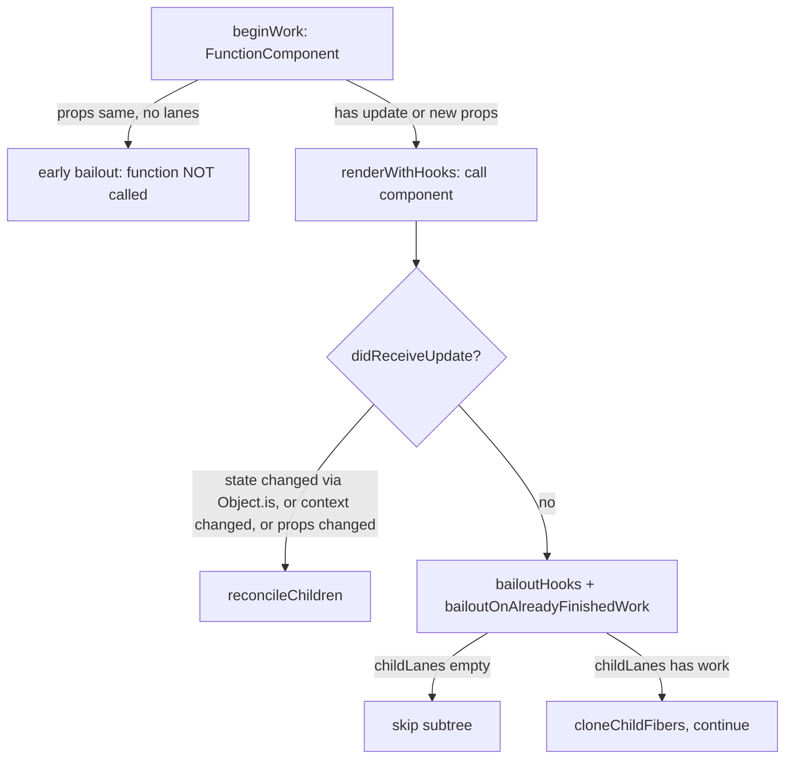

# Hooks on Update

> [!summary] TL;DR
> On a re-render, `renderWithHooks` installs `HooksDispatcherOnUpdate`. Each hook call then *clones* the matching node from the committed (`current`) fiber's hook list onto the work-in-progress fiber. `useState`/`useReducer` merge the pending update ring into a `baseQueue` and replay it. Updates whose lane isn't part of this render are skipped and kept for a later render ("rebasing"). If the resulting state is not `Object.is`-equal to the old one, the fiber is marked `didReceiveUpdate`. If nothing changed and no props/context changed, `bailoutHooks` throws the render away and React reuses the old children.

This page assumes [[10 Hooks on Mount|Hooks on Mount]]: the `Hook` shape, the effect ring on `fiber.updateQueue`, and how the dispatcher is chosen. The trigger for all of this is a `setState` that queued an update and scheduled a render. See [[12 setState - dispatchSetState and Batching|setState]].

## 1. `updateWorkInProgressHook`: walking two lists in lockstep

On update, `renderWithHooks` has already set `workInProgress.memoizedState = null`.[^rwh] So the WIP fiber starts with an empty hook list, and the `current` fiber (`workInProgress.alternate`) holds the committed one. Two module-level cursors track progress: `currentHook` (in the old list) and `workInProgressHook` (in the new one).[^cursors]

```js
function updateWorkInProgressHook(): Hook {
  // advance the cursor on the committed list
  let nextCurrentHook = currentHook === null
    ? currentlyRenderingFiber.alternate?.memoizedState ?? null
    : currentHook.next;

  // is there already a WIP hook here? (only during a render-phase re-render)
  let nextWorkInProgressHook = workInProgressHook === null
    ? currentlyRenderingFiber.memoizedState
    : workInProgressHook.next;

  if (nextWorkInProgressHook !== null) {
    workInProgressHook = nextWorkInProgressHook;          // reuse it
    currentHook = nextCurrentHook;
  } else {
    if (nextCurrentHook === null) {
      throw new Error('Rendered more hooks than during the previous render.');
    }
    currentHook = nextCurrentHook;
    const newHook = {                                     // shallow clone
      memoizedState: currentHook.memoizedState,
      baseState: currentHook.baseState,
      baseQueue: currentHook.baseQueue,
      queue: currentHook.queue,                           // SHARED with current!
      next: null,
    };
    // append to WIP list (same as mount)
  }
  return workInProgressHook;
}
```
(simplified)[^uwih]

What matters:

- **The clone is shallow, and `queue` is shared** between the current and WIP hooks. That's on purpose. `setState` holds a reference to the queue object (bound at mount), and new updates must be visible whichever twin ends up committing.
- **Cloning keeps the committed tree immutable.** If this render is interrupted or thrown away (a higher-priority update arrives, or something suspends), `current`'s hooks still describe what's on screen. That's the [[05 The Fiber Data Structure|double-buffering]] idea applied at hook granularity.
- The "reuse existing WIP hook" branch only fires when the component re-runs within the same render: `renderWithHooksAgain` after a render-phase `setState`, and the StrictMode second pass.[^rwha] It resets the cursors but not `workInProgress.memoizedState`.

## 2. `updateReducer`: from pending ring to new state

`updateState` is literally `updateReducer(basicStateReducer, initialState)`. `initialState` is ignored on update.[^updatestate] `updateReducer` gets the hook and calls `updateReducerImpl(hook, currentHook, reducer)`.[^updatereducer]

### 2a. Merge `queue.pending` into `baseQueue`

```js
let baseQueue = hook.baseQueue;            // leftovers skipped in an earlier render
const pendingQueue = queue.pending;        // new updates since the last render
if (pendingQueue !== null) {
  if (baseQueue !== null) {                // splice two circular lists into one
    const baseFirst = baseQueue.next;
    const pendingFirst = pendingQueue.next;
    baseQueue.next = pendingFirst;
    pendingQueue.next = baseFirst;
  }
  current.baseQueue = baseQueue = pendingQueue;
  queue.pending = null;
}
```
[^merge]

Both lists are circular and identified by their *last* node, so concatenation is two pointer swaps. Note `current.baseQueue = ...`. The merged queue is stored on the **current** hook too, because `queue.pending` was just cleared. If this WIP render gets discarded, the updates would otherwise be lost. Writing them onto `current` means a restarted render finds them again.

> [!note] When did updates land in `queue.pending`?
> Not at `setState` time. `dispatchSetState` puts updates into a global `concurrentQueues` buffer. They're moved onto `queue.pending` by `finishQueueingConcurrentUpdates()` when a render starts (`prepareFreshStack`). This avoids mutating a queue while a concurrent render might be reading it. See [[12 setState - dispatchSetState and Batching|setState]].

### 2b. Replay, skipping lanes that aren't in this render

```js
let newState = baseState;
let newBaseState = null, newBaseQueueFirst = null, newBaseQueueLast = null;
let update = first;
do {
  const updateLane = removeLanes(update.lane, OffscreenLane);
  const shouldSkipUpdate = !isSubsetOfLanes(renderLanes, updateLane); // (hidden-tree case elided)

  if (shouldSkipUpdate) {
    // keep a clone for later; remember the state *before* the first skip
    const clone = { lane: updateLane, action: update.action, hasEagerState: update.hasEagerState,
                    eagerState: update.eagerState, /* ... */ next: null };
    if (newBaseQueueLast === null) {
      newBaseQueueFirst = newBaseQueueLast = clone;
      newBaseState = newState;
    } else {
      newBaseQueueLast = newBaseQueueLast.next = clone;
    }
    currentlyRenderingFiber.lanes = mergeLanes(currentlyRenderingFiber.lanes, updateLane);
    markSkippedUpdateLanes(updateLane);
  } else {
    if (newBaseQueueLast !== null) {
      // once anything was skipped, every later update is kept too (with NoLane so it
      // always applies when the queue is rebased)
      newBaseQueueLast = newBaseQueueLast.next = { ...update, lane: NoLane, next: null };
    }
    newState = update.hasEagerState ? update.eagerState : reducer(newState, update.action);
  }
  update = update.next;
} while (update !== null && update !== first);
```
(simplified. Optimistic `revertLane` and gesture branches dropped)[^skip][^applying]

This is **rebasing**, and it's the subtle core of concurrent state. Example: the state is `0`. A transition queues `+1` (TransitionLane), then a click queues `*2` (SyncLane).

| Render | Lanes | Applied | Result shown | `baseState` / `baseQueue` kept |
|---|---|---|---|---|
| 1 | SyncLane | skip `+1`, apply `*2` | `0 * 2 = 0` | `0` / [`+1`, `*2`(NoLane)] |
| 2 | TransitionLane | `+1`, then `*2` | `(0+1)*2 = 2` | `2` / empty |

The urgent render shows an *intermediate* state that skips the transition. The final state is still as if all updates applied **in insertion order**, the same result a synchronous React would produce. That's why `baseState` is "the state before the first skipped update", not "the last rendered state", and why every update *after* a skipped one is kept and replayed even if it was already applied once. Reducers must be pure, because they can run several times per update.

Skipped lanes are merged back into `currentlyRenderingFiber.lanes`, and the root-level `markSkippedUpdateLanes` records them.[^msul] So when this render commits, the fiber still has pending work and the root schedules another render for those lanes.

### 2c. Eager state and the "did it change?" check

`update.hasEagerState` is set when `dispatchSetState` already computed the next state at call time (the eager path, see [[12 setState - dispatchSetState and Batching|setState]]). The reducer then isn't called again. That's only valid because `basicStateReducer` can't change between renders.

After the loop:

```js
if (newBaseQueueLast === null) newBaseState = newState;
else newBaseQueueLast.next = newBaseQueueFirst;     // close the ring

if (!is(newState, hook.memoizedState)) {
  markWorkInProgressReceivedUpdate();               // didReceiveUpdate = true
}
hook.memoizedState = newState;
hook.baseState = newBaseState;
hook.baseQueue = newBaseQueueLast;
queue.lastRenderedState = newState;                 // used by the next eager-state check
```
[^didchange][^mwiru]

`markWorkInProgressReceivedUpdate` just sets the module-level `didReceiveUpdate = true` in `ReactFiberBeginWork.js`.[^mwiru] It's the only signal that decides whether the component's output counts, as section 5 shows.

> [!warning] Misconception: "setState with the same value never re-renders"
> Often it doesn't, thanks to the *eager* bailout at dispatch time. But that bailout only applies when the fiber has no pending lanes. If it can't apply, React renders the component and only then notices `Object.is(newState, oldState)`. It then bails out *after* calling your function. React's `useState` docs describe this caveat.[^usestatedoc] Section 5 is the mechanism.

## 3. `updateEffect`: deps decide `HasEffect`

```js
function updateEffectImpl(fiberFlags, hookFlags, create, deps) {
  const hook = updateWorkInProgressHook();
  const nextDeps = deps === undefined ? null : deps;
  const effect = hook.memoizedState;
  const inst = effect.inst;                         // same {destroy} instance as before

  if (currentHook !== null && nextDeps !== null) {
    const prevDeps = currentHook.memoizedState.deps;
    if (areHookInputsEqual(nextDeps, prevDeps)) {
      hook.memoizedState = pushSimpleEffect(hookFlags, inst, create, nextDeps); // NO HasEffect
      return;
    }
  }
  currentlyRenderingFiber.flags |= fiberFlags;      // PassiveEffect
  hook.memoizedState = pushSimpleEffect(HookHasEffect | hookFlags, inst, create, nextDeps);
}
```
[^uei][^ue]

Two details people often get wrong:

1. **The effect is pushed every render, changed or not.** The ring on `fiber.updateQueue` is rebuilt from scratch each render, because `renderWithHooks` nulls `updateQueue`. Unchanged effects go in without `HasEffect`, so `commitHookEffectListMount(HookPassive | HookHasEffect)` skips them.[^chelm] They have to be there anyway, because unmount cleanup walks the same ring and needs every effect's `inst.destroy`.
2. **`deps` omitted means `null`, and `null` means "always fire".** `areHookInputsEqual(next, null)` returns `false` (with a DEV warning if deps *became* null). Otherwise it compares element-by-element with `Object.is`, stopping at the shorter length. In DEV it warns if the length changed.[^ahie] Objects and functions created during render are never equal to their predecessors. That's the classic "effect runs every render" bug, and it's exactly what the compiler (below) fixes for you.

Only when deps changed does the *fiber* get `PassiveEffect`. If no effect on the fiber changed, the commit phase's passive pass can skip it, and skip whole subtrees via `subtreeFlags` in the [[09 Commit Phase - Mutation, Layout, Passive Effects|commit phase]].

## 4. `updateMemo`, `updateCallback`, `updateRef`

```js
function updateMemo(nextCreate, deps) {
  const hook = updateWorkInProgressHook();
  const nextDeps = deps === undefined ? null : deps;
  const prevState = hook.memoizedState;            // [value, deps]
  if (nextDeps !== null && areHookInputsEqual(nextDeps, prevState[1])) {
    return prevState[0];                           // cache hit
  }
  const nextValue = nextCreate();                  // (StrictMode DEV: called twice)
  hook.memoizedState = [nextValue, nextDeps];
  return nextValue;
}
```
[^umemo]

`updateCallback` is the same with `[callback, deps]`, and it returns `prevState[0]` on a hit.[^ucb] That's how a stable callback identity comes about: the *new* closure you passed in is thrown away. `updateRef` returns `hook.memoizedState` unchanged.[^updateref]

The cache holds exactly **one** previous value. `useMemo` is "memoize against the last render", not an LRU. React also reserves the right to drop it. Nothing guarantees it survives, for example when a component suspends on mount.

## 5. `didReceiveUpdate` and `bailoutHooks`

Who reads `didReceiveUpdate`? `beginWork` sets it before calling `updateFunctionComponent`. If `oldProps !== newProps` (reference inequality) or legacy context changed, it's `true`. Otherwise it's `false`, and if `checkScheduledUpdateOrContext` finds no work for this fiber at the render lanes, React bails out early without calling your function at all.[^beginwork]

If the fiber *does* have a scheduled update (its `lanes` overlap `renderLanes`), the component renders with `didReceiveUpdate = false`. Then:

- `updateReducerImpl` sets it `true` if any state hook produced a new value.
- `finishRenderingHooks` sets it `true` if a context the fiber read changed (`checkIfContextChanged(current.dependencies)`).[^finish]

Back in `updateFunctionComponent`:

```js
if (current !== null && !didReceiveUpdate) {
  bailoutHooks(current, workInProgress, renderLanes);
  return bailoutOnAlreadyFinishedWork(current, workInProgress, renderLanes);
}
```
[^ufcbail]

```js
export function bailoutHooks(current, workInProgress, lanes) {
  workInProgress.updateQueue = current.updateQueue;            // discard the new effect ring
  workInProgress.flags &= ~(PassiveEffect | UpdateEffect);     // no effects to run
  current.lanes = removeLanes(current.lanes, lanes);           // the update is "done"
}
```
(simplified, DEV StrictEffects flags dropped)[^bailouthooks]

So the "late bailout" throws away the effect list it just built and the children it just returned. `bailoutOnAlreadyFinishedWork` then checks `childLanes`. If no descendant has work in these lanes, the entire subtree is skipped. Otherwise the children are cloned and traversal continues to whoever does have work.[^bofw]

> [!tip] What the late bailout keeps
> The WIP hook list (`workInProgress.memoizedState`) is **not** reset. It contains the freshly processed state (equal by `Object.is`) and the cleared queue, so the processed updates aren't replayed. Only `updateQueue` (effects and the memo cache) is restored from `current`.



## With the React Compiler

Compiled components call `useMemoCache(n)` (as `_c(n)`) instead of `useMemo`/`useCallback`. On update, `useMemoCache` runs the same function as on mount (see [[10 Hooks on Mount|Hooks on Mount]]), and the interesting branch is the one that finds the cache on `current`:[^umc]

```js
let memoCache = currentlyRenderingFiber.updateQueue?.memoCache;  // null: renderWithHooks reset updateQueue
if (memoCache == null) {
  const currentMemoCache = currentlyRenderingFiber.alternate?.updateQueue?.memoCache;
  if (currentMemoCache != null) {
    memoCache = {
      data: enableNoCloningMemoCache
        ? currentMemoCache.data                              // share (flag off in OSS)
        : currentMemoCache.data.map(array => array.slice()), // copy-on-write clone
      index: 0,
    };
  }
}
// ... attach to WIP updateQueue, return memoCache.data[index++]
```

How the cache reaches the WIP fiber:

1. `renderWithHooks` nulls `workInProgress.updateQueue`.[^rwh] The first `useMemoCache` call finds no cache on WIP.
2. It reads `alternate.updateQueue.memoCache`, the committed cache, and **clones each array** with `slice()`. `enableNoCloningMemoCache` is `false` in the OSS feature flags.[^flag]
3. It creates a fresh `FunctionComponentUpdateQueue` on the WIP fiber and attaches the clone. Effects pushed later in the same render go into the same `updateQueue` object.
4. Compiled code then does `if ($[0] !== props.items) { ...; $[0] = props.items; $[1] = result; } else { result = $[1]; }`. It writes only into the *clone*.

Why copy-on-write? A render can be abandoned (interrupted transition, suspension, an error). If compiled code wrote straight into the committed cache, a discarded render could leave values in it that never reached the screen. The next render would then compare against inputs from a render that never happened. Cloning keeps `current`'s cache consistent with the committed UI, the same reason hooks are cloned in section 1. The cost is one shallow array copy per render of the component. That's cheap next to the work the cache saves.

Interaction with bailouts:

- **Early bailout** (function not called): `createWorkInProgress` copies `current.updateQueue` to the WIP fiber,[^cwip] so the memo cache simply carries over untouched.
- **Late bailout**: `bailoutHooks` sets `workInProgress.updateQueue = current.updateQueue`.[^bailouthooks] The cloned cache (and anything written into it during this render) is discarded and the committed cache is kept. That's correct: the output was thrown away.
- **Render-phase re-render / StrictMode second pass**: `resetFunctionComponentUpdateQueue` resets `memoCache.index = 0` and keeps the arrays.[^resetfcuq] So the second pass hits the cache filled by the first.

What changes in practice: in a compiled component, most of the `useMemo`/`useCallback` hook nodes and their `areHookInputsEqual` calls go away. Your `useState`/`useEffect` hooks still go through exactly the paths above, because the compiler doesn't change the reconciler. The big difference is *downstream*. Because the compiler memoizes JSX elements and the props objects it passes to children, children more often see `oldProps === newProps` and take the **early** bailout in `beginWork` instead of re-rendering. Deps arrays for your `useEffect` are also built from memoized values, so effects fire less often by accident. See [[15 Rendering With vs Without the Compiler|With vs Without Compiler]] and [[14 React Compiler - How It Works|React Compiler]].

---
← [[10 Hooks on Mount|Prev]] · [[00 React Internals Index|Index]] · [[12 setState - dispatchSetState and Batching|Next]] →

[^rwh]: `renderWithHooks` (nulls `memoizedState`/`updateQueue`, picks dispatcher) — [packages/react-reconciler/src/ReactFiberHooks.js#L505-L634](https://github.com/facebook/react/blob/v19.3.1/packages/react-reconciler/src/ReactFiberHooks.js#L505-L634)
[^cursors]: module-level `currentlyRenderingFiber`, `currentHook`, `workInProgressHook` — [packages/react-reconciler/src/ReactFiberHooks.js#L261-L271](https://github.com/facebook/react/blob/v19.3.1/packages/react-reconciler/src/ReactFiberHooks.js#L261-L271)
[^uwih]: `updateWorkInProgressHook` — [packages/react-reconciler/src/ReactFiberHooks.js#L1004-L1073](https://github.com/facebook/react/blob/v19.3.1/packages/react-reconciler/src/ReactFiberHooks.js#L1004-L1073)
[^rwha]: `renderWithHooksAgain` — [packages/react-reconciler/src/ReactFiberHooks.js#L791-L857](https://github.com/facebook/react/blob/v19.3.1/packages/react-reconciler/src/ReactFiberHooks.js#L791-L857)
[^updatestate]: `updateState` — [packages/react-reconciler/src/ReactFiberHooks.js#L1962-L1966](https://github.com/facebook/react/blob/v19.3.1/packages/react-reconciler/src/ReactFiberHooks.js#L1962-L1966)
[^updatereducer]: `updateReducer` — [packages/react-reconciler/src/ReactFiberHooks.js#L1307-L1314](https://github.com/facebook/react/blob/v19.3.1/packages/react-reconciler/src/ReactFiberHooks.js#L1307-L1314)
[^merge]: `updateReducerImpl`, merging pending into base queue — [packages/react-reconciler/src/ReactFiberHooks.js#L1332-L1359](https://github.com/facebook/react/blob/v19.3.1/packages/react-reconciler/src/ReactFiberHooks.js#L1332-L1359)
[^skip]: `updateReducerImpl`, lane check and skipped-update cloning — [packages/react-reconciler/src/ReactFiberHooks.js#L1380-L1446](https://github.com/facebook/react/blob/v19.3.1/packages/react-reconciler/src/ReactFiberHooks.js#L1380-L1446)
[^applying]: `updateReducerImpl`, applying updates and eager state — [packages/react-reconciler/src/ReactFiberHooks.js#L1446-L1544](https://github.com/facebook/react/blob/v19.3.1/packages/react-reconciler/src/ReactFiberHooks.js#L1446-L1544)
[^msul]: `markSkippedUpdateLanes` — [packages/react-reconciler/src/ReactFiberWorkLoop.js#L2539-L2544](https://github.com/facebook/react/blob/v19.3.1/packages/react-reconciler/src/ReactFiberWorkLoop.js#L2539-L2544)
[^didchange]: `updateReducerImpl`, `Object.is` check and write-back — [packages/react-reconciler/src/ReactFiberHooks.js#L1546-L1589](https://github.com/facebook/react/blob/v19.3.1/packages/react-reconciler/src/ReactFiberHooks.js#L1546-L1589)
[^mwiru]: `markWorkInProgressReceivedUpdate` / `didReceiveUpdate` — [packages/react-reconciler/src/ReactFiberBeginWork.js#L3800-L3806](https://github.com/facebook/react/blob/v19.3.1/packages/react-reconciler/src/ReactFiberBeginWork.js#L3800-L3806), [#L317](https://github.com/facebook/react/blob/v19.3.1/packages/react-reconciler/src/ReactFiberBeginWork.js#L317)
[^uei]: `updateEffectImpl` — [packages/react-reconciler/src/ReactFiberHooks.js#L2657-L2695](https://github.com/facebook/react/blob/v19.3.1/packages/react-reconciler/src/ReactFiberHooks.js#L2657-L2695)
[^ue]: `updateEffect` — [packages/react-reconciler/src/ReactFiberHooks.js#L2721-L2726](https://github.com/facebook/react/blob/v19.3.1/packages/react-reconciler/src/ReactFiberHooks.js#L2721-L2726)
[^chelm]: `commitHookEffectListMount` — [packages/react-reconciler/src/ReactFiberCommitEffects.js#L141-L247](https://github.com/facebook/react/blob/v19.3.1/packages/react-reconciler/src/ReactFiberCommitEffects.js#L141-L247)
[^ahie]: `areHookInputsEqual` — [packages/react-reconciler/src/ReactFiberHooks.js#L456-L503](https://github.com/facebook/react/blob/v19.3.1/packages/react-reconciler/src/ReactFiberHooks.js#L456-L503)
[^umemo]: `updateMemo` — [packages/react-reconciler/src/ReactFiberHooks.js#L2963-L2988](https://github.com/facebook/react/blob/v19.3.1/packages/react-reconciler/src/ReactFiberHooks.js#L2963-L2988)
[^ucb]: `updateCallback` — [packages/react-reconciler/src/ReactFiberHooks.js#L2930-L2942](https://github.com/facebook/react/blob/v19.3.1/packages/react-reconciler/src/ReactFiberHooks.js#L2930-L2942)
[^updateref]: `updateRef` — [packages/react-reconciler/src/ReactFiberHooks.js#L2635-L2638](https://github.com/facebook/react/blob/v19.3.1/packages/react-reconciler/src/ReactFiberHooks.js#L2635-L2638)
[^beginwork]: `beginWork` setting `didReceiveUpdate` / early bailout — [packages/react-reconciler/src/ReactFiberBeginWork.js#L4250-L4296](https://github.com/facebook/react/blob/v19.3.1/packages/react-reconciler/src/ReactFiberBeginWork.js#L4250-L4296)
[^finish]: `finishRenderingHooks` (context-changed check) — [packages/react-reconciler/src/ReactFiberHooks.js#L718-L730](https://github.com/facebook/react/blob/v19.3.1/packages/react-reconciler/src/ReactFiberHooks.js#L718-L730)
[^ufcbail]: `updateFunctionComponent` late bailout — [packages/react-reconciler/src/ReactFiberBeginWork.js#L1549-L1552](https://github.com/facebook/react/blob/v19.3.1/packages/react-reconciler/src/ReactFiberBeginWork.js#L1549-L1552)
[^bailouthooks]: `bailoutHooks` — [packages/react-reconciler/src/ReactFiberHooks.js#L908-L927](https://github.com/facebook/react/blob/v19.3.1/packages/react-reconciler/src/ReactFiberHooks.js#L908-L927)
[^bofw]: `bailoutOnAlreadyFinishedWork` — [packages/react-reconciler/src/ReactFiberBeginWork.js#L3826-L3865](https://github.com/facebook/react/blob/v19.3.1/packages/react-reconciler/src/ReactFiberBeginWork.js#L3826-L3865)
[^umc]: `useMemoCache` — [packages/react-reconciler/src/ReactFiberHooks.js#L1181-L1263](https://github.com/facebook/react/blob/v19.3.1/packages/react-reconciler/src/ReactFiberHooks.js#L1181-L1263)
[^flag]: `enableNoCloningMemoCache = false` — [packages/shared/ReactFeatureFlags.js#L128](https://github.com/facebook/react/blob/v19.3.1/packages/shared/ReactFeatureFlags.js#L128)
[^cwip]: `createWorkInProgress` copies `memoizedState`/`updateQueue` — [packages/react-reconciler/src/ReactFiber.js#L389-L390](https://github.com/facebook/react/blob/v19.3.1/packages/react-reconciler/src/ReactFiber.js#L389-L390)
[^resetfcuq]: `resetFunctionComponentUpdateQueue` — [packages/react-reconciler/src/ReactFiberHooks.js#L1084-L1096](https://github.com/facebook/react/blob/v19.3.1/packages/react-reconciler/src/ReactFiberHooks.js#L1084-L1096)
[^usestatedoc]: useState reference (caveats on same-value updates) — react.dev, https://react.dev/reference/react/useState
