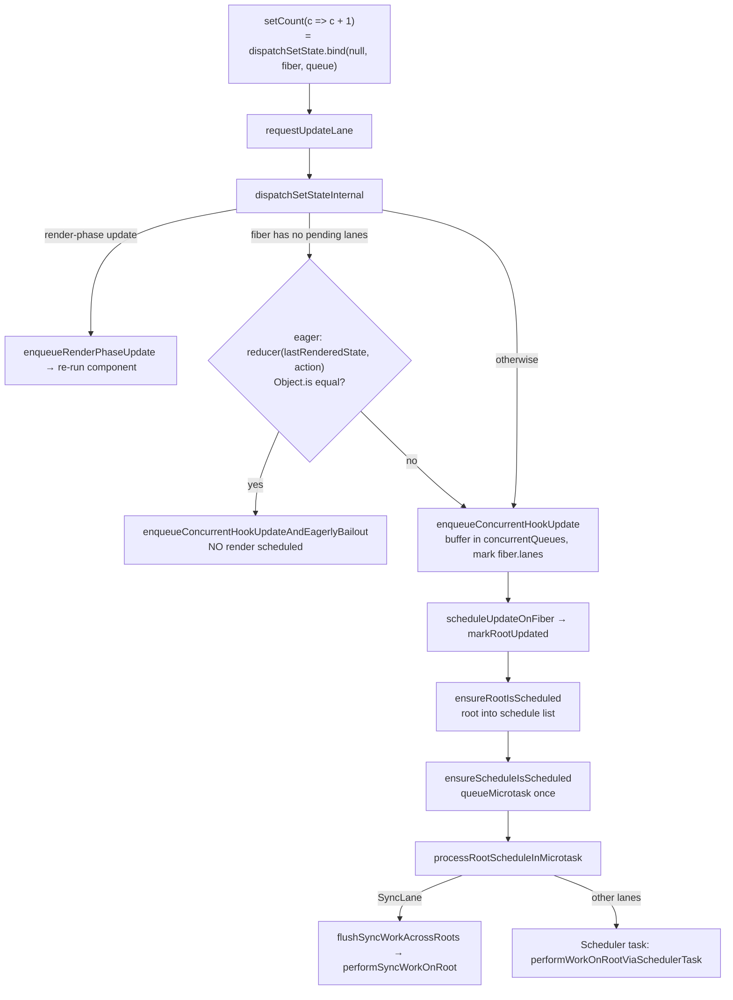

# setState: dispatchSetState and Batching

> [!summary] TL;DR
> `setCount(x)` is `dispatchSetState(fiber, queue, x)`. It picks a **lane** from the current event priority or transition, and may compute the new state *eagerly* and drop the update when nothing would change. Otherwise it pushes the update into a global buffer, marks `fiber.lanes`, and asks the root to be scheduled. Scheduling is deduplicated: one microtask per tick, one callback per root per priority. That's why ten `setState` calls in one handler produce one render. The state variable in your closure doesn't change because nothing has re-rendered yet. setState isn't "async". It's *deferred and batched*.

Previous pages built the hook and its `queue` ([[10 Hooks on Mount|Hooks on Mount]]) and showed how the queue is consumed on re-render ([[11 Hooks on Update|Hooks on Update]]). This page covers the producer side: everything between your `onClick` calling `setCount` and the render starting.

## 1. The call path at a glance



## 2. `requestUpdateLane`: what priority is this update?

```js
export function requestUpdateLane(fiber) {
  if (!disableLegacyMode && (fiber.mode & ConcurrentMode) === NoMode) return SyncLane; // legacy root
  if ((executionContext & RenderContext) !== NoContext && workInProgressRootRenderLanes !== NoLanes) {
    return pickArbitraryLane(workInProgressRootRenderLanes);  // setState during render
  }
  const transition = requestCurrentTransition();             // ReactSharedInternals.T
  if (transition !== null) return requestTransitionLane(transition);
  return eventPriorityToLane(resolveUpdatePriority());
}
```
(simplified)[^rul]

`disableLegacyMode` is `true` in 19.x OSS builds, so the first branch is dead code there.[^flags] The interesting inputs:

- **Transition**: `startTransition` sets `ReactSharedInternals.T` to a transition object for the duration of the callback.[^st][^rct] All transition updates in the same event share one lane: `requestTransitionLane` caches it in `currentEventTransitionLane` until the microtask clears it. That way they render together.[^rtl]
- **Event priority**: `resolveUpdatePriority()` in react-dom returns `ReactDOMSharedInternals.p` if it's set. React's own event listeners set it to `DiscreteEventPriority` for clicks and keydowns (see [[13 The Event System|Event System]]). If it isn't set, it falls back to `getEventPriority(window.event.type)`. If there's no `window.event` (a `setTimeout`, a fetch callback), it's `DefaultEventPriority`.[^rup]
- **Event priority = lane**: `eventPriorityToLane` is the identity function. `DiscreteEventPriority` is defined as `SyncLane`, `ContinuousEventPriority` as `InputContinuousLane`, `DefaultEventPriority` as `DefaultLane`.[^ep]

> [!note] `window.event` is a legacy global that turned out useful
> Using `window.event` lets React give a sensible priority to `setState` calls from *non-React* listeners too (an `addEventListener('click', ...)` you wrote yourself). It's also why a `setState` inside a `click` handler attached with plain DOM APIs still gets SyncLane.

## 3. `dispatchSetStateInternal`: the eager bailout

```js
function dispatchSetStateInternal(fiber, queue, action, lane) {
  const update = { lane, revertLane: NoLane, gesture: null, action,
                   hasEagerState: false, eagerState: null, next: null };

  if (isRenderPhaseUpdate(fiber)) {               // setState while this component renders
    enqueueRenderPhaseUpdate(queue, update);
  } else {
    const alternate = fiber.alternate;
    if (fiber.lanes === NoLanes && (alternate === null || alternate.lanes === NoLanes)) {
      // queue is empty, so the next state depends only on this action
      const currentState = queue.lastRenderedState;
      const eagerState = queue.lastRenderedReducer(currentState, action);
      update.hasEagerState = true;
      update.eagerState = eagerState;
      if (is(eagerState, currentState)) {
        enqueueConcurrentHookUpdateAndEagerlyBailout(fiber, queue, update);
        return false;                              // no render scheduled at all
      }
    }
    const root = enqueueConcurrentHookUpdate(fiber, queue, update, lane);
    if (root !== null) {
      scheduleUpdateOnFiber(root, fiber, lane);
      entangleTransitionUpdate(root, queue, lane);
      return true;
    }
  }
  return false;
}
```
(simplified, try/catch and DEV dispatcher swap dropped)[^dssi][^dss]

Why the precondition `fiber.lanes === NoLanes` on *both* twins? Eager computation is only valid if no other updates are queued ahead of this one. With pending updates, the real next state is `reduce(reduce(base, u1), thisAction)`, and `lastRenderedState` would be the wrong base. Since `bind` captured one fiber of the current/alternate pair, both have to be checked.

Consequences that surprise people:

- The bailout *still enqueues the update* (with `NoLane`), so it can be rebased correctly if a render is already in progress. It just doesn't schedule anything.[^eagerbail]
- **The second call in a handler never gets the eager path.** The first `setX` marks `fiber.lanes`, so `setX(1); setX(1)` from `0` schedules a render and then bails out *late* (after calling your component). See [[11 Hooks on Update|Hooks on Update]] section 5.
- **The eager path is less reliable than it looks, even across separate events.** When a render commits, the work-in-progress copy of the fiber has its lanes cleared, but the *other* copy (now the alternate) can keep the stale `SyncLane`. The next same-value `setState` then fails the "both twins have `NoLanes`" check and does one late-bailout render first. That's the well-known "setting the same state renders one extra time" behaviour. Traced step by step in [[21 Walkthrough - setState to Pixels|setState Walkthrough]].
- If the eager reducer throws, the error is swallowed and the update is queued normally. It'll throw again during render, where error boundaries can catch it.[^dssi]
- The eager result is reused during render (`hasEagerState`), so a functional updater normally runs once, not twice. In StrictMode DEV it's re-invoked on purpose.

A render-phase update (calling `setState` in the component body) takes `enqueueRenderPhaseUpdate`. That function pushes straight onto `queue.pending` and sets `didScheduleRenderPhaseUpdateDuringThisPass`. `renderWithHooks` then re-runs the component immediately, up to 25 times before throwing "Too many re-renders".[^erpu][^rwha]

## 4. Enqueueing: buffered, not linked

```js
function enqueueUpdate(fiber, queue, update, lane) {
  concurrentQueues[concurrentQueuesIndex++] = fiber;
  concurrentQueues[concurrentQueuesIndex++] = queue;
  concurrentQueues[concurrentQueuesIndex++] = update;
  concurrentQueues[concurrentQueuesIndex++] = lane;
  concurrentlyUpdatedLanes = mergeLanes(concurrentlyUpdatedLanes, lane);
  fiber.lanes = mergeLanes(fiber.lanes, lane);          // mark source fiber right away
  if (fiber.alternate !== null) fiber.alternate.lanes = mergeLanes(fiber.alternate.lanes, lane);
}
```
[^eu][^ecqhu]

Updates go into a flat module-level array, *not* onto `queue.pending`. Why? A concurrent render may be running (yielded mid-tree), and `updateReducerImpl` reads `queue.pending`. If a new update appeared in the middle of a render, two components reading the same state could see different values: tearing. Buffering keeps the render's view stable. `finishQueueingConcurrentUpdates()` drains the buffer into each `queue.pending` ring and calls `markUpdateLaneFromFiberToRoot`.[^fqcu] It runs at the start of a fresh render (`prepareFreshStack`)[^pfs] and at a few other safe points. `enqueueConcurrentHookUpdate` returns the root by walking `.return` to the `HostRoot`, so it can schedule immediately.[^grfuf]

### `markUpdateLaneFromFiberToRoot`: why childLanes matter

```js
sourceFiber.lanes |= lane;  alternate.lanes |= lane;
let parent = sourceFiber.return;
while (parent !== null) {
  parent.childLanes = mergeLanes(parent.childLanes, lane);
  if (parent.alternate !== null) parent.alternate.childLanes = mergeLanes(parent.alternate.childLanes, lane);
  // (track whether we pass through a hidden Offscreen)
  parent = parent.return;
}
```
(simplified)[^mulftr]

This is what makes the render phase cheap. Every ancestor learns that *somewhere below it* there's work in lane X. When the [[06 The Work Loop - Render Phase|work loop]] starts from the root, `beginWork` on an ancestor with unchanged props and no own lanes calls `bailoutOnAlreadyFinishedWork`. That checks `includesSomeLane(renderLanes, workInProgress.childLanes)`. If it's false, the whole subtree is skipped in O(1). If it's true, React clones the children and keeps descending, but only along the marked path.[^bofw] Without `childLanes`, React would have to visit every fiber to find the updated one. Updating both twins matters because which twin becomes the WIP depends on the commit history.

## 5. `scheduleUpdateOnFiber` → `ensureRootIsScheduled` → microtask

`scheduleUpdateOnFiber` calls `markRootUpdated(root, lane)`, which adds the lane to `root.pendingLanes`. It handles some interleaving cases (an update arriving during render goes to `workInProgressRootInterleavedUpdatedLanes`), then calls `ensureRootIsScheduled(root)`.[^suof] That function is tiny:

```js
export function ensureRootIsScheduled(root) {
  // add root to a linked list of scheduled roots (if not already there)
  mightHavePendingSyncWork = true;
  ensureScheduleIsScheduled();
}
export function ensureScheduleIsScheduled() {
  if (!didScheduleMicrotask) {
    didScheduleMicrotask = true;
    scheduleImmediateRootScheduleTask();     // queueMicrotask(processRootScheduleInMicrotask)
  }
}
```
(simplified)[^eris][^esis][^sirst]

`scheduleMicrotask` is `queueMicrotask` in the DOM host config.[^qm] When the microtask runs, `processRootScheduleInMicrotask` resets the flag. For each root, `scheduleTaskForRootDuringMicrotask` computes `getNextLanes`. If the result includes `SyncLane`, it cancels any Scheduler task and leaves `callbackNode = null`. Otherwise it schedules `performWorkOnRootViaSchedulerTask` with the [[04 Lanes and the Scheduler|Scheduler]], unless a callback of the **same priority** already exists, in which case it reuses it.[^prsim][^stfrdm] Finally `flushSyncWorkAcrossRoots_impl` renders all roots that have sync lanes, synchronously, still inside the microtask, via `performSyncWorkOnRoot`.[^fswar][^pswor]

## 6. Automatic batching is a side effect of this design

There's no "batch" object. Batching falls out of three dedup points:

1. `didScheduleMicrotask`: however many `setState` calls happen in the current task, only one microtask is queued.
2. The root is in the schedule list once (`root === lastScheduledRoot || root.next !== null`).
3. `root.callbackPriority`: a second update of the same priority reuses the existing Scheduler callback.

All updates land in queues and `pendingLanes` *before* the microtask runs. The single render that follows then processes all of them together. Because this lives at the root-scheduling level and doesn't depend on being inside a React event handler, React 18+ batches `setTimeout`, promise, and native-listener updates too. React 17 only batched inside React event handlers (via `batchedUpdates`), and each `setState` in a `setTimeout` caused its own synchronous render.[^batchingwg] In 19.x OSS, the reconciler's `batchedUpdates` is literally `return fn(a)` because legacy mode is disabled.[^bu]

```js
function handleClick() {
  setCount(c => c + 1);   // SyncLane, queued; microtask scheduled
  setFlag(f => !f);       // SyncLane, queued; microtask already scheduled
  setCount(c => c + 1);   // queued
}                         // → after the handler returns, the microtask runs ONE render
```

> [!tip] Different lanes mean different renders
> Batching is per lane. `setA(1); startTransition(() => setB(2))` queues SyncLane and TransitionLane. The microtask renders SyncLane immediately and commits it. The transition renders later in a Scheduler task, and it's interruptible. That's intended, not a batching failure.

## 7. `flushSync` and `startTransition`: overriding the defaults

**`flushSync(fn)`** sets `ReactSharedInternals.T = null` and the update priority `p = DiscreteEventPriority`, runs `fn`, restores both, and then calls `flushSyncWork()`, which runs `flushSyncWorkOnAllRoots()`.[^fs][^fsw] Updates inside get `SyncLane` and are rendered *and committed* before `flushSync` returns, without waiting for the microtask. Use it when you need the DOM updated before your next line runs (measuring, focusing, third-party integration). It's a de-optimisation otherwise. Calling it during render or commit logs "flushSync was called from inside a lifecycle method".

**`startTransition(fn)`** creates a transition object, puts it on `ReactSharedInternals.T`, runs `fn` synchronously, and restores the previous value.[^st] Only `setState` calls made *synchronously inside* `fn` see the transition, because `requestUpdateLane` reads `T` at call time. Since React 19, `fn` may be async (an Action). The transition stays pending until the returned promise settles, and updates in the same action scope share one lane (`peekEntangledActionLane` in `requestTransitionLane`).[^rtl] But `T` is restored as soon as `fn` returns synchronously, so a `setState` after an `await` is no longer inside the transition. Wrap it in another `startTransition`.

## 8. Misconceptions

> [!warning] "setState is async"
> Nothing about it is async in the Promise sense. The update object is created, given a lane, and queued synchronously, during your call. What's deferred is the *render*, until the end of the current task (SyncLane, in a microtask) or until the Scheduler gets to it. There's nothing to `await`, and `flushSync` can force it synchronous.

> [!warning] "Why is `count` still the old value right after `setCount(count + 1)`?"
> `count` is a `const` captured by your handler's closure *from the render that created the handler*. `setCount` doesn't (and can't) reassign it. The new value only exists in the next render's `hook.memoizedState`, inside a new closure. That's why `setCount(count + 1)` three times adds 1, while `setCount(c => c + 1)` three times adds 3: updaters are queued and applied in order to the evolving state in `updateReducerImpl`.[^queueingdoc] Effects and timers that capture `count` keep the old value until they're recreated with fresh deps. That's the classic stale-closure bug, and refs or `useEffectEvent` are the escape hatches.

> [!warning] "Two `setState`s of the same value cost nothing"
> The first may be bailed out eagerly. Once the fiber has a pending lane, later ones aren't, and React renders the component to find out nothing changed (a late bailout). It's cheap, but your function body does run.

## With the React Compiler

Unchanged. `dispatchSetState`, lanes, queues and root scheduling are runtime reconciler code, and the compiler only transforms component and hook bodies. The compiler does affect *what happens after* the render this page schedules. With memoized JSX and props, more children take the early `oldProps === newProps` bailout, so a `setState` re-renders less of the subtree. Setters are already stable, so the compiler treats them as non-reactive (`isStableType`/`isSetStateType`) and doesn't put them in cache dependency checks.[^stable] See [[15 Rendering With vs Without the Compiler|With vs Without Compiler]].

## Summary

Between your handler calling `setCount` and the render starting, `dispatchSetState` picks a lane, may compute the next state eagerly and skip scheduling, and otherwise buffers the update, marks lanes up to the root, and asks for the root to be scheduled. Scheduling is deduplicated to one microtask per tick and one callback per root per priority, so batching is a side effect of the design rather than a feature. Keep this model: setState is not async, it is deferred and batched, and your closure's `count` is from the render that created it. The consumer side is in [[11 Hooks on Update|Hooks on Update]].

### Key takeaways

- **`requestUpdateLane`**: reads the transition on `ReactSharedInternals.T`, else the event priority, where `DiscreteEventPriority` is `SyncLane`.
- **Eager bailout**: applies only when both twins have `NoLanes`; it still enqueues the update, and later same-value calls bail out late, after your component runs.
- **`concurrentQueues`**: updates go into a flat buffer, not `queue.pending`, so a yielded concurrent render never sees state change mid-render.
- **`markUpdateLaneFromFiberToRoot`**: ORs the lane into every ancestor's `childLanes`, letting `beginWork` skip clean subtrees.
- **`ensureRootIsScheduled`**: queues `processRootScheduleInMicrotask` once; `SyncLane` work renders inside the microtask, other lanes get a Scheduler task.
- **Automatic batching**: three dedup points batch updates from timeouts, promises and native listeners too, and different lanes still mean different renders.
- **`flushSync`**: forces `SyncLane` and renders and commits before returning; a de-optimisation unless you need the DOM now.
- **`startTransition`**: only `setState` calls made synchronously inside `fn` see the transition, so wrap updates after an `await` again.

---
← [[11 Hooks on Update|Prev]] · [[00 React Internals Index|Index]] · [[13 The Event System|Next]] →

[^rul]: `requestUpdateLane` — [packages/react-reconciler/src/ReactFiberWorkLoop.js#L812-L868](https://github.com/facebook/react/blob/v19.3.1/packages/react-reconciler/src/ReactFiberWorkLoop.js#L812-L868)
[^flags]: `disableLegacyMode = true` — [packages/shared/ReactFeatureFlags.js#L205](https://github.com/facebook/react/blob/v19.3.1/packages/shared/ReactFeatureFlags.js#L205)
[^st]: `startTransition` — [packages/react/src/ReactStartTransition.js#L45-L118](https://github.com/facebook/react/blob/v19.3.1/packages/react/src/ReactStartTransition.js#L45-L118)
[^rct]: `requestCurrentTransition` — [packages/react-reconciler/src/ReactFiberTransition.js#L193-L195](https://github.com/facebook/react/blob/v19.3.1/packages/react-reconciler/src/ReactFiberTransition.js#L193-L195)
[^rtl]: `requestTransitionLane` (per-event shared lane) — [packages/react-reconciler/src/ReactFiberRootScheduler.js#L698-L724](https://github.com/facebook/react/blob/v19.3.1/packages/react-reconciler/src/ReactFiberRootScheduler.js#L698-L724)
[^rup]: `resolveUpdatePriority` — [packages/react-dom-bindings/src/client/ReactDOMUpdatePriority.js#L35-L45](https://github.com/facebook/react/blob/v19.3.1/packages/react-dom-bindings/src/client/ReactDOMUpdatePriority.js#L35-L45)
[^ep]: Event priorities and `eventPriorityToLane` — [packages/react-reconciler/src/ReactEventPriorities.js#L24-L53](https://github.com/facebook/react/blob/v19.3.1/packages/react-reconciler/src/ReactEventPriorities.js#L24-L53)
[^dssi]: `dispatchSetStateInternal` — [packages/react-reconciler/src/ReactFiberHooks.js#L3656-L3726](https://github.com/facebook/react/blob/v19.3.1/packages/react-reconciler/src/ReactFiberHooks.js#L3656-L3726)
[^dss]: `dispatchSetState` — [packages/react-reconciler/src/ReactFiberHooks.js#L3626-L3654](https://github.com/facebook/react/blob/v19.3.1/packages/react-reconciler/src/ReactFiberHooks.js#L3626-L3654)
[^eagerbail]: `enqueueConcurrentHookUpdateAndEagerlyBailout` — [packages/react-reconciler/src/ReactFiberConcurrentUpdates.js#L127-L151](https://github.com/facebook/react/blob/v19.3.1/packages/react-reconciler/src/ReactFiberConcurrentUpdates.js#L127-L151)
[^erpu]: `isRenderPhaseUpdate` / `enqueueRenderPhaseUpdate` — [packages/react-reconciler/src/ReactFiberHooks.js#L3838-L3864](https://github.com/facebook/react/blob/v19.3.1/packages/react-reconciler/src/ReactFiberHooks.js#L3838-L3864)
[^rwha]: `renderWithHooksAgain` (`RE_RENDER_LIMIT`) — [packages/react-reconciler/src/ReactFiberHooks.js#L791-L857](https://github.com/facebook/react/blob/v19.3.1/packages/react-reconciler/src/ReactFiberHooks.js#L791-L857)
[^eu]: `enqueueUpdate` (concurrentQueues buffer) — [packages/react-reconciler/src/ReactFiberConcurrentUpdates.js#L90-L113](https://github.com/facebook/react/blob/v19.3.1/packages/react-reconciler/src/ReactFiberConcurrentUpdates.js#L90-L113)
[^ecqhu]: `enqueueConcurrentHookUpdate` — [packages/react-reconciler/src/ReactFiberConcurrentUpdates.js#L115-L125](https://github.com/facebook/react/blob/v19.3.1/packages/react-reconciler/src/ReactFiberConcurrentUpdates.js#L115-L125)
[^fqcu]: `finishQueueingConcurrentUpdates` — [packages/react-reconciler/src/ReactFiberConcurrentUpdates.js#L50-L84](https://github.com/facebook/react/blob/v19.3.1/packages/react-reconciler/src/ReactFiberConcurrentUpdates.js#L50-L84)
[^pfs]: `prepareFreshStack` calls `finishQueueingConcurrentUpdates` — [packages/react-reconciler/src/ReactFiberWorkLoop.js#L2284](https://github.com/facebook/react/blob/v19.3.1/packages/react-reconciler/src/ReactFiberWorkLoop.js#L2284)
[^grfuf]: `getRootForUpdatedFiber` — [packages/react-reconciler/src/ReactFiberConcurrentUpdates.js#L252-L276](https://github.com/facebook/react/blob/v19.3.1/packages/react-reconciler/src/ReactFiberConcurrentUpdates.js#L252-L276)
[^mulftr]: `markUpdateLaneFromFiberToRoot` — [packages/react-reconciler/src/ReactFiberConcurrentUpdates.js#L189-L250](https://github.com/facebook/react/blob/v19.3.1/packages/react-reconciler/src/ReactFiberConcurrentUpdates.js#L189-L250)
[^bofw]: `bailoutOnAlreadyFinishedWork` (childLanes check) — [packages/react-reconciler/src/ReactFiberBeginWork.js#L3826-L3865](https://github.com/facebook/react/blob/v19.3.1/packages/react-reconciler/src/ReactFiberBeginWork.js#L3826-L3865)
[^suof]: `scheduleUpdateOnFiber` — [packages/react-reconciler/src/ReactFiberWorkLoop.js#L987-L1113](https://github.com/facebook/react/blob/v19.3.1/packages/react-reconciler/src/ReactFiberWorkLoop.js#L987-L1113)
[^eris]: `ensureRootIsScheduled` — [packages/react-reconciler/src/ReactFiberRootScheduler.js#L116-L152](https://github.com/facebook/react/blob/v19.3.1/packages/react-reconciler/src/ReactFiberRootScheduler.js#L116-L152)
[^esis]: `ensureScheduleIsScheduled` — [packages/react-reconciler/src/ReactFiberRootScheduler.js#L154-L169](https://github.com/facebook/react/blob/v19.3.1/packages/react-reconciler/src/ReactFiberRootScheduler.js#L154-L169)
[^sirst]: `scheduleImmediateRootScheduleTask` — [packages/react-reconciler/src/ReactFiberRootScheduler.js#L650-L696](https://github.com/facebook/react/blob/v19.3.1/packages/react-reconciler/src/ReactFiberRootScheduler.js#L650-L696)
[^qm]: `scheduleMicrotask` = `queueMicrotask` — [packages/react-dom-bindings/src/client/ReactFiberConfigDOM.js#L871-L877](https://github.com/facebook/react/blob/v19.3.1/packages/react-dom-bindings/src/client/ReactFiberConfigDOM.js#L871-L877)
[^prsim]: `processRootScheduleInMicrotask` — [packages/react-reconciler/src/ReactFiberRootScheduler.js#L259-L348](https://github.com/facebook/react/blob/v19.3.1/packages/react-reconciler/src/ReactFiberRootScheduler.js#L259-L348)
[^stfrdm]: `scheduleTaskForRootDuringMicrotask` — [packages/react-reconciler/src/ReactFiberRootScheduler.js#L384-L509](https://github.com/facebook/react/blob/v19.3.1/packages/react-reconciler/src/ReactFiberRootScheduler.js#L384-L509)
[^fswar]: `flushSyncWorkAcrossRoots_impl` — [packages/react-reconciler/src/ReactFiberRootScheduler.js#L185-L247](https://github.com/facebook/react/blob/v19.3.1/packages/react-reconciler/src/ReactFiberRootScheduler.js#L185-L247)
[^pswor]: `performSyncWorkOnRoot` — [packages/react-reconciler/src/ReactFiberRootScheduler.js#L608-L622](https://github.com/facebook/react/blob/v19.3.1/packages/react-reconciler/src/ReactFiberRootScheduler.js#L608-L622)
[^batchingwg]: "Automatic batching for fewer renders in React 18", reactwg/react-18 Discussion #21 — https://github.com/reactwg/react-18/discussions/21
[^bu]: `batchedUpdates` (no-op when `disableLegacyMode`) — [packages/react-reconciler/src/ReactFiberWorkLoop.js#L1854-L1878](https://github.com/facebook/react/blob/v19.3.1/packages/react-reconciler/src/ReactFiberWorkLoop.js#L1854-L1878)
[^fs]: `flushSyncImpl` — [packages/react-dom/src/shared/ReactDOMFlushSync.js#L19-L50](https://github.com/facebook/react/blob/v19.3.1/packages/react-dom/src/shared/ReactDOMFlushSync.js#L19-L50)
[^fsw]: DOM `flushSyncWork` → `flushSyncWorkOnAllRoots` — [packages/react-dom-bindings/src/client/ReactFiberConfigDOM.js#L5222-L5234](https://github.com/facebook/react/blob/v19.3.1/packages/react-dom-bindings/src/client/ReactFiberConfigDOM.js#L5222-L5234)
[^queueingdoc]: "Queueing a Series of State Updates" — react.dev, https://react.dev/learn/queueing-a-series-of-state-updates
[^stable]: `isSetStateType` / `isStableType` — [compiler/packages/babel-plugin-react-compiler/src/HIR/HIR.ts#L1850-L1909](https://github.com/facebook/react/blob/v19.3.1/compiler/packages/babel-plugin-react-compiler/src/HIR/HIR.ts#L1850-L1909)
