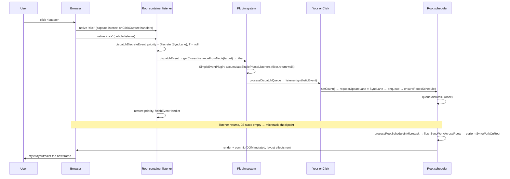

# The Event System

> [!summary] TL;DR
> React doesn't attach your `onClick` to the button. When you call `createRoot(container)`, it puts **one capture and one bubble listener per native event type** on the root container. On a click, the bubble listener (wrapped by `dispatchDiscreteEvent`, which sets update priority to Discrete) finds the fiber for `event.target` through a hidden key on the DOM node. It walks `fiber.return` up to the root collecting `onClick` props, wraps the native event in a `SyntheticEvent`, and calls the handlers in order. A `setState` in your handler gets `SyncLane`, and React renders and commits it in a microtask before the browser paints.

This page sits between the user and [[12 setState - dispatchSetState and Batching|setState]]. It explains *why* a click produces a SyncLane update, and how React finds your handler without any per-element listeners.

## 1. Setup: `listenToAllSupportedEvents`

`createRoot` (and `hydrateRoot`) call `listenToAllSupportedEvents(rootContainerElement)` once per container.[^createroot]

```js
export function listenToAllSupportedEvents(rootContainerElement) {
  if (!rootContainerElement[listeningMarker]) {
    rootContainerElement[listeningMarker] = true;
    allNativeEvents.forEach(domEventName => {
      if (domEventName !== 'selectionchange') {
        if (!nonDelegatedEvents.has(domEventName)) {
          listenToNativeEvent(domEventName, false, rootContainerElement); // bubble
        }
        listenToNativeEvent(domEventName, true, rootContainerElement);    // capture
      }
    });
    // 'selectionchange' only fires on document → listen there once
  }
}
```
(simplified)[^ltase]

- **`allNativeEvents`** is filled at module load. `SimpleEventPlugin.registerEvents()` and the polyfill plugins (EnterLeave, Change, Select, BeforeInput) register their event names.[^plugins] `registerSimpleEvents` builds the `domEventName → reactName` map, `click → onClick`, plus special cases. Note `focusin → onFocus` and `focusout → onBlur`: React's `onFocus` bubbles because it's really `focusin`.[^rse]
- **`nonDelegatedEvents`** (`scroll`, `scrollend`, `load`, `cancel`, `close`, `invalid`, `toggle`, `beforetoggle` and all media events) don't bubble in the DOM. They get only a *capture* listener on the root here. React also attaches them directly to the element when it creates a host instance that needs them (`listenToNonDelegatedEvent`).[^nde]
- `addTrappedEventListener` creates the actual listener via `createEventListenerWrapperWithPriority`. It marks `touchstart`, `touchmove` and `wheel` as `{passive: true}` where supported, so React never blocks scrolling.[^atel]

> [!note] Why the root container and not `document`?
> Up to React 16, everything was delegated to `document`. React 17 moved it to the root container, so several React versions (or several roots) on one page don't fight over `e.stopPropagation()`, and so React trees embedded in non-React apps behave.[^react17]

Why delegate at all? A table with 10,000 rows would otherwise need 10,000 listeners, re-attached on every mount. With delegation, attaching an `onClick` costs nothing beyond storing the prop, and handlers can change every render without any `add/removeEventListener` churn. The cost is an extra walk up the fiber tree on each event.

## 2. Priority is baked into the listener

```js
export function createEventListenerWrapperWithPriority(targetContainer, domEventName, eventSystemFlags) {
  const eventPriority = getEventPriority(domEventName);
  let listenerWrapper;
  switch (eventPriority) {
    case DiscreteEventPriority:   listenerWrapper = dispatchDiscreteEvent; break;
    case ContinuousEventPriority: listenerWrapper = dispatchContinuousEvent; break;
    default:                      listenerWrapper = dispatchEvent; break;
  }
  return listenerWrapper.bind(null, domEventName, eventSystemFlags, targetContainer);
}
```
[^celwp]

`getEventPriority` is a big `switch`. `click`, `keydown`, `input`, `mousedown`, `pointerup`, `focusin` and similar are **Discrete**. `mousemove`, `pointermove`, `scroll`, `wheel`, `drag` and `mouseenter`/`leave` are **Continuous**. `message` maps from the current Scheduler priority. Everything else is Default.[^gep]

```js
function dispatchDiscreteEvent(domEventName, eventSystemFlags, container, nativeEvent) {
  const prevTransition = ReactSharedInternals.T;
  ReactSharedInternals.T = null;                       // a click is never inside a transition
  const previousPriority = getCurrentUpdatePriority();
  try {
    setCurrentUpdatePriority(DiscreteEventPriority);   // ReactDOMSharedInternals.p = SyncLane
    dispatchEvent(domEventName, eventSystemFlags, container, nativeEvent);
  } finally {
    setCurrentUpdatePriority(previousPriority);
    ReactSharedInternals.T = prevTransition;
  }
}
```
[^dde]

This is the link to [[12 setState - dispatchSetState and Batching|setState]]. `requestUpdateLane` → `resolveUpdatePriority()` reads `ReactDOMSharedInternals.p`, finds `DiscreteEventPriority` (= `SyncLane`), and every `setState` in your click handler gets `SyncLane`.[^rup] `dispatchContinuousEvent` does the same thing with `ContinuousEventPriority` (= `InputContinuousLane`).[^dce] The priority is a *dynamic scope*: it's set around the call and restored afterwards, the same pattern `flushSync` and `startTransition` use.

## 3. `dispatchEvent`: from DOM node to fiber

`dispatchEvent` first calls `findInstanceBlockingEvent(nativeEvent)`. That gets the event target, then calls `findInstanceBlockingTarget`, which uses `getClosestInstanceFromNode(target)` to get the fiber.[^de][^fibt] During hydration the target may sit inside a dehydrated Suspense/Activity boundary. In that case the event is "blocked": continuous events are queued for replay, and discrete events try to hydrate synchronously first. In the normal case it's not blocked, and `dispatchEventForPluginEventSystem` is called with the target fiber.

**How a DOM node knows its fiber**: when [[08 completeWork - Building DOM Nodes|completeWork]] creates a host instance, `createInstance` calls `precacheFiberNode(fiber, domElement)` and `updateFiberProps(domElement, props)`.[^ci] These write two expando properties with a per-load random suffix: `'__reactFiber$' + randomKey` and `'__reactProps$' + randomKey`.[^keys][^pfn][^ufp] `commitUpdate` refreshes `__reactProps$` on every update, so the props there are always the *latest committed* props.[^cu]

`getClosestInstanceFromNode` reads `node[internalInstanceKey]`. If the target isn't React-owned (`innerHTML` content, a third-party widget), it walks `parentNode` until it finds one.[^gcifn] (`enableInternalInstanceMap`, which uses a `WeakMap` instead of expandos, is `false` in this release.)

> [!tip] You can use this in DevTools
> In the console, `Object.keys($0).find(k => k.startsWith('__reactFiber$'))` on a selected element gives you its fiber. That's handy for poking at `memoizedState` (the hook list from [[10 Hooks on Mount|Hooks on Mount]]). It's an internal, so never ship code that relies on it.

`dispatchEventForPluginEventSystem` then handles portals and nested roots. It walks up to find the `HostRoot`/`HostPortal` whose container matches the container that received the event, so an event isn't handled twice by nested roots. Finally it calls `batchedUpdates(() => dispatchEventsForPlugins(...))`.[^defpes] In 19.x OSS the DOM-level `batchedUpdates` mostly exists to run `finishEventHandler` afterwards. That restores controlled inputs, flushing sync work first if a controlled component needs it.[^dombu]

## 4. `extractEvents` and `accumulateSinglePhaseListeners`

`dispatchEventsForPlugins` creates an empty `dispatchQueue`, calls `extractEvents`, and then `processDispatchQueue`.[^defp] `extractEvents` always runs `SimpleEventPlugin.extractEvents`. For the bubble phase it also runs the polyfill plugins: EnterLeave (synthesises `onMouseEnter` from `mouseover`/`mouseout`), Change, Select, BeforeInput, and FormAction.[^ee]

`SimpleEventPlugin.extractEvents` maps `click` → `onClick` and picks the synthetic event constructor (`SyntheticMouseEvent` for `click`). It works out `inCapturePhase` from the listener flags, then collects listeners:[^seee]

```js
const listeners = accumulateSinglePhaseListeners(
  targetInst, reactName /* 'onClick' */, nativeEvent.type,
  inCapturePhase, accumulateTargetOnly /* true for non-bubbling scroll */, nativeEvent,
);
if (listeners.length > 0) {
  const event = new SyntheticEventCtor(reactName, reactEventType, null, nativeEvent, nativeEventTarget);
  dispatchQueue.push({ event, listeners });
}
```

```js
export function accumulateSinglePhaseListeners(targetFiber, reactName, nativeEventType,
                                               inCapturePhase, accumulateTargetOnly, nativeEvent) {
  const reactEventName = inCapturePhase ? reactName + 'Capture' : reactName; // onClickCapture
  const listeners = [];
  let instance = targetFiber;
  let lastHostComponent = null;
  while (instance !== null) {
    const { stateNode, tag } = instance;
    if ((tag === HostComponent || tag === HostHoistable || tag === HostSingleton) && stateNode !== null) {
      lastHostComponent = stateNode;
      const listener = getListener(instance, reactEventName);  // stateNode.__reactProps$[...].onClick
      if (listener != null) listeners.push({ instance, listener, currentTarget: lastHostComponent });
    }
    if (accumulateTargetOnly) break;
    instance = instance.return;
  }
  return listeners;   // ordered target → root
}
```
(simplified, createEventHandle/Scope API branches dropped)[^aspl]

What matters:

- **It walks the *fiber* tree, not the DOM tree.** That's why events bubble through portals to their React parent, even when the portal's DOM lives in `document.body`. `instance.return` follows the component hierarchy.
- **Only host fibers contribute.** `<MyButton onClick>` on a function component is just a prop. Only when it reaches a `<button>` (HostComponent) is `onClick` read, and it's read from the **DOM node's current props** (`getListener` → `getFiberCurrentPropsFromNode`), not from `fiber.memoizedProps`.[^gl] Since `commitUpdate` updates `__reactProps$` during commit, handlers are always the latest committed ones, with no listener re-binding.
- `getListener` returns `null` for mouse events on `disabled` interactive elements (`button`, `input`, `select`, `textarea`). That matches browser behaviour across all of them.[^gl]
- **One SyntheticEvent per dispatch**, shared by all listeners in the path. Its `currentTarget` is set per listener.

## 5. SyntheticEvent and `processDispatchQueue`

`createSyntheticEvent(Interface)` returns a constructor that copies the interface's fields from the native event (normalising cross-browser quirks) and stores `nativeEvent`, `target`, `type` and `_reactName`. It implements `preventDefault()`/`stopPropagation()` by calling the native method and flipping `isDefaultPrevented`/`isPropagationStopped`.[^cse] `persist()` is a no-op and `isPersistent()` always returns `true`. Event pooling was removed in React 17, and the methods are kept only for compatibility.[^cse]

```js
function processDispatchQueueItemsInOrder(event, dispatchListeners, inCapturePhase) {
  let previousInstance;
  if (inCapturePhase) {
    for (let i = dispatchListeners.length - 1; i >= 0; i--) { /* root → target */ }
  } else {
    for (let i = 0; i < dispatchListeners.length; i++) {      /* target → root */
      const { instance, currentTarget, listener } = dispatchListeners[i];
      if (instance !== previousInstance && event.isPropagationStopped()) return;
      executeDispatch(event, listener, currentTarget);         // try { listener(event) } catch → reportGlobalError
      previousInstance = instance;
    }
  }
}
```
(simplified)[^pdqio][^ed][^pdq]

Capture and bubble are simulated in one list by iterating it backwards or forwards. The capture-phase native listener collects `onClickCapture` handlers and runs them root→target. The bubble-phase native listener collects `onClick` and runs them target→root. An error thrown in one handler is reported via `reportGlobalError` (and `window.onerror`). It **doesn't** stop the other handlers.

## 6. End to end: a click becomes pixels



Because the update is `SyncLane`, `scheduleTaskForRootDuringMicrotask` doesn't create a Scheduler task. The render runs straight from `flushSyncWorkAcrossRoots_impl` inside the microtask.[^stfrdm][^fswar] Microtasks run before the browser gets a chance to render a frame, so the DOM is updated before the next paint. Passive effects (`useEffect`) from a discrete update are also flushed synchronously at the end of the commit rather than later[^fsw], so the UI is consistent before any further input (see [[09 Commit Phase - Mutation, Layout, Passive Effects|Commit Phase]]). The full trace with every function is in [[21 Walkthrough - setState to Pixels|setState Walkthrough]].

> [!warning] Gotchas
> - **Native listeners run in a different order.** A listener added with `addEventListener` on the button itself fires *before* any React `onClick`, because React's listener is on the root and only fires when the event bubbles there. `e.stopPropagation()` in a React handler stops the *native* event at the root container. It can stop `document`/`window` listeners, but never listeners below the root.
> - **`e.nativeEvent.stopImmediatePropagation()`** doesn't stop other React handlers. They're all called from one native listener.
> - **Programmatic `el.click()`** fires the event synchronously inside your JS, so the stack isn't empty and the microtask render waits until your calling code finishes. If you need the DOM updated in between, use `flushSync`.
> - **`onScroll` doesn't bubble** (since React 17). It's accumulated on the target only (`accumulateTargetOnly`), like the native event.
> - **`onMouseEnter`** isn't delegated `mouseenter`. EnterLeaveEventPlugin computes it from `mouseover`/`mouseout` pairs.

## With the React Compiler

Unchanged. The event system lives in `react-dom-bindings` and runs no component code apart from your handlers. What the compiler changes is **handler identity**. Without it, `onClick={() => setCount(c => c + 1)}` is a new function every render, which is harmless for DOM elements: React just reads the latest one from `__reactProps$`, and attribute diffing treats event props specially. But it breaks `memo` on child *components* that receive the handler. The compiler caches such closures in its memo cache (keyed on the values they capture), so `memo` children and effect deps see stable functions. See [[14 React Compiler - How It Works|React Compiler]] and [[15 Rendering With vs Without the Compiler|With vs Without Compiler]].

## Summary

React never puts your `onClick` on the button. `createRoot` installs one capture and one bubble listener per native event type on the root container, each wrapped with a priority. On a click, React finds the target's fiber through a hidden key on the DOM node, walks `fiber.return` collecting handlers, and calls them with one shared `SyntheticEvent`. The priority scope around that call is the link to [[12 setState - dispatchSetState and Batching|setState]]: every `setState` in the handler gets `SyncLane` and is rendered and committed in a microtask before paint. Next, the compiler, which changes handler identity but not this pipeline.

### Key takeaways

- **`listenToAllSupportedEvents`**: runs once per container; `nonDelegatedEvents` get only a capture listener here and are also attached to the element.
- **`createEventListenerWrapperWithPriority`**: picks the wrapper from `getEventPriority`, so priority is baked into the listener.
- **`dispatchDiscreteEvent`**: sets `DiscreteEventPriority` (= `SyncLane`) and clears the transition around the dispatch, then restores both.
- **`__reactFiber$` / `__reactProps$`**: expandos written by `createInstance` and refreshed by `commitUpdate`; they map a DOM target to its fiber and hold the latest committed props.
- **`accumulateSinglePhaseListeners`**: walks the fiber tree, not the DOM, so events bubble through portals; only host fibers contribute.
- **`processDispatchQueue`**: runs one list backwards for capture and forwards for bubble; a throwing handler doesn't stop the others.
- **`SyntheticEvent`**: one per dispatch, shared by all listeners; `persist()` is a no-op since pooling was removed.
- **Sync flush**: a `SyncLane` update gets no Scheduler task and renders in a microtask, so the DOM changes before the next paint.

---

← [[12 setState - dispatchSetState and Batching|Prev]] · [[00 React Internals Index|Index]] · [[14 React Compiler - How It Works|Next]] →

[^createroot]: `createRoot` calls `listenToAllSupportedEvents` — [packages/react-dom/src/client/ReactDOMRoot.js#L171-L262](https://github.com/facebook/react/blob/v19.3.1/packages/react-dom/src/client/ReactDOMRoot.js#L171-L262)
[^ltase]: `listenToAllSupportedEvents` — [packages/react-dom-bindings/src/events/DOMPluginEventSystem.js#L432-L459](https://github.com/facebook/react/blob/v19.3.1/packages/react-dom-bindings/src/events/DOMPluginEventSystem.js#L432-L459)
[^plugins]: plugin registration — [packages/react-dom-bindings/src/events/DOMPluginEventSystem.js#L93-L100](https://github.com/facebook/react/blob/v19.3.1/packages/react-dom-bindings/src/events/DOMPluginEventSystem.js#L93-L100)
[^rse]: `registerSimpleEvent` / `registerSimpleEvents` — [packages/react-dom-bindings/src/events/DOMEventProperties.js#L125-L149](https://github.com/facebook/react/blob/v19.3.1/packages/react-dom-bindings/src/events/DOMEventProperties.js#L125-L149)
[^nde]: `nonDelegatedEvents` — [packages/react-dom-bindings/src/events/DOMPluginEventSystem.js#L236-L250](https://github.com/facebook/react/blob/v19.3.1/packages/react-dom-bindings/src/events/DOMPluginEventSystem.js#L236-L250)
[^atel]: `addTrappedEventListener` — [packages/react-dom-bindings/src/events/DOMPluginEventSystem.js#L461-L558](https://github.com/facebook/react/blob/v19.3.1/packages/react-dom-bindings/src/events/DOMPluginEventSystem.js#L461-L558)
[^react17]: "React v17.0 Release Candidate: No New Features", Changes to Event Delegation — https://legacy.reactjs.org/blog/2020/08/10/react-v17-rc.html
[^celwp]: `createEventListenerWrapperWithPriority` — [packages/react-dom-bindings/src/events/ReactDOMEventListener.js#L94-L119](https://github.com/facebook/react/blob/v19.3.1/packages/react-dom-bindings/src/events/ReactDOMEventListener.js#L94-L119)
[^gep]: `getEventPriority` — [packages/react-dom-bindings/src/events/ReactDOMEventListener.js#L312-L416](https://github.com/facebook/react/blob/v19.3.1/packages/react-dom-bindings/src/events/ReactDOMEventListener.js#L312-L416)
[^dde]: `dispatchDiscreteEvent` — [packages/react-dom-bindings/src/events/ReactDOMEventListener.js#L121-L137](https://github.com/facebook/react/blob/v19.3.1/packages/react-dom-bindings/src/events/ReactDOMEventListener.js#L121-L137)
[^rup]: `resolveUpdatePriority` — [packages/react-dom-bindings/src/client/ReactDOMUpdatePriority.js#L35-L45](https://github.com/facebook/react/blob/v19.3.1/packages/react-dom-bindings/src/client/ReactDOMUpdatePriority.js#L35-L45)
[^dce]: `dispatchContinuousEvent` — [packages/react-dom-bindings/src/events/ReactDOMEventListener.js#L139-L155](https://github.com/facebook/react/blob/v19.3.1/packages/react-dom-bindings/src/events/ReactDOMEventListener.js#L139-L155)
[^de]: `dispatchEvent` — [packages/react-dom-bindings/src/events/ReactDOMEventListener.js#L157-L235](https://github.com/facebook/react/blob/v19.3.1/packages/react-dom-bindings/src/events/ReactDOMEventListener.js#L157-L235)
[^fibt]: `findInstanceBlockingTarget` — [packages/react-dom-bindings/src/events/ReactDOMEventListener.js#L248-L310](https://github.com/facebook/react/blob/v19.3.1/packages/react-dom-bindings/src/events/ReactDOMEventListener.js#L248-L310)
[^ci]: `createInstance` calls `precacheFiberNode` + `updateFiberProps` — [packages/react-dom-bindings/src/client/ReactFiberConfigDOM.js#L534-L664](https://github.com/facebook/react/blob/v19.3.1/packages/react-dom-bindings/src/client/ReactFiberConfigDOM.js#L534-L664)
[^keys]: `internalInstanceKey` / `internalPropsKey` — [packages/react-dom-bindings/src/client/ReactDOMComponentTree.js#L43-L45](https://github.com/facebook/react/blob/v19.3.1/packages/react-dom-bindings/src/client/ReactDOMComponentTree.js#L43-L45)
[^pfn]: `precacheFiberNode` — [packages/react-dom-bindings/src/client/ReactDOMComponentTree.js#L94-L111](https://github.com/facebook/react/blob/v19.3.1/packages/react-dom-bindings/src/client/ReactDOMComponentTree.js#L94-L111)
[^ufp]: `getFiberCurrentPropsFromNode` / `updateFiberProps` — [packages/react-dom-bindings/src/client/ReactDOMComponentTree.js#L281-L301](https://github.com/facebook/react/blob/v19.3.1/packages/react-dom-bindings/src/client/ReactDOMComponentTree.js#L281-L301)
[^cu]: `commitUpdate` → `updateFiberProps` — [packages/react-dom-bindings/src/client/ReactFiberConfigDOM.js#L999-L1012](https://github.com/facebook/react/blob/v19.3.1/packages/react-dom-bindings/src/client/ReactFiberConfigDOM.js#L999-L1012)
[^gcifn]: `getClosestInstanceFromNode` — [packages/react-dom-bindings/src/client/ReactDOMComponentTree.js#L136-L223](https://github.com/facebook/react/blob/v19.3.1/packages/react-dom-bindings/src/client/ReactDOMComponentTree.js#L136-L223)
[^defpes]: `dispatchEventForPluginEventSystem` — [packages/react-dom-bindings/src/events/DOMPluginEventSystem.js#L589-L703](https://github.com/facebook/react/blob/v19.3.1/packages/react-dom-bindings/src/events/DOMPluginEventSystem.js#L589-L703)
[^dombu]: DOM `batchedUpdates` / `finishEventHandler` — [packages/react-dom-bindings/src/events/ReactDOMUpdateBatching.js#L27-L59](https://github.com/facebook/react/blob/v19.3.1/packages/react-dom-bindings/src/events/ReactDOMUpdateBatching.js#L27-L59)
[^defp]: `dispatchEventsForPlugins` — [packages/react-dom-bindings/src/events/DOMPluginEventSystem.js#L325-L344](https://github.com/facebook/react/blob/v19.3.1/packages/react-dom-bindings/src/events/DOMPluginEventSystem.js#L325-L344)
[^ee]: `extractEvents` (plugin fan-out) — [packages/react-dom-bindings/src/events/DOMPluginEventSystem.js#L102-L203](https://github.com/facebook/react/blob/v19.3.1/packages/react-dom-bindings/src/events/DOMPluginEventSystem.js#L102-L203)
[^seee]: `SimpleEventPlugin.extractEvents` — [packages/react-dom-bindings/src/events/plugins/SimpleEventPlugin.js#L57-L235](https://github.com/facebook/react/blob/v19.3.1/packages/react-dom-bindings/src/events/plugins/SimpleEventPlugin.js#L57-L235)
[^aspl]: `accumulateSinglePhaseListeners` — [packages/react-dom-bindings/src/events/DOMPluginEventSystem.js#L717-L829](https://github.com/facebook/react/blob/v19.3.1/packages/react-dom-bindings/src/events/DOMPluginEventSystem.js#L717-L829)
[^gl]: `getListener` (reads current props from DOM node; disabled check) — [packages/react-dom-bindings/src/events/getListener.js#L14-L78](https://github.com/facebook/react/blob/v19.3.1/packages/react-dom-bindings/src/events/getListener.js#L14-L78)
[^cse]: `createSyntheticEvent` (`persist` no-op, `isPersistent`) — [packages/react-dom-bindings/src/events/SyntheticEvent.js#L31-L143](https://github.com/facebook/react/blob/v19.3.1/packages/react-dom-bindings/src/events/SyntheticEvent.js#L31-L143)
[^pdqio]: `processDispatchQueueItemsInOrder` — [packages/react-dom-bindings/src/events/DOMPluginEventSystem.js#L266-L311](https://github.com/facebook/react/blob/v19.3.1/packages/react-dom-bindings/src/events/DOMPluginEventSystem.js#L266-L311)
[^ed]: `executeDispatch` — [packages/react-dom-bindings/src/events/DOMPluginEventSystem.js#L252-L264](https://github.com/facebook/react/blob/v19.3.1/packages/react-dom-bindings/src/events/DOMPluginEventSystem.js#L252-L264)
[^pdq]: `processDispatchQueue` — [packages/react-dom-bindings/src/events/DOMPluginEventSystem.js#L313-L323](https://github.com/facebook/react/blob/v19.3.1/packages/react-dom-bindings/src/events/DOMPluginEventSystem.js#L313-L323)
[^stfrdm]: `scheduleTaskForRootDuringMicrotask` (SyncLane: no Scheduler task) — [packages/react-reconciler/src/ReactFiberRootScheduler.js#L384-L509](https://github.com/facebook/react/blob/v19.3.1/packages/react-reconciler/src/ReactFiberRootScheduler.js#L384-L509)
[^fswar]: `flushSyncWorkAcrossRoots_impl` — [packages/react-reconciler/src/ReactFiberRootScheduler.js#L185-L247](https://github.com/facebook/react/blob/v19.3.1/packages/react-reconciler/src/ReactFiberRootScheduler.js#L185-L247)
[^fsw]: `flushSpawnedWork`: sync-lane passive effects flushed at end of commit — [packages/react-reconciler/src/ReactFiberWorkLoop.js#L4316-L4329](https://github.com/facebook/react/blob/v19.3.1/packages/react-reconciler/src/ReactFiberWorkLoop.js#L4316-L4329)
