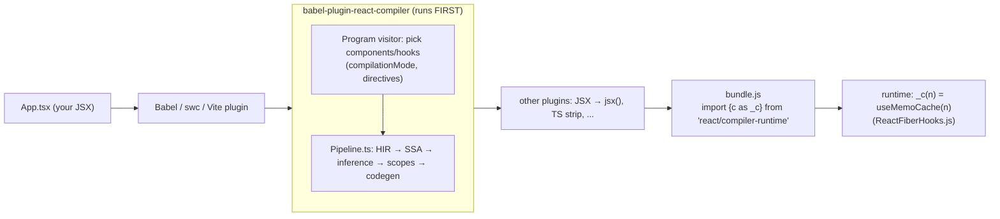

# React Compiler - How It Works

> [!summary] TL;DR
> React Compiler (`babel-plugin-react-compiler`, stable 1.0 since 7 Oct 2025) is a **build-time** Babel plugin that rewrites each component and hook so it memoizes its own intermediate values and JSX in a per-fiber array, `const $ = _c(n)`. It lowers your function into a control-flow-graph IR, infers which values mutate together and which ones are reactive, groups them into "reactive scopes", and emits one `if ($[i] !== dep) { recompute } else { reuse }` block per scope. At runtime the only thing it needs from React is `useMemoCache`. The reconciler, scheduler and commit phase are unchanged.

## What it is, and where it sits in the toolchain

The compiler is "an optimizing compiler that optimizes components and hooks through automatic memoization". It ships as a Babel plugin, but the core is "largely decoupled from Babel": it lowers Babel's AST into its own High-level Intermediate Representation (HIR) and analyses data flow and mutability on that.[^blog] It is a plain dev dependency that runs while you bundle. Nothing extra ships to the browser apart from a tiny runtime import, and **it must be the first plugin in your Babel pipeline** because it needs the original source shape for its analysis.[^install] Vite, Next.js (through an swc integration), Expo/Metro, Rsbuild and Rspack all expose it as a switch.[^install][^intro]

The same core powers the lint rules in `eslint-plugin-react-hooks`: the ESLint plugin effectively runs the compiler and reports a subset of its diagnostics.[^design-arch]



The plugin object is named `react-forget`, the project's old codename, and does all its work from a `Program.enter` visitor so it sees the code before any other plugin has rewritten it.[^babelplugin] For each function in the file it decides whether this is a component or hook to compile, calls the compiler pipeline, and swaps in the returned AST node.[^design-arch]

### Which functions get compiled: `compilationMode` and directives

`getReactFunctionType` makes the decision.[^getfntype]

| `compilationMode` | Compiles |
|---|---|
| `'infer'` (default) | Functions named like a component (PascalCase) or hook (`useX`) **that also create JSX or call a hook**, plus anything with `"use memo"` |
| `'annotation'` | Only functions with a `"use memo"` directive (good for incremental adoption) |
| `'syntax'` | Only Flow `component`/`hook` syntax |
| `'all'` | Every top-level function (not recommended) |

The opt-in directives are `"use memo"` / `"use forget"`, and the opt-out directives are `"use no memo"` / `"use no forget"`.[^directives] Whatever the mode, `"use no memo"` always wins.[^compmode] One consequence of `'infer'`: plain helper functions such as `expensiveSum()` below are **not** compiled. The compiler memoizes the *call* to them inside a component, but the helper itself is untouched, and its memoization is not shared across components.[^intro]

## The pipeline (`Entrypoint/Pipeline.ts`)

`runWithEnvironment` is the real pass list. It is a long, straight-line function, and every pass logs its output under a name. Those names are what you see in the playground's IR tabs.[^pipe-start] The compiler's own design doc describes it in the same phases.[^design-arch] Here are the passes that matter, in order:

### 1. Lowering to HIR: `lower()`
Lowering turns the Babel AST into a **control-flow graph of basic blocks**. Each block holds instructions and ends in a terminal. The IR keeps exact JS evaluation order and resolves `break`/`continue` targets. It is "high-level" because it still knows the difference between `if`, ternary and `&&`, and between `for` and `for..of`, so codegen can emit code that looks like what you wrote.[^lower][^design-principles] Why a CFG and not AST rewriting? Memoization needs data-flow facts ("is `x` mutated after line 5? on which paths?"), and those are textbook CFG analyses. Early prototypes worked on the AST, and the switch to an HIR is what made precise analysis possible.[^blog]

Before SSA there are cleanup passes: `pruneMaybeThrows`, `validateUseMemo`, **`dropManualMemoization`** (turns your `useMemo`/`useCallback` into plain code, keeping markers so it can later check that it preserved your guarantees), IIFE inlining, and block merging.[^dropmanual]

### 2. SSA: `enterSSA`, `eliminateRedundantPhi`
Every assignment gets a fresh identifier, and control-flow joins get phi nodes.[^ssa] After this pass, "which definition of `x` reaches this use?" has a single answer, which the later inference passes rely on. `constantPropagation` follows.

### 3. Type inference and hook validation: `inferTypes`, `validateHooksUsage`
`inferTypes` is deliberately *conservative*. It identifies only what matters for later passes: which values are hooks, `useState` setters, refs, primitives, JSX, and so on.[^infertypes][^design-arch] Right after it, `validateHooksUsage` and `validateNoCapitalizedCalls` run. A conditional hook call fails here.[^pipe-validate-hooks]

### 4. Effect / aliasing inference: `analyseFunctions`, `inferMutationAliasingEffects`, `inferMutationAliasingRanges`
This is the core of the compiler. `inferMutationAliasingEffects` interprets every instruction against an abstract heap, recording effects such as *Create*, *Capture*, *Alias*, *Mutate* and *Freeze*. Values that flow into JSX or a hook become **frozen**, and props and hook results are frozen from the start. Mutating a frozen value is the "This value cannot be modified" error.[^aliasing-effects][^immut-error] `inferMutationAliasingRanges` then computes, for each value, its **mutable range**: the span of instructions from creation to last mutation, extended through aliases.[^ranges] The mutable range is the key concept. A value can only be cached as a unit once it is *done being built*, so everything that mutates it has to sit inside the same memo block.

Then come the render-purity validations: refs read during render, `setState` called unconditionally in render, locals reassigned after render, and others.[^pipe-validations]

### 5. Reactivity: `inferReactivePlaces`
This pass marks which values can **change between renders**: props, state, context, hook results, and anything derived from them.[^reactiveplaces] A `useState` setter is known to be stable, so it is *not* reactive. That is why `handleSelect` in the example below gets a dependency-free, sentinel-only cache slot.

### 6. Reactive scope construction and merging
- `inferReactiveScopeVariables` puts operands that mutate together into disjoint sets. Each set becomes a **reactive scope**, the future `if (...) {...}` memo block.[^scopevars]
- `alignReactiveScopesToBlockScopesHIR` and `mergeOverlappingReactiveScopesHIR` stretch and merge scopes so they nest properly inside JS block structure. You cannot emit an `if` that starts inside one branch and ends in another.[^mergeoverlap]
- `buildReactiveScopeTerminalsHIR` makes the scopes explicit in the CFG.
- `flattenScopesWithHooksOrUseHIR` removes any scope that contains a hook or `use` call, because memoizing it would make the hook call conditional.[^flattenhooks] This is why `useState` calls in compiled output always sit *outside* `if ($[i] ...)` blocks.
- `propagateScopeDependenciesHIR` computes each scope's **dependencies**, the reactive values it reads (down to property paths like `props.items.length`), which become the `$[i] !== dep` checks.[^propdeps]

### 7. ReactiveFunction and pruning
`buildReactiveFunction` turns the CFG back into a tree, a hybrid of HIR and AST.[^buildrf] Then the cost/benefit passes run:
- `pruneNonEscapingScopes`: if a value never escapes (it isn't returned, isn't reachable from the return value, isn't passed to a hook), caching it buys nothing, so its scope is removed.[^nonescaping]
- `pruneNonReactiveDependencies` and `pruneUnusedScopes`.
- `mergeReactiveScopesThatInvalidateTogether`: when scopes have identical dependencies, or one scope's output is the next one's only input, they always invalidate together, so they are merged to save slots and comparisons.[^mergeinval]
- `pruneAlwaysInvalidatingScopes`: an unmemoized object or array literal is new on every render, so memoizing anything downstream of it is wasted and gets removed.[^alwaysinval]
- Then `propagateEarlyReturns`, `promoteUsedTemporaries`, `renameVariables`, and `validatePreservedManualMemoization`, which checks that it kept the guarantees of any `useMemo` you wrote.

### 8. Codegen: `codegenFunction`
If any slots were used, codegen emits `const $ = _c(<count>)` at the top.[^codegen-c] For each scope it emits `$[i] !== dep` comparisons joined with `||`.[^codegen-neq] A scope **with no dependencies** gets a one-time init check instead: `$[k] === Symbol.for("react.memo_cache_sentinel")`.[^codegen-sentinel] The import comes from `react/compiler-runtime` for target `'19'`, or from the `react-compiler-runtime` npm package for `'17'`/`'18'`.[^runtime-module]

> [!note] The pipeline is a moving target
> The pass names above come from `Pipeline.ts` at tag v19.3.1 of the monorepo. The `babel-plugin-react-compiler@1.0.0` npm build used for the real output below is published separately, so its internal pass list can differ slightly. The phases are the same.

## Real compiler output, annotated

I compiled the example below with `babel-plugin-react-compiler@1.0.0` and `@babel/core` through a small script, with JSX left in place so the result stays readable. The script and the outputs live in the scratchpad (`compile-demo/compile.mjs`, `examples/App.jsx`, `out-App.js`).

**Input**

```jsx
import { useState } from "react";

function expensiveSum(items) {
  let total = 0;
  for (const item of items) total += item.price;
  return total;
}

export function List({ items, onSelect }) {
  return (
    <ul>
      {items.map((item) => (
        <li key={item.id} onClick={() => onSelect(item.id)}>{item.name}</li>
      ))}
    </ul>
  );
}

export function Counter({ items }) {
  const [count, setCount] = useState(0);
  const [selected, setSelected] = useState(null);
  const total = expensiveSum(items);
  const handleSelect = (id) => setSelected(id);

  return (
    <div>
      <button onClick={() => setCount(count + 1)}>Clicked {count}</button>
      <p>Total: {total} / selected: {selected}</p>
      <List items={items} onSelect={handleSelect} />
    </div>
  );
}
```

**Output for `Counter`.** The code is verbatim; only the `// ◀` comments are mine.

```js
import { c as _c } from "react/compiler-runtime";        // ◀ added once per file; = React's useMemoCache
export function Counter(t0) {
  const $ = _c(17);                                        // ◀ 17 slots on this fiber's memo cache
  const {
    items
  } = t0;                                                  // ◀ props destructuring moved into the body
  const [count, setCount] = useState(0);                   // ◀ hooks stay unconditional (flattenScopesWithHooks)
  const [selected, setSelected] = useState(null);
  let t1;
  if ($[0] !== items) {                                    // ◀ scope 1, dep = items (sentinel on mount, so always true)
    t1 = expensiveSum(items);                              // ◀ the "useMemo" you didn't write
    $[0] = items;                                          // ◀ store dep...
    $[1] = t1;                                             // ◀ ...and result (written together: atomic)
  } else {
    t1 = $[1];                                             // ◀ cache hit: skip the loop entirely
  }
  const total = t1;
  let t2;
  if ($[2] === Symbol.for("react.memo_cache_sentinel")) {  // ◀ no reactive deps: setSelected is stable
    t2 = id => setSelected(id);                            // ◀ the "useCallback" you didn't write; created once
    $[2] = t2;
  } else {
    t2 = $[2];
  }
  const handleSelect = t2;
  let t3;
  if ($[3] !== count) {                                    // ◀ inline handler closes over count → dep = count
    t3 = () => setCount(count + 1);
    $[3] = count;
    $[4] = t3;
  } else {
    t3 = $[4];
  }
  let t4;
  if ($[5] !== count || $[6] !== t3) {                     // ◀ <button> element, deps = count and the handler
    t4 = <button onClick={t3}>Clicked {count}</button>;
    $[5] = count;
    $[6] = t3;
    $[7] = t4;
  } else {
    t4 = $[7];
  }
  let t5;
  if ($[8] !== selected || $[9] !== total) {               // ◀ <p> only rebuilt when its inputs change
    t5 = <p>Total: {total} / selected: {selected}</p>;
    $[8] = selected;
    $[9] = total;
    $[10] = t5;
  } else {
    t5 = $[10];
  }
  let t6;
  if ($[11] !== items) {                                   // ◀ <List> element: handleSelect is stable, so dep = items only
    t6 = <List items={items} onSelect={handleSelect} />;
    $[11] = items;
    $[12] = t6;
  } else {
    t6 = $[12];                                            // ◀ SAME element object as last render → see page 15
  }
  let t7;
  if ($[13] !== t4 || $[14] !== t5 || $[15] !== t6) {      // ◀ outer <div>: deps are the child elements
    t7 = <div>{t4}{t5}{t6}</div>;
    $[13] = t4;
    $[14] = t5;
    $[15] = t6;
    $[16] = t7;
  } else {
    t7 = $[16];                                            // ◀ nothing changed → return the previous tree
  }
  return t7;
}
```

What to take from it:
- **Granularity is finer than you would write by hand.** One `useMemo` per JSX node, keyed on exactly what that node reads. When you click the button, `count` changes, so `t3`, `t4` and `t7` are rebuilt, while `t5` and `t6` (the `<List>` element) are reused.
- **Element identity is the payoff.** `t6` is the identical object from the previous render. That is what lets the reconciler skip `List` entirely; see [[15 Rendering With vs Without the Compiler|With vs Without Compiler]].
- **Cache writes are atomic.** Inputs and outputs of a scope are written together. React relies on this property in `useMemoCache` (below).

**Output for `List`.** This is also verbatim. Notice the nested scope: the `map` callback is cached on `onSelect` alone, and the mapped array on `items` and `onSelect`:

```js
export function List(t0) {
  const $ = _c(7);
  const { items, onSelect } = t0;
  let t1;
  if ($[0] !== items || $[1] !== onSelect) {
    let t2;
    if ($[3] !== onSelect) {
      t2 = item => <li key={item.id} onClick={() => onSelect(item.id)}>{item.name}</li>;
      $[3] = onSelect;
      $[4] = t2;
    } else {
      t2 = $[4];
    }
    t1 = items.map(t2);
    $[0] = items; $[1] = onSelect; $[2] = t1;
  } else {
    t1 = $[2];
  }
  // ... <ul>{t1}</ul> cached on t1 (slots 5-6)
}
```

(Simplified: I collapsed the destructuring and the last scope onto fewer lines.) When a callback captures nothing reactive, the compiler goes further and **outlines** it to module scope. In the page 15 example, `data.map((d) => <Row .../>)` becomes `data.map(_temp)` with `function _temp(d) {...}` hoisted out.[^outline]

## The runtime: `_c` → `useMemoCache`

On React 19, `react/compiler-runtime` is a one-line re-export, `export {useMemoCache as c} from './ReactHooks'`, and React also exposes it as `React.__COMPILER_RUNTIME`.[^react-runtime] `useMemoCache` is a hook in the dispatcher like any other. The mount and update dispatchers both point at the same function.[^dispatchers] It does not follow the usual mount/update split, and it **does not allocate a `Hook` object in the `memoizedState` list** (see [[10 Hooks on Mount|Hooks on Mount]] for that list). Instead the cache lives on `fiber.updateQueue.memoCache`.[^fcuq]

```js
// packages/react-reconciler/src/ReactFiberHooks.js (simplified)
function useMemoCache(size) {
  let memoCache = currentlyRenderingFiber.updateQueue?.memoCache;  // re-render in same pass
  if (memoCache == null) {
    const current = currentlyRenderingFiber.alternate;
    const currentMemoCache = current?.updateQueue?.memoCache;
    if (currentMemoCache != null) {
      memoCache = {
        data: enableNoCloningMemoCache
          ? currentMemoCache.data
          : currentMemoCache.data.map(array => array.slice()), // copy-on-write
        index: 0,
      };
    }
  }
  if (memoCache == null) memoCache = { data: [], index: 0 };     // first mount
  // ... ensure updateQueue exists, store memoCache on it
  let data = memoCache.data[memoCache.index];
  if (data === undefined) {
    data = memoCache.data[memoCache.index] = new Array(size);
    for (let i = 0; i < size; i++) data[i] = REACT_MEMO_CACHE_SENTINEL;
  }
  memoCache.index++;
  return data;
}
```

The full function is in ReactFiberHooks.js.[^usememocache] A few senior-level details:

- **Mount:** the array is filled with `Symbol.for('react.memo_cache_sentinel')`. Every `$[i] !== dep` check is then trivially true, because no user value equals that symbol, so every scope computes. Scopes without deps check `=== sentinel` explicitly.
- **Update: copy-on-write.** `renderWithHooks` sets `workInProgress.updateQueue = null` at the start of every render.[^rwh-null] `useMemoCache` therefore clones the *current* fiber's arrays (`slice()`), unless `enableNoCloningMemoCache` is on, which it is not in v19.3.1.[^nocloneflag] The clone means a render that is interrupted or thrown away can't corrupt the committed cache, which is the same double-buffering idea as fibers ([[05 The Fiber Data Structure|Fiber]]). The cost is one array copy per compiled component per render.
- **Why atomic writes matter:** the comment on that flag explains that because the compiler never records a scope's inputs without its outputs, a future mode could share one cache across interrupted attempts and so "resume" partway through a component.[^usememocache]
- **Render-phase re-renders** (`setState` during render) reuse the work-in-progress cache, and `resetFunctionComponentUpdateQueue` resets only `index`, not the data.[^resetuq]
- The slot count must be constant across renders. In DEV, React prints a console error if it changes.[^usememocache]

### React 17/18: `react-compiler-runtime`
With `target: '17' | '18'` the import becomes `react-compiler-runtime`, which you install as a **runtime** dependency, not a dev dependency.[^target][^runtime-module] Its `c` uses `React.__COMPILER_RUNTIME.c` when present. Otherwise it falls back to a userspace polyfill: `useMemo(() => new Array(size).fill($empty), [])`, a sentinel-filled array kept alive by an ordinary `useMemo`. The polyfill also sets `$[$empty] = true` so DevTools can recognise the array.[^polyfill] The trade-off is that the cache is a regular hook slot rather than living on the update queue, and it is not copy-on-write.

## Bailouts: when the compiler leaves a function alone

The compiler's stance is that skipping is always safe. By default (`panicThreshold: 'none'`), a function that fails validation is **emitted unchanged** and the build continues.[^panic][^handleerror] I fed it four known-bad components, and this is what the logger reported (`examples/Bailouts.jsx`, `examples/Mut.jsx`):

| Component | Result | Compiler event |
|---|---|---|
| `"use no memo"` in body | Left as written | `CompileSkip`, directive |
| `if (cond) { useState() }` | Left as written | `CompileError`: "Hooks must always be called in a consistent order…"[^hooksusage] |
| `return <div>{ref.current}</div>` | Left as written | `CompileError`: "Cannot access refs during render"[^refaccess] |
| `props.label = "x"` | Left as written | `CompileError`: "This value cannot be modified"[^immut-error] |
| `items.push(1)` (prop destructured) | **Compiled!** | `CompileSuccess` |

> [!warning] That last row is the real lesson
> `items.push(1)` on a prop is a Rules of React violation, but the compiler only *knows* `items` is frozen. It doesn't know `items` is an array, so it can't be sure `.push` mutates. It compiled the component and cached `<div>{items.length}</div>` on `items.length`. The compiler catches what it can **prove**. The rest of the contract is on you, which is exactly how the docs frame runtime issues: "your code violates the Rules of React in subtle ways that the compiler couldn't detect".[^debugging]

Other skip reasons: an ESLint or Flow suppression comment for React rules inside the function (`findProgramSuppressions`) makes the compiler assume the code breaks the rules.[^suppressions] Known-incompatible library APIs, such as `react-hook-form`'s `watch` and TanStack Table, are on a list (`DefaultModuleTypeProvider.ts`) and cause a skip.[^incompatible] So do unsupported syntax such as class components, which are an explicit non-goal.[^design-goals]

`panicThreshold` controls how loud failures are. `'none'` (default; the docs say production should always use it) skips silently. `'critical_errors'` throws on critical or unrecognised errors. `'all_errors'` fails the build on any diagnostic.[^panic][^panicenum] Config errors always throw.[^handleerror] To see the skips without failing the build, pass a `logger` with `logEvent` (that's what my script does) or use the ESLint rules.

## What the compiler does NOT do

- **No reconciler, scheduler, lane or commit changes.** It only rewrites your component bodies. [[06 The Work Loop - Render Phase|Work Loop]], [[07 beginWork and Reconciliation|beginWork & Reconciliation]], [[04 Lanes and the Scheduler|Lanes & Scheduler]] and [[09 Commit Phase - Mutation, Layout, Passive Effects|Commit Phase]] run the same code with or without it. The speedup comes *indirectly*, through stable element and prop identities hitting bailouts that already existed.
- **It does not stop a component's function from running** when that component has its own state update. It makes the run cheaper.
- **It doesn't compile `node_modules`** (default `sources` excludes them), class components, or non-component helpers.[^defaults][^design-goals]
- **It doesn't share memoization** between components or instances. Every fiber has its own cache.[^intro]
- **It is not "perfect" memoization.** Zero unnecessary recomputation is an explicit non-goal, because tracking overhead and code size would hurt startup.[^design-goals]
- **It doesn't change semantics** for code that follows the rules. Existing `useMemo`/`useCallback` still work as escape hatches, for example to pin an effect dependency. The docs advise leaving existing manual memoization in place, because removing it can change the compiled output.[^intro]

> [!tip] Misconception: "the compiler makes React fine-grained like Signals"
> No. React still re-renders components top-down from the component that owns the state. The compiler makes those re-renders *cheaper* and makes unchanged subtrees *bail out*, which is why the docs put "fine-grained reactivity" in quotes.[^intro]

See [[15 Rendering With vs Without the Compiler|With vs Without Compiler]] for the fiber-by-fiber effect on a state update.

---
← [[13 The Event System|Prev]] · [[00 React Internals Index|Index]] · [[15 Rendering With vs Without the Compiler|Next]] →

[^blog]: React Compiler v1.0 (Lauren Tan, Joe Savona, Mofei Zhang, 7 Oct 2025): https://react.dev/blog/2025/10/07/react-compiler-1
[^intro]: react.dev, "React Compiler: Introduction": https://react.dev/learn/react-compiler/introduction
[^install]: react.dev, "React Compiler: Installation" (must run first in the Babel pipeline): https://react.dev/learn/react-compiler/installation
[^debugging]: react.dev, "Debugging and Troubleshooting": https://react.dev/learn/react-compiler/debugging
[^compmode]: react.dev, `compilationMode` reference: https://react.dev/reference/react-compiler/compilationMode
[^panic]: react.dev, `panicThreshold` reference: https://react.dev/reference/react-compiler/panicThreshold
[^target]: react.dev, `target` reference: https://react.dev/reference/react-compiler/target
[^incompatible]: react.dev, `incompatible-library` lint: https://react.dev/reference/eslint-plugin-react-hooks/lints/incompatible-library; known list incl. `react-hook-form`, `@tanstack/react-table` in [compiler/packages/babel-plugin-react-compiler/src/HIR/DefaultModuleTypeProvider.ts#L46-L89](https://github.com/facebook/react/blob/v19.3.1/compiler/packages/babel-plugin-react-compiler/src/HIR/DefaultModuleTypeProvider.ts#L46-L89)
[^design-arch]: Compiler design doc, Architecture: [compiler/docs/DESIGN_GOALS.md#L38-L55](https://github.com/facebook/react/blob/v19.3.1/compiler/docs/DESIGN_GOALS.md#L38-L55)
[^design-principles]: Compiler design doc, Design Principles (HIR): [compiler/docs/DESIGN_GOALS.md#L29-L36](https://github.com/facebook/react/blob/v19.3.1/compiler/docs/DESIGN_GOALS.md#L29-L36)
[^design-goals]: Compiler design doc, Goals / Non-Goals: [compiler/docs/DESIGN_GOALS.md#L5-L27](https://github.com/facebook/react/blob/v19.3.1/compiler/docs/DESIGN_GOALS.md#L5-L27)
[^babelplugin]: `BabelPluginReactCompiler` — [compiler/packages/babel-plugin-react-compiler/src/Babel/BabelPlugin.ts#L24-L36](https://github.com/facebook/react/blob/v19.3.1/compiler/packages/babel-plugin-react-compiler/src/Babel/BabelPlugin.ts#L24-L36)
[^getfntype]: `getReactFunctionType` — [compiler/packages/babel-plugin-react-compiler/src/Entrypoint/Program.ts#L865-L911](https://github.com/facebook/react/blob/v19.3.1/compiler/packages/babel-plugin-react-compiler/src/Entrypoint/Program.ts#L865-L911)
[^directives]: `OPT_IN_DIRECTIVES` / `OPT_OUT_DIRECTIVES` — [compiler/packages/babel-plugin-react-compiler/src/Entrypoint/Program.ts#L49-L50](https://github.com/facebook/react/blob/v19.3.1/compiler/packages/babel-plugin-react-compiler/src/Entrypoint/Program.ts#L49-L50)
[^pipe-start]: `runWithEnvironment` → `lower` — [compiler/packages/babel-plugin-react-compiler/src/Entrypoint/Pipeline.ts#L148-L158](https://github.com/facebook/react/blob/v19.3.1/compiler/packages/babel-plugin-react-compiler/src/Entrypoint/Pipeline.ts#L148-L158)
[^lower]: `lower` — [compiler/packages/babel-plugin-react-compiler/src/HIR/BuildHIR.ts#L72](https://github.com/facebook/react/blob/v19.3.1/compiler/packages/babel-plugin-react-compiler/src/HIR/BuildHIR.ts#L72)
[^dropmanual]: Early passes incl. `dropManualMemoization` — [Pipeline.ts#L160-L181](https://github.com/facebook/react/blob/v19.3.1/compiler/packages/babel-plugin-react-compiler/src/Entrypoint/Pipeline.ts#L160-L181); implementation [Inference/DropManualMemoization.ts#L391](https://github.com/facebook/react/blob/v19.3.1/compiler/packages/babel-plugin-react-compiler/src/Inference/DropManualMemoization.ts#L391)
[^ssa]: `enterSSA` — [compiler/packages/babel-plugin-react-compiler/src/SSA/EnterSSA.ts#L254](https://github.com/facebook/react/blob/v19.3.1/compiler/packages/babel-plugin-react-compiler/src/SSA/EnterSSA.ts#L254); called at [Pipeline.ts#L188-L198](https://github.com/facebook/react/blob/v19.3.1/compiler/packages/babel-plugin-react-compiler/src/Entrypoint/Pipeline.ts#L188-L198)
[^infertypes]: `inferTypes` — [compiler/packages/babel-plugin-react-compiler/src/TypeInference/InferTypes.ts#L64](https://github.com/facebook/react/blob/v19.3.1/compiler/packages/babel-plugin-react-compiler/src/TypeInference/InferTypes.ts#L64)
[^pipe-validate-hooks]: `inferTypes` → `validateHooksUsage` — [Pipeline.ts#L200-L212](https://github.com/facebook/react/blob/v19.3.1/compiler/packages/babel-plugin-react-compiler/src/Entrypoint/Pipeline.ts#L200-L212)
[^aliasing-effects]: `analyseFunctions`, `inferMutationAliasingEffects` — [Pipeline.ts#L217-L221](https://github.com/facebook/react/blob/v19.3.1/compiler/packages/babel-plugin-react-compiler/src/Entrypoint/Pipeline.ts#L217-L221); implementation [Inference/InferMutationAliasingEffects.ts#L98](https://github.com/facebook/react/blob/v19.3.1/compiler/packages/babel-plugin-react-compiler/src/Inference/InferMutationAliasingEffects.ts#L98)
[^immut-error]: "This value cannot be modified" diagnostic — [compiler/packages/babel-plugin-react-compiler/src/Inference/InferMutationAliasingEffects.ts#L612-L615](https://github.com/facebook/react/blob/v19.3.1/compiler/packages/babel-plugin-react-compiler/src/Inference/InferMutationAliasingEffects.ts#L612-L615)
[^ranges]: `inferMutationAliasingRanges` doc comment — [compiler/packages/babel-plugin-react-compiler/src/Inference/InferMutationAliasingRanges.ts#L32-L75](https://github.com/facebook/react/blob/v19.3.1/compiler/packages/babel-plugin-react-compiler/src/Inference/InferMutationAliasingRanges.ts#L32-L75)
[^pipe-validations]: Render validations after mutable ranges — [Pipeline.ts#L234-L296](https://github.com/facebook/react/blob/v19.3.1/compiler/packages/babel-plugin-react-compiler/src/Entrypoint/Pipeline.ts#L234-L296)
[^reactiveplaces]: `inferReactivePlaces` — [compiler/packages/babel-plugin-react-compiler/src/Inference/InferReactivePlaces.ts#L205](https://github.com/facebook/react/blob/v19.3.1/compiler/packages/babel-plugin-react-compiler/src/Inference/InferReactivePlaces.ts#L205); called at [Pipeline.ts#L298-L299](https://github.com/facebook/react/blob/v19.3.1/compiler/packages/babel-plugin-react-compiler/src/Entrypoint/Pipeline.ts#L298-L299)
[^scopevars]: `inferReactiveScopeVariables` — [compiler/packages/babel-plugin-react-compiler/src/ReactiveScopes/InferReactiveScopeVariables.ts#L60-L86](https://github.com/facebook/react/blob/v19.3.1/compiler/packages/babel-plugin-react-compiler/src/ReactiveScopes/InferReactiveScopeVariables.ts#L60-L86); gated on `enableMemoization` at [Pipeline.ts#L328-L336](https://github.com/facebook/react/blob/v19.3.1/compiler/packages/babel-plugin-react-compiler/src/Entrypoint/Pipeline.ts#L328-L336)
[^mergeoverlap]: `alignReactiveScopesToBlockScopesHIR` / `mergeOverlappingReactiveScopesHIR` — [Pipeline.ts#L384-L395](https://github.com/facebook/react/blob/v19.3.1/compiler/packages/babel-plugin-react-compiler/src/Entrypoint/Pipeline.ts#L384-L395); [HIR/MergeOverlappingReactiveScopesHIR.ts#L105](https://github.com/facebook/react/blob/v19.3.1/compiler/packages/babel-plugin-react-compiler/src/HIR/MergeOverlappingReactiveScopesHIR.ts#L105)
[^flattenhooks]: `flattenScopesWithHooksOrUseHIR` — [compiler/packages/babel-plugin-react-compiler/src/ReactiveScopes/FlattenScopesWithHooksOrUseHIR.ts#L20-L40](https://github.com/facebook/react/blob/v19.3.1/compiler/packages/babel-plugin-react-compiler/src/ReactiveScopes/FlattenScopesWithHooksOrUseHIR.ts#L20-L40)
[^propdeps]: `propagateScopeDependenciesHIR` — [compiler/packages/babel-plugin-react-compiler/src/HIR/PropagateScopeDependenciesHIR.ts#L53](https://github.com/facebook/react/blob/v19.3.1/compiler/packages/babel-plugin-react-compiler/src/HIR/PropagateScopeDependenciesHIR.ts#L53); called at [Pipeline.ts#L428-L433](https://github.com/facebook/react/blob/v19.3.1/compiler/packages/babel-plugin-react-compiler/src/Entrypoint/Pipeline.ts#L428-L433)
[^buildrf]: `buildReactiveFunction` — [compiler/packages/babel-plugin-react-compiler/src/ReactiveScopes/BuildReactiveFunction.ts#L42](https://github.com/facebook/react/blob/v19.3.1/compiler/packages/babel-plugin-react-compiler/src/ReactiveScopes/BuildReactiveFunction.ts#L42); pruning passes at [Pipeline.ts#L435-L491](https://github.com/facebook/react/blob/v19.3.1/compiler/packages/babel-plugin-react-compiler/src/Entrypoint/Pipeline.ts#L435-L491)
[^nonescaping]: `pruneNonEscapingScopes` doc comment — [compiler/packages/babel-plugin-react-compiler/src/ReactiveScopes/PruneNonEscapingScopes.ts#L40-L60](https://github.com/facebook/react/blob/v19.3.1/compiler/packages/babel-plugin-react-compiler/src/ReactiveScopes/PruneNonEscapingScopes.ts#L40-L60)
[^mergeinval]: `mergeReactiveScopesThatInvalidateTogether` doc comment — [compiler/packages/babel-plugin-react-compiler/src/ReactiveScopes/MergeReactiveScopesThatInvalidateTogether.ts#L60-L86](https://github.com/facebook/react/blob/v19.3.1/compiler/packages/babel-plugin-react-compiler/src/ReactiveScopes/MergeReactiveScopesThatInvalidateTogether.ts#L60-L86)
[^alwaysinval]: `pruneAlwaysInvalidatingScopes` — [compiler/packages/babel-plugin-react-compiler/src/ReactiveScopes/PruneAlwaysInvalidatingScopes.ts#L18-L29](https://github.com/facebook/react/blob/v19.3.1/compiler/packages/babel-plugin-react-compiler/src/ReactiveScopes/PruneAlwaysInvalidatingScopes.ts#L18-L29)
[^outline]: `enableFunctionOutlining` → `outlineFunctions` — [Pipeline.ts#L358-L361](https://github.com/facebook/react/blob/v19.3.1/compiler/packages/babel-plugin-react-compiler/src/Entrypoint/Pipeline.ts#L358-L361)
[^codegen-c]: `codegenFunction` emits `const $ = _c(n)` — [compiler/packages/babel-plugin-react-compiler/src/ReactiveScopes/CodegenReactiveFunction.ts#L163-L178](https://github.com/facebook/react/blob/v19.3.1/compiler/packages/babel-plugin-react-compiler/src/ReactiveScopes/CodegenReactiveFunction.ts#L163-L178)
[^codegen-neq]: `codegenReactiveScope` builds `$[i] !== dep` — [CodegenReactiveFunction.ts#L560-L590](https://github.com/facebook/react/blob/v19.3.1/compiler/packages/babel-plugin-react-compiler/src/ReactiveScopes/CodegenReactiveFunction.ts#L560-L590)
[^codegen-sentinel]: Sentinel test for dependency-free scopes — [CodegenReactiveFunction.ts#L650-L667](https://github.com/facebook/react/blob/v19.3.1/compiler/packages/babel-plugin-react-compiler/src/ReactiveScopes/CodegenReactiveFunction.ts#L650-L667); constant `MEMO_CACHE_SENTINEL` at [L62](https://github.com/facebook/react/blob/v19.3.1/compiler/packages/babel-plugin-react-compiler/src/ReactiveScopes/CodegenReactiveFunction.ts#L62)
[^runtime-module]: `getReactCompilerRuntimeModule` — [compiler/packages/babel-plugin-react-compiler/src/Entrypoint/Program.ts#L1337-L1345](https://github.com/facebook/react/blob/v19.3.1/compiler/packages/babel-plugin-react-compiler/src/Entrypoint/Program.ts#L1337-L1345)
[^react-runtime]: `react/compiler-runtime` → [packages/react/src/ReactCompilerRuntime.js#L10](https://github.com/facebook/react/blob/v19.3.1/packages/react/src/ReactCompilerRuntime.js#L10); `__COMPILER_RUNTIME` export [packages/react/src/ReactClient.js#L111](https://github.com/facebook/react/blob/v19.3.1/packages/react/src/ReactClient.js#L111); `useMemoCache` → dispatcher [packages/react/src/ReactHooks.js#L212-L216](https://github.com/facebook/react/blob/v19.3.1/packages/react/src/ReactHooks.js#L212-L216)
[^dispatchers]: `HooksDispatcherOnMount` / `OnUpdate` both use `useMemoCache` — [packages/react-reconciler/src/ReactFiberHooks.js#L3926-L3981](https://github.com/facebook/react/blob/v19.3.1/packages/react-reconciler/src/ReactFiberHooks.js#L3926-L3981)
[^fcuq]: `FunctionComponentUpdateQueue.memoCache` — [packages/react-reconciler/src/ReactFiberHooks.js#L249-L254](https://github.com/facebook/react/blob/v19.3.1/packages/react-reconciler/src/ReactFiberHooks.js#L249-L254)
[^usememocache]: `useMemoCache` — [packages/react-reconciler/src/ReactFiberHooks.js#L1181-L1263](https://github.com/facebook/react/blob/v19.3.1/packages/react-reconciler/src/ReactFiberHooks.js#L1181-L1263)
[^rwh-null]: `renderWithHooks` clears `updateQueue` — [packages/react-reconciler/src/ReactFiberHooks.js#L529-L531](https://github.com/facebook/react/blob/v19.3.1/packages/react-reconciler/src/ReactFiberHooks.js#L529-L531)
[^nocloneflag]: `enableNoCloningMemoCache = false` — [packages/shared/ReactFeatureFlags.js#L128](https://github.com/facebook/react/blob/v19.3.1/packages/shared/ReactFeatureFlags.js#L128)
[^resetuq]: `resetFunctionComponentUpdateQueue` — [packages/react-reconciler/src/ReactFiberHooks.js#L1084-L1096](https://github.com/facebook/react/blob/v19.3.1/packages/react-reconciler/src/ReactFiberHooks.js#L1084-L1096)
[^polyfill]: `react-compiler-runtime` `c` polyfill — [compiler/packages/react-compiler-runtime/src/index.ts#L19-L39](https://github.com/facebook/react/blob/v19.3.1/compiler/packages/react-compiler-runtime/src/index.ts#L19-L39)
[^handleerror]: `handleError` (panicThreshold) — [compiler/packages/babel-plugin-react-compiler/src/Entrypoint/Program.ts#L246-L262](https://github.com/facebook/react/blob/v19.3.1/compiler/packages/babel-plugin-react-compiler/src/Entrypoint/Program.ts#L246-L262)
[^panicenum]: `PanicThresholdOptionsSchema` — [compiler/packages/babel-plugin-react-compiler/src/Entrypoint/Options.ts#L20-L37](https://github.com/facebook/react/blob/v19.3.1/compiler/packages/babel-plugin-react-compiler/src/Entrypoint/Options.ts#L20-L37)
[^defaults]: `defaultOptions` (`compilationMode: 'infer'`, `panicThreshold: 'none'`, `sources` excludes `node_modules`, `target: '19'`) — [compiler/packages/babel-plugin-react-compiler/src/Entrypoint/Options.ts#L312-L330](https://github.com/facebook/react/blob/v19.3.1/compiler/packages/babel-plugin-react-compiler/src/Entrypoint/Options.ts#L312-L330)
[^hooksusage]: `validateHooksUsage` — [compiler/packages/babel-plugin-react-compiler/src/Validation/ValidateHooksUsage.ts#L86](https://github.com/facebook/react/blob/v19.3.1/compiler/packages/babel-plugin-react-compiler/src/Validation/ValidateHooksUsage.ts#L86)
[^refaccess]: `validateNoRefAccessInRender` — [compiler/packages/babel-plugin-react-compiler/src/Validation/ValidateNoRefAccessInRender.ts#L122](https://github.com/facebook/react/blob/v19.3.1/compiler/packages/babel-plugin-react-compiler/src/Validation/ValidateNoRefAccessInRender.ts#L122)
[^suppressions]: `findProgramSuppressions` usage — [compiler/packages/babel-plugin-react-compiler/src/Entrypoint/Program.ts#L431-L443](https://github.com/facebook/react/blob/v19.3.1/compiler/packages/babel-plugin-react-compiler/src/Entrypoint/Program.ts#L431-L443)
