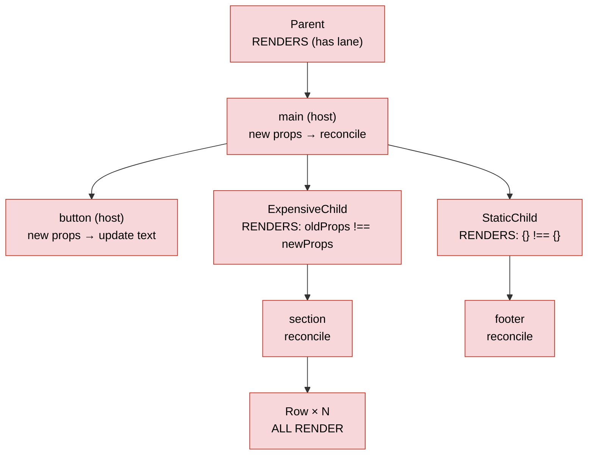
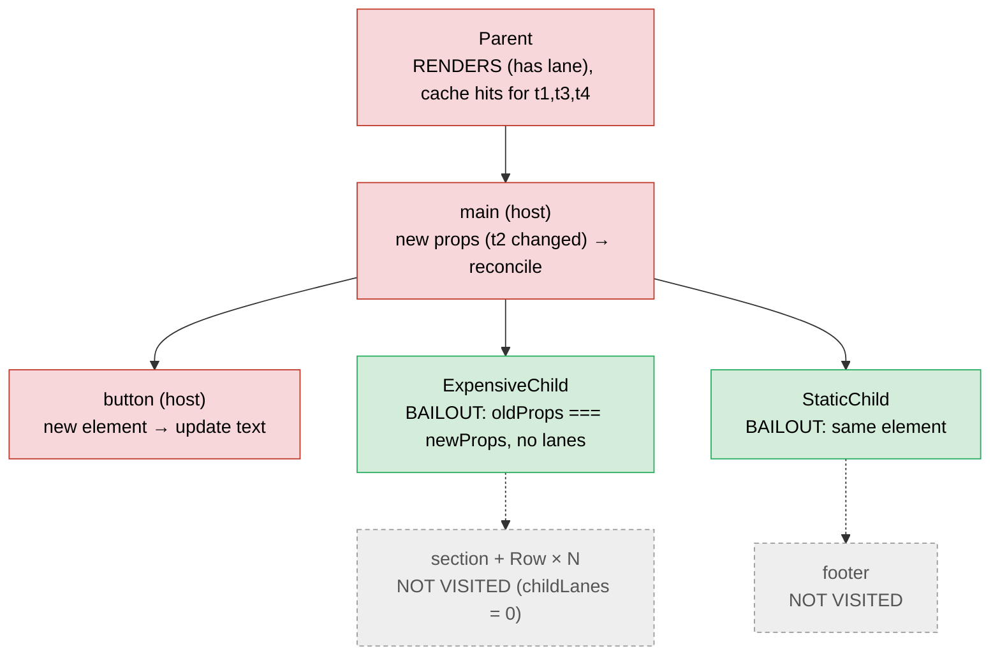

# Rendering With vs Without the Compiler

> [!summary] TL;DR
> The reconciler has always had a cheap bailout: if a fiber's props object is **the same reference** as last time and it has no pending work, `beginWork` skips it and possibly its whole subtree. Without the compiler that path almost never fires below a re-rendering parent, because each render creates new JSX element objects and so new props objects. Compiled components return the *cached* element objects, so `oldProps === newProps` holds and whole subtrees bail out. First render is the same in both modes, apart from filling the cache. DOM work that's actually needed is the same in both.

The compiler mechanics are in [[14 React Compiler - How It Works|React Compiler]]. This page follows one update through [[07 beginWork and Reconciliation|beginWork & Reconciliation]] in both modes.

## The example app

```jsx
function ExpensiveChild({ data }) {
  const rows = data.map((d) => <Row key={d.id} value={d.value} />);
  return <section>{rows}</section>;
}

function StaticChild() {
  return <footer>Static footer</footer>;
}

export function Parent({ data }) {
  const [count, setCount] = useState(0);
  return (
    <main>
      <button onClick={() => setCount((c) => c + 1)}>{count}</button>
      <ExpensiveChild data={data} />
      <StaticChild />
    </main>
  );
}
```

This is what `babel-plugin-react-compiler@1.0.0` actually emits for `Parent`. The output is verbatim and the comments are mine. (Source: `compile-demo/examples/Parent.jsx` → `out-Parent.js` in the scratchpad.)

```js
export function Parent(t0) {
  const $ = _c(9);
  const { data } = t0;
  const [count, setCount] = useState(0);
  let t1;
  if ($[0] === Symbol.for("react.memo_cache_sentinel")) {
    t1 = () => setCount(_temp2);              // handler created once (setCount is stable)
    $[0] = t1;
  } else { t1 = $[0]; }
  let t2;
  if ($[1] !== count) {
    t2 = <button onClick={t1}>{count}</button>; // rebuilt when count changes
    $[1] = count; $[2] = t2;
  } else { t2 = $[2]; }
  let t3;
  if ($[3] !== data) {
    t3 = <ExpensiveChild data={data} />;        // cached on `data`
    $[3] = data; $[4] = t3;
  } else { t3 = $[4]; }
  let t4;
  if ($[5] === Symbol.for("react.memo_cache_sentinel")) {
    t4 = <StaticChild />;                       // no deps: created ONCE per fiber lifetime
    $[5] = t4;
  } else { t4 = $[5]; }
  let t5;
  if ($[6] !== t2 || $[7] !== t3) {
    t5 = <main>{t2}{t3}{t4}</main>;
    $[6] = t2; $[7] = t3; $[8] = t5;
  } else { t5 = $[8]; }
  return t5;
}
function _temp2(c) { return c + 1; }            // updater outlined to module scope
```

(I joined some lines; the statements are unchanged.) `ExpensiveChild` is compiled too: `rows` is cached on `data`, and the `<section>` on `rows`. The `map` callback captures nothing reactive, so it is outlined as `_temp`. `StaticChild` becomes a single sentinel-guarded `<footer>`.

## The bailout that makes it work

All the gain comes from one check at the top of `beginWork`:

```js
// packages/react-reconciler/src/ReactFiberBeginWork.js (simplified)
if (current !== null) {
  const oldProps = current.memoizedProps;
  const newProps = workInProgress.pendingProps;
  if (oldProps !== newProps || hasLegacyContextChanged() /* || DEV hot reload */) {
    didReceiveUpdate = true;
  } else {
    const hasScheduledUpdateOrContext = checkScheduledUpdateOrContext(current, renderLanes);
    if (!hasScheduledUpdateOrContext && (workInProgress.flags & DidCapture) === NoFlags) {
      didReceiveUpdate = false;
      return attemptEarlyBailoutIfNoScheduledUpdate(current, workInProgress, renderLanes);
    }
    // ...
  }
}
```

That's the full rule.[^bw-bailout] Note that the comparison is **reference equality on the whole props object**, not a shallow compare. `checkScheduledUpdateOrContext` asks whether this fiber has an update in the lanes being rendered (`current.lanes`), or whether a context it read changed.[^checksched] If not, the early bailout ends in `bailoutOnAlreadyFinishedWork`. If `childLanes` doesn't intersect `renderLanes` either, it returns `null` and **the entire subtree is skipped**. Otherwise it clones the children and keeps walking down to the fiber that actually has work.[^bailout-finished]

Where do `pendingProps` and `memoizedProps` come from?
- When the parent reconciles its children and finds an element of the same type, it calls `useFiber(current, element.props)`, which creates the work-in-progress with `pendingProps = element.props`.[^useFiber][^cwip]
- After `beginWork` finishes, `performUnitOfWork` sets `memoizedProps = pendingProps`.[^puow]

So `memoizedProps` is literally the props object of the element rendered last time. **If the parent hands over the same element object again, `newProps === oldProps` holds automatically.** JSX compiles to `jsx(type, props)`, which allocates a new element and a new props object on every call ([[01 Bootstrap - Packages, JSX and the Dispatcher|Bootstrap]]), so uncompiled code never hands over the same object. Compiled code does, whenever the scope's dependencies didn't change.

> [!note] This trick predates the compiler
> Hoisting `const footer = <StaticChild />` to module scope, or passing `children` from above, has always hit this same path. The compiler applies it to every element whose inputs didn't change.

## First render: same path, plus cache filling

On mount `current === null` for every fiber, so the bailout block doesn't apply in either mode. Every component runs, every fiber is created, and [[08 completeWork - Building DOM Nodes|completeWork]] builds every DOM node.

The compiler adds this on top:
1. `_c(9)` → `useMemoCache(9)` finds no cache on the fiber or its alternate, allocates `{data: [], index: 0}`, puts it on `fiber.updateQueue.memoCache`, and fills a 9-slot array with `REACT_MEMO_CACHE_SENTINEL`.[^umc]
2. Every scope runs. `$[i] !== dep` is true because the slot holds the sentinel, and sentinel-guarded scopes are true by definition. The scope writes its deps and outputs into the slots.
3. The extra cost is one array per compiled component instance plus the stored deps and outputs: a few comparisons and stores per scope. The compiler's stated goal is to "keep startup time neutral".[^design-goals] An independent audit of a 15k-line app measured no visible initial-load impact.[^makarevich]

Otherwise the path is identical: [[03 root.render - Scheduling the First Update|root.render]] → [[06 The Work Loop - Render Phase|Work Loop]] → [[09 Commit Phase - Mutation, Layout, Passive Effects|Commit Phase]].

## State change: click the button

`setCount` → `dispatchSetState` marks the `Parent` fiber with a lane and bubbles `childLanes` to the root ([[12 setState - dispatchSetState and Batching|setState]]). The render starts at the root, and every ancestor of `Parent` bails out with `oldProps === newProps` plus `childLanes` set, which clones down to `Parent`. That part is identical in both modes.

`Parent` itself has a pending lane, so it **renders in both modes**. `updateReducer` sees a new `count`, which differs (`!is(new, old)`), and calls `markWorkInProgressReceivedUpdate()`.[^reducer-mark] This is covered in [[11 Hooks on Update|Hooks on Update]].

### Without the compiler

`Parent()` returns a fresh `<main>` holding a fresh `<button>`, a fresh `<ExpensiveChild data={data}/>` (new props object, same `data`), and a fresh `<StaticChild/>` (new, empty `{}` props object).



Every function component below `Parent` runs: `ExpensiveChild` re-maps `data` and creates N new `<Row>` elements, each `Row` runs, and so on down. Every host fiber in that subtree (`<section>`, whatever `Row` renders, `<footer>`) also gets a new props object. `completeWork`'s `updateHostComponent` only checks `oldProps === newProps`, so it flags each of them `Update`.[^hostcomplete] In the commit phase, `commitUpdate` → `updateProperties` then diffs old against new props for every flagged node.[^commitupdate] Nearly all of those diffs find nothing to change, so the **only real DOM write is the button's text**, but you still paid for all the diffing. (There is no `HostText` fiber here. `<button>{count}</button>` has a single primitive child, so React treats it as the `children` prop: `updateProperties` → `setTextContent`. The uncompiled build also re-assigns `onClick` on every render because the arrow function is new each time. The compiled build skips that because the handler is cached. See [[21 Walkthrough - setState to Pixels|setState Walkthrough]].) The only standard fix is `React.memo`, which turns the identity check into `shallowEqual(prevProps, nextProps)` in `updateSimpleMemoComponent`. It only works if every prop is stable, which in turn needs `useCallback`/`useMemo` in the parent.[^simplememo]

### With the compiler

`Parent()` still runs, because it has the update. Inside it:
- `$[1] !== count` is true, so a new `<button>` element is built.
- `$[3] !== data` is false, so `t3` is the **same `<ExpensiveChild>` element object** as last render.
- `t4` is the same `<StaticChild>` element object (sentinel already replaced).
- `t2` changed, so a new `<main>` is built.



`<main>` reconciles its array of children. For `ExpensiveChild` and `StaticChild` it calls `useFiber(current, element.props)` with the *cached* element's props, which are the very object stored as `memoizedProps` last time. In `beginWork` for those fibers, `oldProps === newProps`, no lane, and no context change, so `attemptEarlyBailoutIfNoScheduledUpdate` → `bailoutOnAlreadyFinishedWork` returns `null`. **The component function never runs, and its subtree is never visited.**[^bw-bailout][^bailout-finished] `completeWork` still runs for the bailed-out fiber itself (`performUnitOfWork` completes any unit whose `beginWork` returned `null`), but its descendants are never touched.[^puow]

### Second line of defence: compiled children

Suppose `ExpensiveChild` *does* render, say because `data` changed or because it reads a context that changed. Its own cache still helps. `rows` is recomputed only if `data` changed, and if `ExpensiveChild` re-renders for an unrelated reason (a context it reads), `rows` and the `<section>` come from `$` and every `Row` bails out. Without the compiler, a re-render always cascades. With it, a re-render stops at the first level whose inputs didn't change. That covers most of what `React.memo` was used for. It is not *identical*: the compiled component's function still runs (cheaply) when its parent hands it a *new* element whose props are shallow-equal, whereas `React.memo` would skip the function call.

> [!warning] Misconception: "with the compiler, Parent doesn't re-render"
> It does. The component that owns the state always runs. The compiler doesn't change *who is scheduled*. It changes how much each run allocates, and whether **children** get identical props. React DevTools still highlights `Parent`, and compiled components carry a ✨ badge.[^debugging]

## Comparison table

| Concern | Without compiler | With compiler |
|---|---|---|
| Component owning the state | Renders | Renders (same) |
| Its JSX elements | All new objects every render | Only those whose deps changed. Others are reused from `$` |
| Children with unchanged inputs | Render (props object is new), recursively | `beginWork` bailout (`oldProps === newProps`), subtree skipped |
| Reconciliation (child diffing) | Whole subtree under the updated component | Only the changed path. Skipped subtrees are not diffed |
| Host fibers flagged `Update` (props diffed in commit) | Every host fiber in the re-rendered subtree, since all have new props objects | Only host fibers on the changed path |
| Actual DOM mutations in commit | Only what actually changed (here: one text node) | **Same.** The compiler can't remove needed DOM work, and `updateProperties` already skipped writes that changed nothing |
| Effects deps | Objects/functions created in render are new each time → effects re-fire unless `useMemo`/`useCallback` | Memoized on their real inputs, so effects fire only when inputs change (see below) |
| `useMemo` / `useCallback` / `memo` | Needed for perf | Mostly unnecessary. Keep them as escape hatches, and don't rip out existing ones without testing[^intro] |
| Memory | Baseline | One cache array per compiled component instance (copy-on-write clone per render in v19.3.1)[^umc] |
| First render cost | Baseline | About the same: allocate and populate slots |

### Effects deps stability, from real output

```jsx
function EffectDeps({ userId }) {
  const options = { userId, retry: 3 };
  useEffect(() => { subscribe(options); }, [options]);
  return <i>{userId}</i>;
}
```

Uncompiled, `options` is new on every render, so the effect re-subscribes every render. The classic bug. Compiled (verbatim, trimmed):

```js
if ($[0] !== userId) { t1 = { userId, retry: 3 }; $[0] = userId; $[1] = t1; } else { t1 = $[1]; }
const options = t1;
if ($[2] !== options) { t2 = () => { subscribe(options); }; t3 = [options]; /* ... */ } else { /* reuse */ }
useEffect(t2, t3);
```

Now `options` changes only when `userId` changes, so the effect fires only then. The flip side is in the debugging guide: code that *accidentally* relied on memoization (or on its absence) can behave differently, for example effects over-firing or under-firing once the compiler memoizes differently than you did.[^debugging]

## Gotchas: where the two modes really differ

I checked each of these against real 1.0.0 output (`examples/Gotchas.jsx` → `out-Gotchas.js`).

1. **Non-idempotent render code gets frozen.** `const t = Date.now(); return <span>{t}</span>;` compiles into a *sentinel-only* scope. The timestamp is computed **once per mount** and never changes, even when the parent re-renders. Uncompiled, every render shows a new time. Render must be pure. Read clocks and randomness in effects or event handlers, or keep them in state.
2. **External mutable values.** `<span>{globalCounter.n}</span>` with a module-level mutable object also compiles to a sentinel-only scope, because a module global isn't reactive. Mutating `globalCounter.n` and re-rendering shows the stale value forever. Uncompiled, it "worked" by accident. Use state, context, or `useSyncExternalStore`.
3. **Reading refs during render.** `ref.current` in JSX is a validation error, and the compiler **skips** the component rather than cache a stale read (see the bailout table in [[14 React Compiler - How It Works|React Compiler]]).
4. **Undetected mutation.** Mutating a prop through a method call (`items.push`) compiled fine. The compiler trusts the Rules of React where it can't prove a violation.
5. **Libraries relying on referential instability or interior mutability.** APIs like `react-hook-form`'s `watch()`, or MobX `observer` objects, return the *same* reference while their contents change. Memoized code never sees the change, and the UI looks frozen. Known APIs are flagged by the `incompatible-library` lint and the component is skipped. MobX is not detected, so use `"use no memo"`.[^incompatible] A real-app audit found components skipped because of a single external-library call, which is the practical ceiling on the gains.[^makarevich]
6. **Memoization isn't shared.** Two components calling `expensive(items)` each compute it once per *their own* cache. The compiler memoizes per fiber, not globally.[^intro]

> [!tip] Debugging recipe
> If a component misbehaves only when compiled, add `"use no memo"`. If the bug disappears, look for a Rules of React violation in that component (gotchas 1, 2, 4, 5). Don't treat it as a compiler bug at first.[^debugging]

## What is unchanged

The scheduler, lanes, the work loop, `beginWork`'s logic, child reconciliation, `completeWork`, commit, and effect flushing run the **same code**. Even the cache is just another hook (`useMemoCache`) on the fiber. With the compiler, the existing bailout paths simply fire far more often, because compiled components produce stable element identities.

## Summary

The reconciler has always had a cheap bailout: if a fiber's props object is the same reference as last time and it has no pending work, `beginWork` skips it and possibly its subtree. Uncompiled code rarely hits it below a re-rendering parent, because every `jsx()` call allocates a new props object. Compiled components return cached elements, so `oldProps === newProps` holds and unchanged subtrees are never visited. The state owner still renders and the real DOM writes are the same; the win is skipped renders and skipped prop diffing. This closes the pair begun in [[14 React Compiler - How It Works|React Compiler]].

### Key takeaways

- **The `beginWork` bailout**: same props reference (not a shallow compare) and no pending work; if `childLanes` is clear too, the subtree is skipped.
- **`useFiber(current, element.props)`**: the element's props become `memoizedProps`, so the same element passes the check automatically.
- **First render**: `current === null` everywhere, so both modes do the same work plus filling the cache.
- **Without the compiler**: every component below the state owner renders, and every host fiber there is flagged `Update` and diffed.
- **With the compiler**: `ExpensiveChild` and `StaticChild` get cached elements, bail out, and their subtrees go unvisited.
- **Second line of defence**: a compiled child that re-renders reuses its own cache; close to `React.memo`, not identical.
- **Effect deps**: render-created objects are memoized on their real inputs, so effects fire only when those change.
- **Gotchas**: `Date.now()` in render, mutable globals and interior-mutable libraries freeze; try `"use no memo"` first.

---

← [[14 React Compiler - How It Works|Prev]] · [[00 React Internals Index|Index]] · [[20 Walkthrough - First Render End to End|Next]] →

[^bw-bailout]: `beginWork` props/lane bailout — [packages/react-reconciler/src/ReactFiberBeginWork.js#L4250-L4294](https://github.com/facebook/react/blob/v19.3.1/packages/react-reconciler/src/ReactFiberBeginWork.js#L4250-L4294)
[^checksched]: `checkScheduledUpdateOrContext` — [packages/react-reconciler/src/ReactFiberBeginWork.js#L3939-L3956](https://github.com/facebook/react/blob/v19.3.1/packages/react-reconciler/src/ReactFiberBeginWork.js#L3939-L3956)
[^bailout-finished]: `bailoutOnAlreadyFinishedWork` (returns `null` when `childLanes` don't intersect `renderLanes`) — [packages/react-reconciler/src/ReactFiberBeginWork.js#L3826-L3865](https://github.com/facebook/react/blob/v19.3.1/packages/react-reconciler/src/ReactFiberBeginWork.js#L3826-L3865); `attemptEarlyBailoutIfNoScheduledUpdate` starts at [L3958](https://github.com/facebook/react/blob/v19.3.1/packages/react-reconciler/src/ReactFiberBeginWork.js#L3958)
[^useFiber]: `updateElement` → `useFiber(current, element.props)` — [packages/react-reconciler/src/ReactChildFiber.js#L580-L627](https://github.com/facebook/react/blob/v19.3.1/packages/react-reconciler/src/ReactChildFiber.js#L580-L627); `useFiber` [L502-L508](https://github.com/facebook/react/blob/v19.3.1/packages/react-reconciler/src/ReactChildFiber.js#L502-L508)
[^cwip]: `createWorkInProgress` sets `pendingProps` — [packages/react-reconciler/src/ReactFiber.js#L323-L353](https://github.com/facebook/react/blob/v19.3.1/packages/react-reconciler/src/ReactFiber.js#L323-L353)
[^puow]: `performUnitOfWork`: `memoizedProps = pendingProps`, complete on `null` — [packages/react-reconciler/src/ReactFiberWorkLoop.js#L3081-L3119](https://github.com/facebook/react/blob/v19.3.1/packages/react-reconciler/src/ReactFiberWorkLoop.js#L3081-L3119)
[^reducer-mark]: `updateReducerImpl` → `markWorkInProgressReceivedUpdate` when state changed — [packages/react-reconciler/src/ReactFiberHooks.js#L1551-L1555](https://github.com/facebook/react/blob/v19.3.1/packages/react-reconciler/src/ReactFiberHooks.js#L1551-L1555); post-render bailout in `updateFunctionComponent` [packages/react-reconciler/src/ReactFiberBeginWork.js#L1549-L1552](https://github.com/facebook/react/blob/v19.3.1/packages/react-reconciler/src/ReactFiberBeginWork.js#L1549-L1552)
[^simplememo]: `updateSimpleMemoComponent` (`shallowEqual`) — [packages/react-reconciler/src/ReactFiberBeginWork.js#L547-L617](https://github.com/facebook/react/blob/v19.3.1/packages/react-reconciler/src/ReactFiberBeginWork.js#L547-L617)
[^hostcomplete]: `updateHostComponent` (completeWork) — [packages/react-reconciler/src/ReactFiberCompleteWork.js#L463-L481](https://github.com/facebook/react/blob/v19.3.1/packages/react-reconciler/src/ReactFiberCompleteWork.js#L463-L481)
[^commitupdate]: `commitUpdate` → `updateProperties` — [packages/react-dom-bindings/src/client/ReactFiberConfigDOM.js#L999-L1012](https://github.com/facebook/react/blob/v19.3.1/packages/react-dom-bindings/src/client/ReactFiberConfigDOM.js#L999-L1012)
[^umc]: `useMemoCache` — [packages/react-reconciler/src/ReactFiberHooks.js#L1181-L1263](https://github.com/facebook/react/blob/v19.3.1/packages/react-reconciler/src/ReactFiberHooks.js#L1181-L1263)
[^design-goals]: Compiler design doc, Goals — [compiler/docs/DESIGN_GOALS.md#L5-L15](https://github.com/facebook/react/blob/v19.3.1/compiler/docs/DESIGN_GOALS.md#L5-L15)
[^intro]: react.dev, "React Compiler: Introduction": https://react.dev/learn/react-compiler/introduction
[^debugging]: react.dev, "Debugging and Troubleshooting": https://react.dev/learn/react-compiler/debugging
[^incompatible]: react.dev, `incompatible-library` lint: https://react.dev/reference/eslint-plugin-react-hooks/lints/incompatible-library
[^makarevich]: Nadia Makarevich, "How React Compiler Performs on Real Code": https://dev.to/adevnadia/how-react-compiler-performs-on-real-code-5gkf
