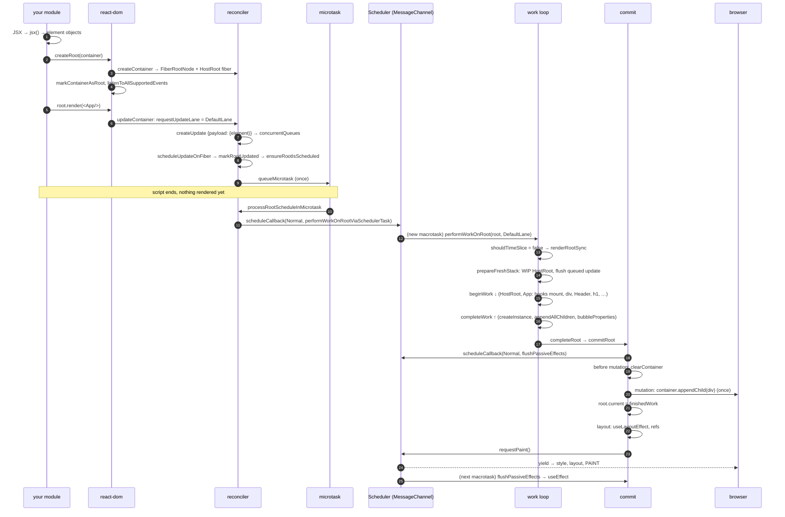

# Walkthrough: First Render End to End

> [!summary] TL;DR
> `createRoot(el).render(<App/>)` renders nothing synchronously. It builds the root objects, attaches the event listeners, queues one `DefaultLane` update and books a microtask. The microtask books a Scheduler task. That task renders the whole tree with **`renderRootSync`**, because `DefaultLane` is a *blocking* lane and is never time-sliced. The DOM is built off-screen in `completeWork`, inserted with **one** `appendChild` during commit, layout effects run, the browser paints, and `useEffect` runs in a later Scheduler task. With the React Compiler the path is identical. The only extra work is filling each component's memo cache.

This page is the narrative. Every step links to the deep-dive page that explains it properly. The companion story, a click that updates the counter, is [[21 Walkthrough - setState to Pixels|setState Walkthrough]].

## The running example

The same app is used on both walkthrough pages. I added one layout effect and one passive effect so the commit phase has something to run:

```jsx
import { useState, useEffect, useLayoutEffect } from "react";
import { createRoot } from "react-dom/client";

function Header({ title }) {
  return <h1>{title}</h1>;
}

function Footer() {
  return <footer>made with React</footer>;
}

function App() {
  const [count, setCount] = useState(0);
  useLayoutEffect(() => {
    document.title = `count: ${count}`;
  }, [count]);
  useEffect(() => {
    console.log("committed", count);
  }, [count]);
  return (
    <div>
      <Header title="Counter" />
      <button onClick={() => setCount((c) => c + 1)}>{count}</button>
      <Footer />
    </div>
  );
}

createRoot(document.getElementById("root")).render(<App />);
```

The fiber tree this produces has **eight fibers**: `HostRoot → App → div → [Header → h1, button, Footer → footer]`. There are no `HostText` fibers. `<h1>{title}</h1>`, `<button>{count}</button>` and `<footer>made with React</footer>` each have a single string or number child, and `shouldSetTextContent` says those are written as `textContent` rather than getting their own fiber.[^sstc] That detail comes back in [[21 Walkthrough - setState to Pixels|the update walkthrough]].

## The whole flow



## Call stack at a glance

```text
── synchronous, in your module ───────────────────────────────────────────
jsx(App, {})                                   → ReactElement {type: App, props: {}}
createRoot(container)
  createContainer → createFiberRoot            → FiberRootNode + HostRoot fiber, initializeUpdateQueue
  markContainerAsRoot(root.current, container)
  listenToAllSupportedEvents(container)
root.render(<App/>)  (ReactDOMRoot.prototype.render)
  updateContainer
    requestUpdateLane(current)                 → DefaultLane
    updateContainerImpl
      createUpdate(lane); update.payload = {element}
      enqueueUpdate → enqueueConcurrentClassUpdate  (buffered in concurrentQueues)
      scheduleUpdateOnFiber
        markRootUpdated                        (root.pendingLanes |= DefaultLane)
        ensureRootIsScheduled → ensureScheduleIsScheduled
          scheduleImmediateRootScheduleTask    → queueMicrotask(...)
── microtask ──────────────────────────────────────────────────────────────
processRootScheduleInMicrotask
  scheduleTaskForRootDuringMicrotask           → scheduleCallback(NormalPriority, performWorkOnRootViaSchedulerTask)
── macrotask: Scheduler (MessageChannel) ──────────────────────────────────
performWorkUntilDeadline → flushWork → workLoop
  performWorkOnRootViaSchedulerTask
    performWorkOnRoot(root, DefaultLane, forceSync=false)
      renderRootSync                           (shouldTimeSlice === false)
        prepareFreshStack → createWorkInProgress(root.current), finishQueueingConcurrentUpdates
        workLoopSync → performUnitOfWork × 8
          beginWork(HostRoot) → updateHostRoot → processUpdateQueue → reconcileChildFibers
          beginWork(App)      → updateFunctionComponent → renderWithHooks → App()
                                 mountState, mountLayoutEffect, mountEffect → mountChildFibers
          beginWork(div)      → updateHostComponent → reconcileChildrenArray
          …
          completeUnitOfWork → completeWork(h1 | button | footer | div)
                                 createInstance, appendAllChildren, finalizeInitialChildren, bubbleProperties
      finishConcurrentRender → completeRootWhenReady → completeRoot → commitRoot
        commitBeforeMutationEffects            (HostRoot Snapshot → clearContainer)
        flushMutationEffects → commitMutationEffects → … → commitPlacement
          insertOrAppendPlacementNodeIntoContainer → appendChildToContainer
          root.current = finishedWork
        flushLayoutEffects → commitLayoutEffects → commitHookLayoutEffects
        flushSpawnedWork → requestPaint()
── browser: style / layout / paint ───────────────────────────────────────
── later macrotask: Scheduler ─────────────────────────────────────────────
flushPassiveEffects → flushPassiveEffectsImpl → commitPassiveMountEffects → useEffect create()
```

## The steps

### 1. Module load: JSX becomes plain objects

Before React does anything, your bundler has turned `<App />` into `jsx(App, {})` (automatic runtime). In production `jsx` is `jsxProd`, which reuses the config object literal as `props` and calls `ReactElement` to build `{$$typeof: REACT_ELEMENT_TYPE, type: App, key: null, ref: null, props: {}}`.[^jsxprod][^reactelement] Nothing else happens. An element is an inert description, and none of `App`'s code has run. `useState` is also just a forwarding stub at this point: it reads `ReactSharedInternals.H`, which is `null` outside a render.[^usestate-react]

→ deep dive: [[01 Bootstrap - Packages, JSX and the Dispatcher|Bootstrap]]

### 2. `createRoot`: FiberRoot, HostRoot, and every listener

`createRoot(container)` validates the container and calls `createContainer`, which calls `createFiberRoot`.[^createroot][^createcontainer] That builds two objects pointing at each other:[^createfiberroot][^fiberrootnode][^hostrootfiber]

```text
ReactDOMRoot { _internalRoot } ──► FiberRootNode
                                     containerInfo: div#root
                                     current ──────────────► HostRoot fiber (tag 3, ConcurrentMode)
                                     pendingLanes: 0           stateNode ──► FiberRootNode
                                     callbackNode: null        memoizedState: {element: null, isDehydrated: false, cache}
                                                               updateQueue: {baseState, shared: {pending: null}, …}
                                                               alternate: null, child: null
```

`initializeUpdateQueue` gives the HostRoot a class-style update queue.[^initqueue] Then `createRoot` stamps the container with `__reactContainer$<random>` (`markContainerAsRoot`) and calls `listenToAllSupportedEvents(container)`, which attaches one capture listener and (for bubbling events) one bubble listener per native event type.[^markcontainer][^listen] All the event wiring the click in page 21 needs exists now, before any component has rendered.

→ deep dive: [[02 createRoot - FiberRoot and HostRoot|createRoot]], [[13 The Event System|Event System]]

### 3. `root.render(<App/>)` → `updateContainer`

`ReactDOMRoot.prototype.render` checks the root isn't unmounted and calls `updateContainer(children, root, null, null)`.[^render] `updateContainer` reads `container.current` (the HostRoot fiber), picks a lane, and hands off to `updateContainerImpl`.[^updatecontainer]

→ deep dive: [[03 root.render - Scheduling the First Update|root.render]]

### 4. `requestUpdateLane` → `DefaultLane`

`requestUpdateLane` checks for a render-phase update (no), then for a transition (`ReactSharedInternals.T` is `null`), and finally returns `eventPriorityToLane(resolveUpdatePriority())`.[^requestlane] The DOM's `resolveUpdatePriority` finds no priority set by a React event wrapper and, at top level in a module, `window.event === undefined`, so it returns `DefaultEventPriority`.[^resolveprio] Event priorities *are* lanes: `DefaultEventPriority` is defined as `DefaultLane`.[^eventprio]

```text
SyncLane     = 0b0000000000000000000000000000010
DefaultLane  = 0b0000000000000000000000000100000   ← this update
```
[^lanes]

→ deep dive: [[04 Lanes and the Scheduler|Lanes & Scheduler]]

### 5. The update is created and *buffered*

`updateContainerImpl` creates `Update {lane: DefaultLane, tag: UpdateState, payload: {element: <App/>}}` and calls `enqueueUpdate(rootFiber, update, lane)`.[^updatecontainerimpl][^createupdate] That goes to `enqueueConcurrentClassUpdate`, which does *not* link the update into `updateQueue.shared.pending` yet.[^enqueueupdate-class] It pushes `(fiber, queue, update, lane)` onto the module-level `concurrentQueues` array and marks `fiber.lanes |= DefaultLane` right away.[^concurrent-enqueue] `getRootForUpdatedFiber` walks `.return` to the HostRoot, which for the root fiber is immediate, and returns the FiberRoot.[^getroot]

```text
concurrentQueues = [HostRoot, hostRootQueue, update{payload:{element}}, DefaultLane]
HostRoot.lanes   = DefaultLane
HostRoot.updateQueue.shared.pending = null      ← still empty; linked in step 10
```

→ deep dive: [[03 root.render - Scheduling the First Update|root.render]], [[12 setState - dispatchSetState and Batching|setState]] (same buffer)

### 6. `scheduleUpdateOnFiber` marks the root

`scheduleUpdateOnFiber(root, rootFiber, DefaultLane)` calls `markRootUpdated`, which ORs the lane into `root.pendingLanes` and clears the suspended/pinged bookkeeping.[^suof][^markrootupdated] We're not inside a render, so it goes on to `ensureRootIsScheduled(root)`. After this step, `root.pendingLanes === DefaultLane` is the only record that there is work to do.

### 7. `ensureRootIsScheduled` books one microtask

`ensureRootIsScheduled` appends the root to the scheduler's linked list of roots, sets `mightHavePendingSyncWork`, and calls `ensureScheduleIsScheduled`.[^ensureroot][^ensureschedule] That queues at most one microtask per tick via `scheduleImmediateRootScheduleTask`, and in the DOM host config `scheduleMicrotask` is `queueMicrotask`.[^sirst][^schedulemicrotask] **`root.render` now returns.** Your script carries on. If it called `root.render` again, the second update would join the same queue and the same microtask.

> [!note] Why not render right here?
> Deferring to a microtask is what makes batching automatic. Everything queued in the same synchronous turn lands in `pendingLanes` before anyone decides what to render.

### 8. Microtask: pick lanes, book a Scheduler task

When the JS stack empties, `processRootScheduleInMicrotask` runs. For each scheduled root it calls `scheduleTaskForRootDuringMicrotask`.[^prsim] That calls `getNextLanes`, which returns `DefaultLane`. The result doesn't include `SyncLane`, so instead of flushing in the microtask, it maps the lane's event priority to `NormalPriority` and calls `scheduleCallback(NormalPriority, performWorkOnRootViaSchedulerTask.bind(null, root))`.[^stfrdm] The Scheduler pushes the task onto its min-heap and posts a `MessageChannel` message.[^schedcb][^messagechannel]

→ deep dive: [[04 Lanes and the Scheduler|Lanes & Scheduler]]

### 9. Scheduler task → `performWorkOnRoot`, and why it is *not* time-sliced

In a new macrotask, `performWorkUntilDeadline` → `flushWork` → `workLoop` calls the callback.[^perfdeadline][^flushwork][^schedworkloop] Between the microtask and this task the browser *could* paint, so any static HTML shell stays visible. `performWorkOnRootViaSchedulerTask` flushes leftover passive effects (none), recomputes `getNextLanes` (still `DefaultLane`), and calls `performWorkOnRoot(root, lanes, forceSync)`.[^pwvst]

Now the important decision:[^timeslice]

```js
const shouldTimeSlice =
  (!forceSync && !includesBlockingLane(lanes) && !includesExpiredLane(root, lanes)) ||
  checkIfRootIsPrerendering(root, lanes);
let exitStatus = shouldTimeSlice
  ? renderRootConcurrent(root, lanes)
  : renderRootSync(root, lanes, true);
```

`includesBlockingLane` tests against `SyncLane | InputContinuousLane | DefaultLane` (plus their hydration variants and `GestureLane`).[^blocking] `DefaultLane` is in that set, so **`shouldTimeSlice` is `false` and the first render runs through `renderRootSync`**, in one go, never checking `shouldYield()`. Only transition, retry, idle and offscreen lanes reach `renderRootConcurrent`.

> [!warning] Misconception: "createRoot makes the first render concurrent"
> It makes it *asynchronous*: it starts in a later task, after `root.render` has returned. It doesn't make it *interruptible*. A 300 ms initial tree blocks the main thread for 300 ms. If you want it to yield, wrap the call in `startTransition(() => root.render(<App/>))`.

→ deep dive: [[06 The Work Loop - Render Phase|Work Loop]]

### 10. `prepareFreshStack`: a WIP HostRoot, and the update gets linked

`renderRootSync` sets `executionContext |= RenderContext`, pushes the dispatcher, and sees `workInProgressRoot !== root`, so it calls `prepareFreshStack(root, DefaultLane)`.[^rrs][^pfs] Two things matter there:

- `createWorkInProgress(root.current, null)`. The HostRoot has no alternate, so a second HostRoot fiber is allocated and the two are cross-linked (`wip.alternate = current`, `current.alternate = wip`). The WIP copies `updateQueue`, `memoizedState`, `lanes` and `child` (`null`).[^cwip]
- `finishQueueingConcurrentUpdates()` drains `concurrentQueues`. The update is spliced into `queue.shared.pending` (a one-element circular list), and `markUpdateLaneFromFiberToRoot` would set `childLanes` on ancestors (the HostRoot has none).[^fqcu]

```text
FiberRoot.current ──► HostRoot(A)  ◄──alternate──►  HostRoot(B) = workInProgress
                      shared.pending ──► update ⟲ (both share the same queue.shared)
```

→ deep dive: [[05 The Fiber Data Structure|Fiber]], [[06 The Work Loop - Render Phase|Work Loop]]

### 11. `beginWork(HostRoot)`: the queue becomes the element

`workLoopSync` calls `performUnitOfWork` until `workInProgress === null`.[^wls][^puow] The first unit is HostRoot(B). `beginWork` sees `current !== null`, with identical (`null`) props, but `checkScheduledUpdateOrContext` finds `DefaultLane` in `current.lanes`, so it doesn't bail. It sets `workInProgress.lanes = NoLanes` and dispatches to `updateHostRoot`.[^beginwork] `updateHostRoot` clones the queue and runs `processUpdateQueue`, which applies the payload: `memoizedState = {element: <App/>, …}`.[^updatehostroot][^processupdatequeue] `nextChildren` is that element, so it calls `reconcileChildren`.

→ deep dive: [[07 beginWork and Reconciliation|beginWork & Reconciliation]]

### 12. `Placement` only on the top

The HostRoot has a `current`, so `reconcileChildren` uses `reconcileChildFibers`, the reconciler **with side-effect tracking on**.[^reconcilechildren] `reconcileSingleElement` finds no existing child, calls `createFiberFromElement` (a function without `prototype.isReactComponent` becomes a `FunctionComponent` fiber), and `placeSingleChild` sees `alternate === null` and sets **`Placement`** on the App fiber.[^rse][^cffe][^cftp][^pss]

Every fiber *below* App has `current === null` and goes through `mountChildFibers`, which is the same reconciler with tracking off. None of them get `Placement`. That's the setup for the single DOM insertion in step 18.

### 13. `beginWork(App)`: `renderWithHooks` with the mount dispatcher

`updateFunctionComponent` calls `renderWithHooks`.[^ufc] `renderWithHooks` sets `currentlyRenderingFiber = App`, nulls `memoizedState` and `updateQueue`, and because `current === null` installs **`HooksDispatcherOnMount`** in `ReactSharedInternals.H`. Then it calls `App(props)`.[^rwh][^dmount] Your code runs for the first time.

### 14. Hooks build the list

Each hook call appends a node via `mountWorkInProgressHook`.[^mwih]

- `useState(0)` → `mountState` → `mountStateImpl` creates the hook and its queue `{pending: null, lanes: NoLanes, lastRenderedReducer: basicStateReducer, lastRenderedState: 0}`, and binds `dispatch = dispatchSetState.bind(null, App fiber, queue)`.[^mountstate][^mountstateimpl] That bound function is the `setCount` your `onClick` closes over.
- `useLayoutEffect` → `mountLayoutEffect` sets fiber flags `Update | LayoutStatic` and pushes an effect tagged `HookHasEffect | HookLayout`.[^mountlayout][^mounteffectimpl]
- `useEffect` → `mountEffect` sets `Passive | PassiveStatic` and pushes an effect tagged `HookHasEffect | HookPassive`.[^mounteffect][^pushsimple]

```text
App fiber
  flags: Placement | Update | Passive   (+ static flags)
  memoizedState ─► Hook{useState: 0, queue}
                    └ next ─► Hook{Effect{Layout|HasEffect, deps:[0]}}
                               └ next ─► Hook{Effect{Passive|HasEffect, deps:[0]}}
  updateQueue: {lastEffect ─► passive effect ⟲ layout effect, events: null, stores: null, memoCache: null}
```

`App` returns a `<div>` element. `renderWithHooks` swaps in `ContextOnlyDispatcher` (calling a hook now would throw) and returns it. `reconcileChildren` (mount variant) creates the `div` fiber.

→ deep dive: [[10 Hooks on Mount|Hooks on Mount]]

### 15. Children all the way down

`beginWork(div)` → `updateHostComponent` pushes host context, and `props.children` is an array, so `reconcileChildrenArray` creates three fibers: `Header`, `button` and `Footer`.[^uhc-begin][^rca] Then the depth-first walk continues:

| # | Unit | What happens |
|---|---|---|
| 1 | B(HostRoot) | update queue → `<App/>`, App fiber + `Placement` |
| 2 | B(App) | hooks mounted, `<div>` child |
| 3 | B(div) | 3 children reconciled |
| 4 | B(Header) | `Header({title: "Counter"})` → `<h1>` fiber |
| 5 | B(h1) | `shouldSetTextContent` → no child → returns `null` |
| 6 | **C(h1)** | DOM `<h1>` created. Sibling? None in Header → climb |
| 7 | C(Header) | bubbling only → sibling `button` |
| 8 | B(button) → **C(button)** | text child → no fiber. DOM `<button>` created |
| 9 | B(Footer) → B(footer) → **C(footer)** → C(Footer) | same shape as Header |
| 10 | **C(div)** | DOM `<div>`, appends h1, button, footer |
| 11 | C(App), C(HostRoot) | bubbling. `workInProgress = null` → `RootCompleted` |

`performUnitOfWork` copies `pendingProps` into `memoizedProps` after each `beginWork`. That stored props object is what the next render compares by identity.[^puow] `completeUnitOfWork` drives the climb.[^cuow]

→ deep dive: [[06 The Work Loop - Render Phase|Work Loop]], [[07 beginWork and Reconciliation|beginWork & Reconciliation]]

### 16. `completeWork`: DOM built off-screen

For each `HostComponent` with no `current`, `completeWork` calls `createInstance` (`document.createElement`, plus `precacheFiberNode` and `updateFiberProps`, which write the `__reactFiber$` and `__reactProps$` expandos the event system reads later).[^cw-hc][^createinstance][^precache][^ufp] It then calls `appendAllChildren`, which appends the nearest host descendants through component fibers. At `div` it skips over `Header` and `Footer` and appends `h1`, `button` and `footer`.[^aac][^aic] Finally `finalizeInitialChildren` → `setInitialProperties` sets attributes, and `setProp('children', 0)` sets the button's `textContent` to `"0"`.[^fic][^sip][^setprop-children] `onClick` isn't an attribute. `setProp` only installs Safari's no-op `onclick` workaround (`trapClickOnNonInteractiveElement`).[^setprop-onclick]

```text
detached:  <div><h1>Counter</h1><button>0</button><footer>made with React</footer></div>
document:  <div id="root"></div>         ← untouched so far
```

At the HostRoot, `completeWork` sees a first client render (`current.child === null`, not hydrating) and sets **`Snapshot`**, which schedules `clearContainer` for the commit.[^cw-root]

→ deep dive: [[08 completeWork - Building DOM Nodes|completeWork]]

### 17. `bubbleProperties`: summaries for the commit

Every `completeWork` ends with `bubbleProperties`, which ORs children's `flags | subtreeFlags` into the parent's `subtreeFlags` and merges `lanes | childLanes` into `childLanes`.[^bubble] At the end:

```text
HostRoot(B)  flags: Snapshot      subtreeFlags: Placement|Update|Passive|…   childLanes: 0
App          flags: Placement|Update|Passive
div, h1, button, footer, Header, Footer: no mutation flags
```

The commit can now ask "is there anything of kind X below here?" with one bitmask test per fiber.

### 18. Commit: `completeRoot` → `commitRoot`, mutation, the single insertion

`performWorkOnRoot` reads `finishedWork = root.current.alternate` and calls `finishConcurrentRender` (used for sync renders too). That calls `completeRootWhenReady` → `completeRoot` → `commitRoot`.[^pwor][^fcr][^crwr][^completeroot][^commitroot] There is no `commitRootImpl` in 19.3.1. `commitRoot`:

1. `markRootFinished` clears `DefaultLane` from `pendingLanes`.
2. The tree has `Passive` in its `subtreeFlags`, so **it posts `scheduleCallback(NormalSchedulerPriority, flushPassiveEffects)` before any DOM work**.[^passive-sched]
3. **Before mutation**: `commitBeforeMutationEffects` disables React's event system, and for the HostRoot's `Snapshot` calls `clearContainer`, removing any placeholder markup.[^cbme][^bmeof][^clearcontainer]
4. **Mutation**: `flushMutationEffects` → `commitMutationEffects` → `commitMutationEffectsOnFiber` recurses where `subtreeFlags & MutationMask`, and `commitReconciliationEffects` finds `Placement` on App.[^fme][^cme][^cmeof][^cre] `commitHostPlacement` → `commitPlacement` finds the host parent (the HostRoot, so `containerInfo`). App isn't a host node, so `insertOrAppendPlacementNodeIntoContainer` recurses to `div` and calls **`appendChildToContainer(container, div)`**.[^chp][^commitplacement][^ioapnic][^actc] That one call puts the whole UI into the document.

→ deep dive: [[09 Commit Phase - Mutation, Layout, Passive Effects|Commit Phase]]

### 19. The swap: `root.current = finishedWork`

At the end of `flushMutationEffects`, React does `root.current = finishedWork` (line 4051).[^swap] It sits after mutation, so unmount-style code would still see the old tree, and before layout, so `useLayoutEffect` and refs see the new one. HostRoot(B) is now current. HostRoot(A) is the scratch buffer for the next render.

### 20. Layout effects (before paint)

`flushLayoutEffects` → `commitLayoutEffects` → `commitLayoutEffectOnFiber`, children first, pruned by `LayoutMask`.[^fle][^cle][^cleof] App has `Update`, so `commitHookLayoutEffects` → `commitHookEffectListMount(HookLayout | HookHasEffect)` runs the layout create function: `document.title = "count: 0"`.[^chle][^chelm] The DOM is live, so measuring here returns real geometry (with a forced synchronous layout). Nothing has painted.

### 21. `flushSpawnedWork` → `requestPaint` → pixels

`flushSpawnedWork` calls `requestPaint()`, which sets Scheduler's `needsPaint`.[^fsw][^requestpaint] The lanes were `DefaultLane`, not `SyncLane`, so the "flush passive effects synchronously" branch is skipped.[^syncflush] The task returns. Back in Scheduler's `workLoop`, `shouldYieldToHost()` now returns `true` because `needsPaint` is set, so Scheduler stops and posts another message instead of running the passive-effects task straight away.[^syh] **The JS task ends, and the browser runs style, layout and paint. The user sees "Counter / 0 / made with React".**

### 22. Passive effects in the next task

The next Scheduler macrotask runs the callback posted in step 18: `flushPassiveEffects` → `flushPassiveEffectsImpl`. That first runs all passive unmounts (none), then `commitPassiveMountEffects` → `commitPassiveMountOnFiber` → `commitHookPassiveMountEffects` → your `useEffect` create function. `console.log("committed", 0)`.[^fpe][^fpei][^cpme][^chpme] A `setState` here would get at most `DefaultLane` and be batched normally.

> [!tip] What "useEffect runs after paint" really means
> For this first render it's true because `DefaultLane` commits leave passive effects to a separate task and `requestPaint` makes Scheduler yield. In [[21 Walkthrough - setState to Pixels|the click walkthrough]] the same effect runs *before* paint, because the commit is on `SyncLane`.

## With the React Compiler

This is the real `babel-plugin-react-compiler@1.0.0` output for the example (file `compile-demo/examples/Walkthrough.jsx` → `out-Walkthrough.js` in the scratchpad, verbatim apart from the comments I added):

```js
import { c as _c } from "react/compiler-runtime";
function Header(t0) {
  const $ = _c(2);
  const { title } = t0;
  let t1;
  if ($[0] !== title) {
    t1 = <h1>{title}</h1>;
    $[0] = title;
    $[1] = t1;
  } else {
    t1 = $[1];
  }
  return t1;
}
function Footer() {
  const $ = _c(1);
  let t0;
  if ($[0] === Symbol.for("react.memo_cache_sentinel")) {
    t0 = <footer>made with React</footer>;
    $[0] = t0;
  } else {
    t0 = $[0];
  }
  return t0;
}
function App() {
  const $ = _c(13);
  const [count, setCount] = useState(0);
  let t0;
  let t1;
  if ($[0] !== count) {
    t0 = () => { document.title = `count: ${count}`; };
    t1 = [count];
    $[0] = count; $[1] = t0; $[2] = t1;
  } else {
    t0 = $[1]; t1 = $[2];
  }
  useLayoutEffect(t0, t1);
  let t2;
  let t3;
  if ($[3] !== count) {
    t2 = () => { console.log("committed", count); };
    t3 = [count];
    $[3] = count; $[4] = t2; $[5] = t3;
  } else {
    t2 = $[4]; t3 = $[5];
  }
  useEffect(t2, t3);
  let t4;
  let t5;
  if ($[6] === Symbol.for("react.memo_cache_sentinel")) {
    t4 = <Header title="Counter" />;        // no reactive inputs: built once per fiber
    t5 = () => setCount(_temp);             // setCount is stable, so the handler is too
    $[6] = t4; $[7] = t5;
  } else {
    t4 = $[6]; t5 = $[7];
  }
  let t6;
  if ($[8] !== count) {
    t6 = <button onClick={t5}>{count}</button>;
    $[8] = count; $[9] = t6;
  } else {
    t6 = $[9];
  }
  let t7;
  if ($[10] === Symbol.for("react.memo_cache_sentinel")) {
    t7 = <Footer />;
    $[10] = t7;
  } else {
    t7 = $[10];
  }
  let t8;
  if ($[11] !== t6) {
    t8 = <div>{t4}{t6}{t7}</div>;
    $[11] = t6; $[12] = t8;
  } else {
    t8 = $[12];
  }
  return t8;
}
function _temp(c) {
  return c + 1;                             // the updater, outlined to module scope
}
```

(I joined some short statements onto one line.) Now re-walk the 22 steps:

- **Steps 1–12: unchanged.** The compiler doesn't touch `react-dom`, the root, lanes, the scheduler or `beginWork(HostRoot)`. `createRoot(...).render(<App />)` at module level isn't inside a component, so it is left alone. The `_c` import resolves to `useMemoCache`: `react/compiler-runtime` is literally `export {useMemoCache as c} from './ReactHooks'`.[^compiler-runtime]
- **Step 13: one extra hook call first.** `App()` begins with `_c(13)`, dispatched through the mount dispatcher to `useMemoCache`.[^dmount][^umc] There is no cache on the fiber or its (nonexistent) alternate, so it allocates `{data: [], index: 0}`, creates the `FunctionComponentUpdateQueue`, stores the cache in **`fiber.updateQueue.memoCache`**, and returns a 13-slot array filled with `REACT_MEMO_CACHE_SENTINEL` (`Symbol.for('react.memo_cache_sentinel')`).[^umc][^sentinel] It doesn't add a node to the hook list.
- **Step 14: same hook list, plus cache filling.** Every `$[i] !== dep` test is true against the sentinel, and every `=== sentinel` test is true by definition, so every scope runs once and writes its slots. `useState`, `useLayoutEffect` and `useEffect` produce exactly the hook nodes and effect ring shown in step 14. The effects are pushed into the *same* `updateQueue` object that holds the cache.

  ```text
  App.updateQueue.memoCache.data[0] =
    [0, layoutFn, [0], 0, passiveFn, [0], <Header/>, onClickFn, 0, <button/>, <Footer/>, <button/>, <div/>]
     0     1      2   3     4       5       6          7      8      9         10        11       12
  ```
- **Step 15: same walk.** `Header` and `Footer` are compiled too. `Header` caches `<h1>` on `title` (`_c(2)`), and `Footer` caches `<footer>` behind a sentinel (`_c(1)`). Each fills its own cache on its own fiber. Every component still runs exactly once, and every fiber is created exactly as before: `current === null` everywhere, so no bailout check applies.
- **Steps 16–22: unchanged.** Same DOM nodes, same single `appendChildToContainer`, same swap, same layout effect, same paint, same passive effect in the next task. The cached element objects simply become the `pendingProps` source for the fibers, as uncompiled elements would.

The cost on mount is three small arrays (13 + 2 + 1 slots), a few comparisons and stores, and the closures that would have been created anyway. The payoff shows up only on the *next* render, which is the subject of [[21 Walkthrough - setState to Pixels|setState Walkthrough]]: the cached `<Header/>` and `<Footer/>` elements are what let React skip those subtrees.

### Step by step comparison

| Step | Without compiler | With compiler |
|---|---|---|
| 1. JSX → elements | `jsx()` at render time | Same calls, wrapped in cache scopes |
| 2. `createRoot` | FiberRoot + HostRoot + listeners | Same |
| 3–7. `root.render` → update → microtask | `DefaultLane`, buffered update, one microtask | Same |
| 8–9. Scheduler task, `renderRootSync` | Not time-sliced (blocking lane) | Same |
| 10–12. `prepareFreshStack`, HostRoot, `Placement` on App | As described | Same |
| 13. `renderWithHooks(App)` | Mount dispatcher → `App()` | Same, but the first call is `_c(13)` → `useMemoCache` → sentinel-filled array on `updateQueue.memoCache` |
| 14. Hooks | 3 hook nodes, 2 effects | Same 3 nodes and 2 effects, plus 13 cache slots written |
| 15. Children | Header and Footer run, 8 fibers | Same, and Header/Footer fill `_c(2)`/`_c(1)` caches |
| 16–17. `completeWork`, bubbling | 4 DOM nodes built off-screen | Same |
| 18–19. Commit, single `appendChild`, swap | Same | Same |
| 20. Layout effect | `document.title = "count: 0"` | Same |
| 21. Paint | After the task ends | Same |
| 22. Passive effect | Next Scheduler task | Same |

## Summary

`createRoot(el).render(<App/>)` renders nothing synchronously: it builds the root objects, attaches the listeners, buffers one `DefaultLane` update and books a microtask. The microtask books a Scheduler task, which renders the whole tree with `renderRootSync`, because `DefaultLane` is blocking and never time-sliced. The DOM is built off-screen, inserted with one `appendChildToContainer`, layout effects run, the browser paints, and `useEffect` runs in a later task. The compiler only adds cache filling; its payoff comes on the next render, in the click walkthrough.

### Key takeaways

- **JSX and `createRoot`**: elements are inert objects; `createRoot` builds the `FiberRootNode` and HostRoot fiber and calls `listenToAllSupportedEvents` before any component runs.
- **`requestUpdateLane`**: with no React event and no transition, a top-level `root.render` resolves to `DefaultEventPriority`, which is `DefaultLane`.
- **Buffered update**: `enqueueConcurrentClassUpdate` parks the update in `concurrentQueues`; `prepareFreshStack` links it into `shared.pending` only when the render starts ([[03 root.render - Scheduling the First Update|root.render]]).
- **One microtask, then a task**: `ensureRootIsScheduled` queues one microtask, and `scheduleTaskForRootDuringMicrotask` books a `NormalPriority` Scheduler task because the lanes don't include `SyncLane` ([[04 Lanes and the Scheduler|Lanes & Scheduler]]).
- **Not time-sliced**: `includesBlockingLane` covers `DefaultLane`, so `shouldTimeSlice` is `false`; `createRoot` makes the first render asynchronous, not interruptible ([[06 The Work Loop - Render Phase|Work Loop]]).
- **`Placement` only on App**: the HostRoot reconciles with side-effect tracking on, while everything below goes through `mountChildFibers`.
- **Hooks on mount**: `HooksDispatcherOnMount` builds the hook list, binds `setCount` to `dispatchSetState`, and flags the fiber `Update | Passive`.
- **`completeWork`**: `createInstance` writes the `__reactFiber$`/`__reactProps$` expandos, `appendAllChildren` assembles the detached tree, and `bubbleProperties` summarises flags ([[08 completeWork - Building DOM Nodes|completeWork]]).
- **Commit**: passive effects are scheduled first, `clearContainer` runs, one `appendChildToContainer` inserts the UI, then `root.current = finishedWork` and layout effects run before paint ([[09 Commit Phase - Mutation, Layout, Passive Effects|Commit Phase]]).
- **Paint, then `useEffect`**: `requestPaint` makes Scheduler yield, the browser paints, and the passive effect runs in the next task because this commit was not `SyncLane`.

---

← [[15 Rendering With vs Without the Compiler|Prev]] · [[00 React Internals Index|Index]] · [[21 Walkthrough - setState to Pixels|Next]] →

[^sstc]: `shouldSetTextContent` — [packages/react-dom-bindings/src/client/ReactFiberConfigDOM.js#L744-L755](https://github.com/facebook/react/blob/v19.3.1/packages/react-dom-bindings/src/client/ReactFiberConfigDOM.js#L744-L755)
[^jsxprod]: `jsxProd` — [packages/react/src/jsx/ReactJSXElement.js#L291-L348](https://github.com/facebook/react/blob/v19.3.1/packages/react/src/jsx/ReactJSXElement.js#L291-L348)
[^reactelement]: `ReactElement` — [packages/react/src/jsx/ReactJSXElement.js#L170-L283](https://github.com/facebook/react/blob/v19.3.1/packages/react/src/jsx/ReactJSXElement.js#L170-L283)
[^usestate-react]: `useState` / `resolveDispatcher` in the `react` package — [packages/react/src/ReactHooks.js#L24-L71](https://github.com/facebook/react/blob/v19.3.1/packages/react/src/ReactHooks.js#L24-L71)
[^createroot]: `createRoot` — [packages/react-dom/src/client/ReactDOMRoot.js#L171-L262](https://github.com/facebook/react/blob/v19.3.1/packages/react-dom/src/client/ReactDOMRoot.js#L171-L262)
[^createcontainer]: `createContainer` — [packages/react-reconciler/src/ReactFiberReconciler.js#L235-L280](https://github.com/facebook/react/blob/v19.3.1/packages/react-reconciler/src/ReactFiberReconciler.js#L235-L280)
[^createfiberroot]: `createFiberRoot` — [packages/react-reconciler/src/ReactFiberRoot.js#L157-L236](https://github.com/facebook/react/blob/v19.3.1/packages/react-reconciler/src/ReactFiberRoot.js#L157-L236)
[^fiberrootnode]: `FiberRootNode` — [packages/react-reconciler/src/ReactFiberRoot.js#L50-L155](https://github.com/facebook/react/blob/v19.3.1/packages/react-reconciler/src/ReactFiberRoot.js#L50-L155)
[^hostrootfiber]: `createHostRootFiber` — [packages/react-reconciler/src/ReactFiber.js#L529-L551](https://github.com/facebook/react/blob/v19.3.1/packages/react-reconciler/src/ReactFiber.js#L529-L551)
[^initqueue]: `initializeUpdateQueue` — [packages/react-reconciler/src/ReactFiberClassUpdateQueue.js#L176-L189](https://github.com/facebook/react/blob/v19.3.1/packages/react-reconciler/src/ReactFiberClassUpdateQueue.js#L176-L189)
[^markcontainer]: `markContainerAsRoot` — [packages/react-dom-bindings/src/client/ReactDOMComponentTree.js#L113-L116](https://github.com/facebook/react/blob/v19.3.1/packages/react-dom-bindings/src/client/ReactDOMComponentTree.js#L113-L116)
[^listen]: `listenToAllSupportedEvents` — [packages/react-dom-bindings/src/events/DOMPluginEventSystem.js#L432-L459](https://github.com/facebook/react/blob/v19.3.1/packages/react-dom-bindings/src/events/DOMPluginEventSystem.js#L432-L459)
[^render]: `ReactDOMRoot.prototype.render` — [packages/react-dom/src/client/ReactDOMRoot.js#L107-L136](https://github.com/facebook/react/blob/v19.3.1/packages/react-dom/src/client/ReactDOMRoot.js#L107-L136)
[^updatecontainer]: `updateContainer` — [packages/react-reconciler/src/ReactFiberReconciler.js#L353-L370](https://github.com/facebook/react/blob/v19.3.1/packages/react-reconciler/src/ReactFiberReconciler.js#L353-L370)
[^requestlane]: `requestUpdateLane` — [packages/react-reconciler/src/ReactFiberWorkLoop.js#L812-L868](https://github.com/facebook/react/blob/v19.3.1/packages/react-reconciler/src/ReactFiberWorkLoop.js#L812-L868)
[^resolveprio]: `resolveUpdatePriority` (DOM) — [packages/react-dom-bindings/src/client/ReactDOMUpdatePriority.js#L35-L45](https://github.com/facebook/react/blob/v19.3.1/packages/react-dom-bindings/src/client/ReactDOMUpdatePriority.js#L35-L45)
[^eventprio]: Event priorities defined as lanes — [packages/react-reconciler/src/ReactEventPriorities.js#L24-L28](https://github.com/facebook/react/blob/v19.3.1/packages/react-reconciler/src/ReactEventPriorities.js#L24-L28)
[^lanes]: `SyncLane`, `InputContinuousLane`, `DefaultLane` — [packages/react-reconciler/src/ReactFiberLane.js#L47-L54](https://github.com/facebook/react/blob/v19.3.1/packages/react-reconciler/src/ReactFiberLane.js#L47-L54)
[^updatecontainerimpl]: `updateContainerImpl` — [packages/react-reconciler/src/ReactFiberReconciler.js#L393-L458](https://github.com/facebook/react/blob/v19.3.1/packages/react-reconciler/src/ReactFiberReconciler.js#L393-L458)
[^createupdate]: `createUpdate` — [packages/react-reconciler/src/ReactFiberClassUpdateQueue.js#L210-L221](https://github.com/facebook/react/blob/v19.3.1/packages/react-reconciler/src/ReactFiberClassUpdateQueue.js#L210-L221)
[^enqueueupdate-class]: `enqueueUpdate` (class queue) — [packages/react-reconciler/src/ReactFiberClassUpdateQueue.js#L223-L274](https://github.com/facebook/react/blob/v19.3.1/packages/react-reconciler/src/ReactFiberClassUpdateQueue.js#L223-L274)
[^concurrent-enqueue]: `enqueueUpdate` (concurrent buffer) — [packages/react-reconciler/src/ReactFiberConcurrentUpdates.js#L90-L113](https://github.com/facebook/react/blob/v19.3.1/packages/react-reconciler/src/ReactFiberConcurrentUpdates.js#L90-L113)
[^getroot]: `getRootForUpdatedFiber` — [packages/react-reconciler/src/ReactFiberConcurrentUpdates.js#L252-L276](https://github.com/facebook/react/blob/v19.3.1/packages/react-reconciler/src/ReactFiberConcurrentUpdates.js#L252-L276)
[^suof]: `scheduleUpdateOnFiber` — [packages/react-reconciler/src/ReactFiberWorkLoop.js#L987-L1113](https://github.com/facebook/react/blob/v19.3.1/packages/react-reconciler/src/ReactFiberWorkLoop.js#L987-L1113)
[^markrootupdated]: `markRootUpdated` — [packages/react-reconciler/src/ReactFiberLane.js#L825-L849](https://github.com/facebook/react/blob/v19.3.1/packages/react-reconciler/src/ReactFiberLane.js#L825-L849)
[^ensureroot]: `ensureRootIsScheduled` — [packages/react-reconciler/src/ReactFiberRootScheduler.js#L116-L152](https://github.com/facebook/react/blob/v19.3.1/packages/react-reconciler/src/ReactFiberRootScheduler.js#L116-L152)
[^ensureschedule]: `ensureScheduleIsScheduled` — [packages/react-reconciler/src/ReactFiberRootScheduler.js#L154-L169](https://github.com/facebook/react/blob/v19.3.1/packages/react-reconciler/src/ReactFiberRootScheduler.js#L154-L169)
[^sirst]: `scheduleImmediateRootScheduleTask` — [packages/react-reconciler/src/ReactFiberRootScheduler.js#L650-L696](https://github.com/facebook/react/blob/v19.3.1/packages/react-reconciler/src/ReactFiberRootScheduler.js#L650-L696)
[^schedulemicrotask]: `scheduleMicrotask` = `queueMicrotask` — [packages/react-dom-bindings/src/client/ReactFiberConfigDOM.js#L871-L877](https://github.com/facebook/react/blob/v19.3.1/packages/react-dom-bindings/src/client/ReactFiberConfigDOM.js#L871-L877)
[^prsim]: `processRootScheduleInMicrotask` — [packages/react-reconciler/src/ReactFiberRootScheduler.js#L259-L348](https://github.com/facebook/react/blob/v19.3.1/packages/react-reconciler/src/ReactFiberRootScheduler.js#L259-L348)
[^stfrdm]: `scheduleTaskForRootDuringMicrotask` — [packages/react-reconciler/src/ReactFiberRootScheduler.js#L384-L509](https://github.com/facebook/react/blob/v19.3.1/packages/react-reconciler/src/ReactFiberRootScheduler.js#L384-L509)
[^schedcb]: `unstable_scheduleCallback` — [packages/scheduler/src/forks/Scheduler.js#L335-L427](https://github.com/facebook/react/blob/v19.3.1/packages/scheduler/src/forks/Scheduler.js#L335-L427)
[^messagechannel]: `MessageChannel` host callback — [packages/scheduler/src/forks/Scheduler.js#L546-L554](https://github.com/facebook/react/blob/v19.3.1/packages/scheduler/src/forks/Scheduler.js#L546-L555)
[^perfdeadline]: `performWorkUntilDeadline` — [packages/scheduler/src/forks/Scheduler.js#L498-L528](https://github.com/facebook/react/blob/v19.3.1/packages/scheduler/src/forks/Scheduler.js#L498-L528)
[^flushwork]: `flushWork` — [packages/scheduler/src/forks/Scheduler.js#L145-L191](https://github.com/facebook/react/blob/v19.3.1/packages/scheduler/src/forks/Scheduler.js#L145-L191)
[^schedworkloop]: Scheduler `workLoop` — [packages/scheduler/src/forks/Scheduler.js#L193-L266](https://github.com/facebook/react/blob/v19.3.1/packages/scheduler/src/forks/Scheduler.js#L193-L266)
[^pwvst]: `performWorkOnRootViaSchedulerTask` — [packages/react-reconciler/src/ReactFiberRootScheduler.js#L513-L606](https://github.com/facebook/react/blob/v19.3.1/packages/react-reconciler/src/ReactFiberRootScheduler.js#L513-L606)
[^timeslice]: `shouldTimeSlice` in `performWorkOnRoot` — [packages/react-reconciler/src/ReactFiberWorkLoop.js#L1165-L1181](https://github.com/facebook/react/blob/v19.3.1/packages/react-reconciler/src/ReactFiberWorkLoop.js#L1165-L1181)
[^blocking]: `includesBlockingLane` — [packages/react-reconciler/src/ReactFiberLane.js#L684-L694](https://github.com/facebook/react/blob/v19.3.1/packages/react-reconciler/src/ReactFiberLane.js#L684-L694)
[^rrs]: `renderRootSync` — [packages/react-reconciler/src/ReactFiberWorkLoop.js#L2623-L2768](https://github.com/facebook/react/blob/v19.3.1/packages/react-reconciler/src/ReactFiberWorkLoop.js#L2623-L2768)
[^pfs]: `prepareFreshStack` (`createWorkInProgress` at L2256, `finishQueueingConcurrentUpdates` at L2284) — [packages/react-reconciler/src/ReactFiberWorkLoop.js#L2023-L2293](https://github.com/facebook/react/blob/v19.3.1/packages/react-reconciler/src/ReactFiberWorkLoop.js#L2023-L2293)
[^cwip]: `createWorkInProgress` — [packages/react-reconciler/src/ReactFiber.js#L323-L437](https://github.com/facebook/react/blob/v19.3.1/packages/react-reconciler/src/ReactFiber.js#L323-L437)
[^fqcu]: `finishQueueingConcurrentUpdates` — [packages/react-reconciler/src/ReactFiberConcurrentUpdates.js#L50-L84](https://github.com/facebook/react/blob/v19.3.1/packages/react-reconciler/src/ReactFiberConcurrentUpdates.js#L50-L84)
[^wls]: `workLoopSync` — [packages/react-reconciler/src/ReactFiberWorkLoop.js#L2772-L2777](https://github.com/facebook/react/blob/v19.3.1/packages/react-reconciler/src/ReactFiberWorkLoop.js#L2772-L2777)
[^puow]: `performUnitOfWork` — [packages/react-reconciler/src/ReactFiberWorkLoop.js#L3081-L3123](https://github.com/facebook/react/blob/v19.3.1/packages/react-reconciler/src/ReactFiberWorkLoop.js#L3081-L3123)
[^beginwork]: `beginWork` (bailout gate L4250-L4320, tag switch after) — [packages/react-reconciler/src/ReactFiberBeginWork.js#L4226-L4512](https://github.com/facebook/react/blob/v19.3.1/packages/react-reconciler/src/ReactFiberBeginWork.js#L4226-L4512)
[^updatehostroot]: `updateHostRoot` — [packages/react-reconciler/src/ReactFiberBeginWork.js#L1831-L1949](https://github.com/facebook/react/blob/v19.3.1/packages/react-reconciler/src/ReactFiberBeginWork.js#L1831-L1949)
[^processupdatequeue]: `processUpdateQueue` — [packages/react-reconciler/src/ReactFiberClassUpdateQueue.js#L487-L698](https://github.com/facebook/react/blob/v19.3.1/packages/react-reconciler/src/ReactFiberClassUpdateQueue.js#L487-L698)
[^reconcilechildren]: `reconcileChildren` — [packages/react-reconciler/src/ReactFiberBeginWork.js#L339-L370](https://github.com/facebook/react/blob/v19.3.1/packages/react-reconciler/src/ReactFiberBeginWork.js#L339-L370)
[^rse]: `reconcileSingleElement` — [packages/react-reconciler/src/ReactChildFiber.js#L1703-L1806](https://github.com/facebook/react/blob/v19.3.1/packages/react-reconciler/src/ReactChildFiber.js#L1703-L1806)
[^cffe]: `createFiberFromElement` — [packages/react-reconciler/src/ReactFiber.js#L739-L765](https://github.com/facebook/react/blob/v19.3.1/packages/react-reconciler/src/ReactFiber.js#L739-L765)
[^cftp]: `createFiberFromTypeAndProps` (defaults to `FunctionComponent`) — [packages/react-reconciler/src/ReactFiber.js#L554-L737](https://github.com/facebook/react/blob/v19.3.1/packages/react-reconciler/src/ReactFiber.js#L554-L737)
[^pss]: `placeSingleChild` — [packages/react-reconciler/src/ReactChildFiber.js#L543-L550](https://github.com/facebook/react/blob/v19.3.1/packages/react-reconciler/src/ReactChildFiber.js#L543-L550)
[^ufc]: `updateFunctionComponent` — [packages/react-reconciler/src/ReactFiberBeginWork.js#L1453-L1562](https://github.com/facebook/react/blob/v19.3.1/packages/react-reconciler/src/ReactFiberBeginWork.js#L1453-L1562)
[^rwh]: `renderWithHooks` (dispatcher choice at L562-L566) — [packages/react-reconciler/src/ReactFiberHooks.js#L505-L634](https://github.com/facebook/react/blob/v19.3.1/packages/react-reconciler/src/ReactFiberHooks.js#L505-L634)
[^dmount]: `HooksDispatcherOnMount` — [packages/react-reconciler/src/ReactFiberHooks.js#L3926-L3952](https://github.com/facebook/react/blob/v19.3.1/packages/react-reconciler/src/ReactFiberHooks.js#L3926-L3952)
[^mwih]: `mountWorkInProgressHook` — [packages/react-reconciler/src/ReactFiberHooks.js#L983-L1002](https://github.com/facebook/react/blob/v19.3.1/packages/react-reconciler/src/ReactFiberHooks.js#L983-L1002)
[^mountstate]: `mountState` — [packages/react-reconciler/src/ReactFiberHooks.js#L1948-L1960](https://github.com/facebook/react/blob/v19.3.1/packages/react-reconciler/src/ReactFiberHooks.js#L1948-L1960)
[^mountstateimpl]: `mountStateImpl` — [packages/react-reconciler/src/ReactFiberHooks.js#L1920-L1946](https://github.com/facebook/react/blob/v19.3.1/packages/react-reconciler/src/ReactFiberHooks.js#L1920-L1946)
[^mountlayout]: `mountLayoutEffect` — [packages/react-reconciler/src/ReactFiberHooks.js#L2796-L2808](https://github.com/facebook/react/blob/v19.3.1/packages/react-reconciler/src/ReactFiberHooks.js#L2796-L2808)
[^mounteffectimpl]: `mountEffectImpl` — [packages/react-reconciler/src/ReactFiberHooks.js#L2640-L2655](https://github.com/facebook/react/blob/v19.3.1/packages/react-reconciler/src/ReactFiberHooks.js#L2640-L2655)
[^mounteffect]: `mountEffect` — [packages/react-reconciler/src/ReactFiberHooks.js#L2697-L2719](https://github.com/facebook/react/blob/v19.3.1/packages/react-reconciler/src/ReactFiberHooks.js#L2697-L2719)
[^pushsimple]: `pushSimpleEffect` — [packages/react-reconciler/src/ReactFiberHooks.js#L2588-L2603](https://github.com/facebook/react/blob/v19.3.1/packages/react-reconciler/src/ReactFiberHooks.js#L2588-L2603)
[^uhc-begin]: `updateHostComponent` (begin phase) — [packages/react-reconciler/src/ReactFiberBeginWork.js#L1966-L2033](https://github.com/facebook/react/blob/v19.3.1/packages/react-reconciler/src/ReactFiberBeginWork.js#L1966-L2033)
[^rca]: `reconcileChildrenArray` — [packages/react-reconciler/src/ReactChildFiber.js#L1177-L1369](https://github.com/facebook/react/blob/v19.3.1/packages/react-reconciler/src/ReactChildFiber.js#L1177-L1369)
[^cuow]: `completeUnitOfWork` — [packages/react-reconciler/src/ReactFiberWorkLoop.js#L3368-L3431](https://github.com/facebook/react/blob/v19.3.1/packages/react-reconciler/src/ReactFiberWorkLoop.js#L3368-L3431)
[^cw-hc]: `completeWork`, `HostComponent` case — [packages/react-reconciler/src/ReactFiberCompleteWork.js#L1374-L1472](https://github.com/facebook/react/blob/v19.3.1/packages/react-reconciler/src/ReactFiberCompleteWork.js#L1374-L1472)
[^createinstance]: `createInstance` — [packages/react-dom-bindings/src/client/ReactFiberConfigDOM.js#L534-L664](https://github.com/facebook/react/blob/v19.3.1/packages/react-dom-bindings/src/client/ReactFiberConfigDOM.js#L534-L664)
[^precache]: `precacheFiberNode` — [packages/react-dom-bindings/src/client/ReactDOMComponentTree.js#L94-L111](https://github.com/facebook/react/blob/v19.3.1/packages/react-dom-bindings/src/client/ReactDOMComponentTree.js#L94-L111)
[^ufp]: `updateFiberProps` — [packages/react-dom-bindings/src/client/ReactDOMComponentTree.js#L295-L301](https://github.com/facebook/react/blob/v19.3.1/packages/react-dom-bindings/src/client/ReactDOMComponentTree.js#L295-L301)
[^aac]: `appendAllChildren` — [packages/react-reconciler/src/ReactFiberCompleteWork.js#L245-L352](https://github.com/facebook/react/blob/v19.3.1/packages/react-reconciler/src/ReactFiberCompleteWork.js#L245-L352)
[^aic]: `appendInitialChild` — [packages/react-dom-bindings/src/client/ReactFiberConfigDOM.js#L695-L701](https://github.com/facebook/react/blob/v19.3.1/packages/react-dom-bindings/src/client/ReactFiberConfigDOM.js#L695-L701)
[^fic]: `finalizeInitialChildren` — [packages/react-dom-bindings/src/client/ReactFiberConfigDOM.js#L703-L721](https://github.com/facebook/react/blob/v19.3.1/packages/react-dom-bindings/src/client/ReactFiberConfigDOM.js#L703-L721)
[^sip]: `setInitialProperties` — [packages/react-dom-bindings/src/client/ReactDOMComponent.js#L1111-L1496](https://github.com/facebook/react/blob/v19.3.1/packages/react-dom-bindings/src/client/ReactDOMComponent.js#L1111-L1496)
[^setprop-children]: `setProp`, `case 'children'` (string/number → `setTextContent`) — [packages/react-dom-bindings/src/client/ReactDOMComponent.js#L406-L434](https://github.com/facebook/react/blob/v19.3.1/packages/react-dom-bindings/src/client/ReactDOMComponent.js#L406-L434)
[^setprop-onclick]: `setProp`, `case 'onClick'` → `trapClickOnNonInteractiveElement` — [packages/react-dom-bindings/src/client/ReactDOMComponent.js#L618-L627](https://github.com/facebook/react/blob/v19.3.1/packages/react-dom-bindings/src/client/ReactDOMComponent.js#L618-L627)
[^cw-root]: `completeWork`, `HostRoot` case (`Snapshot` at L1178) — [packages/react-reconciler/src/ReactFiberCompleteWork.js#L1119-L1198](https://github.com/facebook/react/blob/v19.3.1/packages/react-reconciler/src/ReactFiberCompleteWork.js#L1119-L1198)
[^bubble]: `bubbleProperties` — [packages/react-reconciler/src/ReactFiberCompleteWork.js#L793-L914](https://github.com/facebook/react/blob/v19.3.1/packages/react-reconciler/src/ReactFiberCompleteWork.js#L793-L914)
[^pwor]: `performWorkOnRoot` (`finishedWork = root.current.alternate` at L1222) — [packages/react-reconciler/src/ReactFiberWorkLoop.js#L1137-L1325](https://github.com/facebook/react/blob/v19.3.1/packages/react-reconciler/src/ReactFiberWorkLoop.js#L1137-L1325)
[^fcr]: `finishConcurrentRender` — [packages/react-reconciler/src/ReactFiberWorkLoop.js#L1420-L1576](https://github.com/facebook/react/blob/v19.3.1/packages/react-reconciler/src/ReactFiberWorkLoop.js#L1420-L1576)
[^crwr]: `completeRootWhenReady` — [packages/react-reconciler/src/ReactFiberWorkLoop.js#L1578-L1701](https://github.com/facebook/react/blob/v19.3.1/packages/react-reconciler/src/ReactFiberWorkLoop.js#L1578-L1701)
[^completeroot]: `completeRoot` — [packages/react-reconciler/src/ReactFiberWorkLoop.js#L3511-L3723](https://github.com/facebook/react/blob/v19.3.1/packages/react-reconciler/src/ReactFiberWorkLoop.js#L3511-L3723)
[^commitroot]: `commitRoot` — [packages/react-reconciler/src/ReactFiberWorkLoop.js#L3725-L3922](https://github.com/facebook/react/blob/v19.3.1/packages/react-reconciler/src/ReactFiberWorkLoop.js#L3725-L3922)
[^passive-sched]: `commitRoot` posting the passive-effects callback — [packages/react-reconciler/src/ReactFiberWorkLoop.js#L3771-L3820](https://github.com/facebook/react/blob/v19.3.1/packages/react-reconciler/src/ReactFiberWorkLoop.js#L3771-L3820)
[^cbme]: `commitBeforeMutationEffects` — [packages/react-reconciler/src/ReactFiberCommitWork.js#L352-L371](https://github.com/facebook/react/blob/v19.3.1/packages/react-reconciler/src/ReactFiberCommitWork.js#L352-L371)
[^bmeof]: `commitBeforeMutationEffectsOnFiber` — [packages/react-reconciler/src/ReactFiberCommitWork.js#L483-L579](https://github.com/facebook/react/blob/v19.3.1/packages/react-reconciler/src/ReactFiberCommitWork.js#L483-L579)
[^clearcontainer]: `clearContainer` — [packages/react-dom-bindings/src/client/ReactFiberConfigDOM.js#L3972-L3988](https://github.com/facebook/react/blob/v19.3.1/packages/react-dom-bindings/src/client/ReactFiberConfigDOM.js#L3972-L3988)
[^fme]: `flushMutationEffects` — [packages/react-reconciler/src/ReactFiberWorkLoop.js#L4009-L4053](https://github.com/facebook/react/blob/v19.3.1/packages/react-reconciler/src/ReactFiberWorkLoop.js#L4009-L4053)
[^cme]: `commitMutationEffects` — [packages/react-reconciler/src/ReactFiberCommitWork.js#L2027-L2044](https://github.com/facebook/react/blob/v19.3.1/packages/react-reconciler/src/ReactFiberCommitWork.js#L2027-L2044)
[^cmeof]: `commitMutationEffectsOnFiber` — [packages/react-reconciler/src/ReactFiberCommitWork.js#L2072-L2843](https://github.com/facebook/react/blob/v19.3.1/packages/react-reconciler/src/ReactFiberCommitWork.js#L2072-L2843)
[^cre]: `commitReconciliationEffects` — [packages/react-reconciler/src/ReactFiberCommitWork.js#L2845-L2864](https://github.com/facebook/react/blob/v19.3.1/packages/react-reconciler/src/ReactFiberCommitWork.js#L2845-L2864)
[^chp]: `commitHostPlacement` — [packages/react-reconciler/src/ReactFiberCommitHostEffects.js#L585-L595](https://github.com/facebook/react/blob/v19.3.1/packages/react-reconciler/src/ReactFiberCommitHostEffects.js#L585-L595)
[^commitplacement]: `commitPlacement` — [packages/react-reconciler/src/ReactFiberCommitHostEffects.js#L452-L543](https://github.com/facebook/react/blob/v19.3.1/packages/react-reconciler/src/ReactFiberCommitHostEffects.js#L452-L543)
[^ioapnic]: `insertOrAppendPlacementNodeIntoContainer` — [packages/react-reconciler/src/ReactFiberCommitHostEffects.js#L330-L392](https://github.com/facebook/react/blob/v19.3.1/packages/react-reconciler/src/ReactFiberCommitHostEffects.js#L330-L392)
[^actc]: `appendChildToContainer` — [packages/react-dom-bindings/src/client/ReactFiberConfigDOM.js#L1082-L1133](https://github.com/facebook/react/blob/v19.3.1/packages/react-dom-bindings/src/client/ReactFiberConfigDOM.js#L1082-L1133)
[^swap]: `root.current = finishedWork` — [packages/react-reconciler/src/ReactFiberWorkLoop.js#L4047-L4051](https://github.com/facebook/react/blob/v19.3.1/packages/react-reconciler/src/ReactFiberWorkLoop.js#L4047-L4051)
[^fle]: `flushLayoutEffects` — [packages/react-reconciler/src/ReactFiberWorkLoop.js#L4055-L4152](https://github.com/facebook/react/blob/v19.3.1/packages/react-reconciler/src/ReactFiberWorkLoop.js#L4055-L4152)
[^cle]: `commitLayoutEffects` — [packages/react-reconciler/src/ReactFiberCommitWork.js#L3063-L3078](https://github.com/facebook/react/blob/v19.3.1/packages/react-reconciler/src/ReactFiberCommitWork.js#L3063-L3078)
[^cleof]: `commitLayoutEffectOnFiber` — [packages/react-reconciler/src/ReactFiberCommitWork.js#L600-L934](https://github.com/facebook/react/blob/v19.3.1/packages/react-reconciler/src/ReactFiberCommitWork.js#L600-L934)
[^chle]: `commitHookLayoutEffects` — [packages/react-reconciler/src/ReactFiberCommitEffects.js#L97-L112](https://github.com/facebook/react/blob/v19.3.1/packages/react-reconciler/src/ReactFiberCommitEffects.js#L97-L112)
[^chelm]: `commitHookEffectListMount` — [packages/react-reconciler/src/ReactFiberCommitEffects.js#L141-L247](https://github.com/facebook/react/blob/v19.3.1/packages/react-reconciler/src/ReactFiberCommitEffects.js#L141-L247)
[^fsw]: `flushSpawnedWork` (`requestPaint()` at L4189) — [packages/react-reconciler/src/ReactFiberWorkLoop.js#L4154-L4437](https://github.com/facebook/react/blob/v19.3.1/packages/react-reconciler/src/ReactFiberWorkLoop.js#L4154-L4437)
[^requestpaint]: Scheduler `requestPaint` — [packages/scheduler/src/forks/Scheduler.js#L474-L479](https://github.com/facebook/react/blob/v19.3.1/packages/scheduler/src/forks/Scheduler.js#L474-L479)
[^syncflush]: Sync-lane passive flush in `flushSpawnedWork` — [packages/react-reconciler/src/ReactFiberWorkLoop.js#L4316-L4329](https://github.com/facebook/react/blob/v19.3.1/packages/react-reconciler/src/ReactFiberWorkLoop.js#L4316-L4330)
[^syh]: `shouldYieldToHost` — [packages/scheduler/src/forks/Scheduler.js#L459-L472](https://github.com/facebook/react/blob/v19.3.1/packages/scheduler/src/forks/Scheduler.js#L459-L472)
[^fpe]: `flushPassiveEffects` — [packages/react-reconciler/src/ReactFiberWorkLoop.js#L4691-L4726](https://github.com/facebook/react/blob/v19.3.1/packages/react-reconciler/src/ReactFiberWorkLoop.js#L4691-L4726)
[^fpei]: `flushPassiveEffectsImpl` — [packages/react-reconciler/src/ReactFiberWorkLoop.js#L4728-L4875](https://github.com/facebook/react/blob/v19.3.1/packages/react-reconciler/src/ReactFiberWorkLoop.js#L4728-L4875)
[^cpme]: `commitPassiveMountEffects` — [packages/react-reconciler/src/ReactFiberCommitWork.js#L3764-L3780](https://github.com/facebook/react/blob/v19.3.1/packages/react-reconciler/src/ReactFiberCommitWork.js#L3764-L3780)
[^chpme]: `commitHookPassiveMountEffects` — [packages/react-reconciler/src/ReactFiberCommitEffects.js#L305-L316](https://github.com/facebook/react/blob/v19.3.1/packages/react-reconciler/src/ReactFiberCommitEffects.js#L305-L316)
[^compiler-runtime]: `react/compiler-runtime` re-export — [packages/react/src/ReactCompilerRuntime.js#L10](https://github.com/facebook/react/blob/v19.3.1/packages/react/src/ReactCompilerRuntime.js#L10)
[^umc]: `useMemoCache` — [packages/react-reconciler/src/ReactFiberHooks.js#L1181-L1263](https://github.com/facebook/react/blob/v19.3.1/packages/react-reconciler/src/ReactFiberHooks.js#L1181-L1263)
[^sentinel]: `REACT_MEMO_CACHE_SENTINEL` — [packages/shared/ReactSymbols.js#L41-L43](https://github.com/facebook/react/blob/v19.3.1/packages/shared/ReactSymbols.js#L41-L43)
