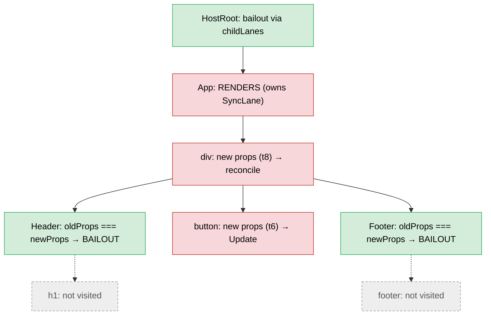

# Walkthrough: setState to Pixels

> [!summary] TL;DR
> A click reaches React through the listener `createRoot` put on the container. `dispatchDiscreteEvent` sets the update priority to Discrete, so `setCount` gets **`SyncLane`**. The update is buffered, one microtask is queued, and when your handler returns the microtask renders and commits **synchronously, with no Scheduler task**. The render starts at the root, bails out down the `childLanes` trail to `App`, re-runs `App`, and then, without the compiler, re-runs `Header` and `Footer` too, because their element objects are new. The DOM diff happens at commit time (`commitUpdate` → `updateProperties`), and the only real write is the button's text. For a `SyncLane` commit, `useEffect` runs at the end of the commit, **before** paint. With the React Compiler, `Header` and `Footer` come out of `App`'s memo cache as the same element objects, so their subtrees are skipped. The DOM writes are identical.

This continues the app from [[20 Walkthrough - First Render End to End|First Render Walkthrough]]. The first render has committed, its passive effect has run, and the screen shows `0`.

## Starting state

```jsx
function App() {
  const [count, setCount] = useState(0);
  useLayoutEffect(() => { document.title = `count: ${count}`; }, [count]);
  useEffect(() => { console.log("committed", count); }, [count]);
  return (
    <div>
      <Header title="Counter" />
      <button onClick={() => setCount((c) => c + 1)}>{count}</button>
      <Footer />
    </div>
  );
}
```

```text
FiberRoot.current ─► HostRoot(B)          HostRoot(A) = alternate (the old WIP from mount)
                      └ App               alternate: null    lanes: 0
                         └ div            alternate: null
                            ├ Header ─ h1     (all alternate: null; only the HostRoot pair exists so far)
                            ├ button          stateNode: <button>, __reactProps$.onClick = arrow#1
                            └ Footer ─ footer
App.memoizedState: Hook{0, queue{pending: null, lastRenderedState: 0, dispatch: setCount}} → Hook{layout} → Hook{passive}
root.pendingLanes: 0
```

## The whole flow

```mermaid
sequenceDiagram
  autonumber
  participant U as user
  participant B as browser
  participant L as root listener (react-dom)
  participant H as your onClick
  participant RC as reconciler
  participant MT as microtask
  participant WL as work loop
  participant C as commit
  U->>B: click <button>
  B->>L: native click, capture then bubble on #root
  L->>L: dispatchDiscreteEvent: p = DiscreteEventPriority, T = null
  L->>L: dispatchEvent → getClosestInstanceFromNode → button fiber
  L->>L: SimpleEventPlugin: accumulateSinglePhaseListeners('onClick')
  L->>H: processDispatchQueue → listener(syntheticEvent)
  H->>RC: setCount(c => c + 1) = dispatchSetState
  RC->>RC: requestUpdateLane → SyncLane, eager state: 1 ≠ 0
  RC->>RC: enqueueConcurrentHookUpdate (buffered), App.lanes = SyncLane
  RC->>MT: scheduleUpdateOnFiber → ensureRootIsScheduled → queueMicrotask
  L->>L: restore priority; listener returns
  MT->>RC: processRootScheduleInMicrotask: SyncLane → no Scheduler task
  RC->>WL: flushSyncWorkAcrossRoots → performSyncWorkOnRoot → renderRootSync
  WL->>WL: prepareFreshStack: link update, HostRoot.childLanes = SyncLane
  WL->>WL: HostRoot bails out → App renders (updateReducerImpl: 1)
  WL->>WL: div, Header, h1, button, Footer, footer (no compiler: all re-render)
  WL->>WL: completeWork: markUpdate on changed props (no diff yet)
  WL->>C: completeRoot → commitRoot
  C->>B: mutation: commitUpdate → updateProperties → button text "1"
  C->>C: root.current = finishedWork, layout: document.title
  C->>C: flushSpawnedWork: SyncLane → flushPendingEffects → useEffect NOW
  B->>U: microtask ends, task ends → paint "1"
```

## Call stack at a glance

```text
── browser task: native 'click' event ────────────────────────────────────
(root capture listener)  dispatchDiscreteEvent → dispatchEvent → … no onClickCapture handlers
(root bubble listener)   dispatchDiscreteEvent(click, flags, container, nativeEvent)
  setCurrentUpdatePriority(DiscreteEventPriority)            // ReactDOMSharedInternals.p = SyncLane
  dispatchEvent
    findInstanceBlockingEvent → getClosestInstanceFromNode(target)   → button fiber
    dispatchEventForPluginEventSystem → batchedUpdates
      dispatchEventsForPlugins
        extractEvents → SimpleEventPlugin.extractEvents
          accumulateSinglePhaseListeners(buttonFiber, 'onClick') → [{button, arrow}]
        processDispatchQueue → processDispatchQueueItemsInOrder → executeDispatch
          onClick()                                          // your arrow
            setCount(c => c + 1)  = dispatchSetState(AppFiber, queue, action)
              requestUpdateLane → resolveUpdatePriority      → SyncLane
              dispatchSetStateInternal
                eager: basicStateReducer(0, action) = 1;  !Object.is(1, 0)
                enqueueConcurrentHookUpdate                  // concurrentQueues, App.lanes |= SyncLane
                scheduleUpdateOnFiber → markRootUpdated → ensureRootIsScheduled
                  ensureScheduleIsScheduled → scheduleImmediateRootScheduleTask → queueMicrotask
  setCurrentUpdatePriority(previous)
── microtask checkpoint (listener returned) ──────────────────────────────
processRootScheduleInMicrotask
  scheduleTaskForRootDuringMicrotask                         → SyncLane, callbackNode = null
  flushSyncWorkAcrossRoots_impl → performSyncWorkOnRoot
    flushPendingEffects                                      // nothing left from the mount
    performWorkOnRoot(root, SyncLane, forceSync=true) → renderRootSync
      prepareFreshStack → createWorkInProgress(root.current) // reuses HostRoot(A)
                          finishQueueingConcurrentUpdates → markUpdateLaneFromFiberToRoot
      workLoopSync → performUnitOfWork
        beginWork(HostRoot) → attemptEarlyBailoutIfNoScheduledUpdate → bailoutOnAlreadyFinishedWork → cloneChildFibers
        beginWork(App)      → updateFunctionComponent → renderWithHooks(HooksDispatcherOnUpdate)
                               updateState → updateReducer → updateReducerImpl → markWorkInProgressReceivedUpdate
                               updateLayoutEffect / updateEffect → updateEffectImpl (deps changed)
                               reconcileChildFibers → reconcileSingleElement → useFiber(div)
        beginWork(div)      → updateHostComponent → reconcileChildrenArray → updateSlot → updateElement → useFiber ×3
        beginWork(Header)   → props !== → renderWithHooks → Header()      // without compiler
        beginWork(h1), beginWork(button), beginWork(Footer), beginWork(footer)
        completeWork(…)     → updateHostComponent (complete): oldProps !== newProps → markUpdate
      finishConcurrentRender → completeRootWhenReady → completeRoot → commitRoot
        flushMutationEffects → commitMutationEffectsOnFiber
          HostComponent + Update → commitHostUpdate → commitUpdate → updateProperties → setProp
                                                                     → setTextContent(button, "1")
          root.current = finishedWork
        flushLayoutEffects → commitHookLayoutEffects                // document.title = "count: 1"
        flushSpawnedWork → requestPaint(); includesSyncLane → flushPendingEffects
          flushPassiveEffects → flushPassiveEffectsImpl → commitPassiveMountEffects   // console.log
── task ends → style / layout / paint ─────────────────────────────────────
```

## The steps

### 1. The click reaches the root container

The user clicks the `<button>`. The browser dispatches a native `click` that travels capture → target → bubble. React has no listener on the button. In [[20 Walkthrough - First Render End to End|step 2 of the first render]], `listenToAllSupportedEvents` put a capture listener and a bubble listener for `click` on `#root`.[^listen] The capture listener fires first, on the way down. It collects `onClickCapture` handlers, finds none, and dispatches nothing. The bubble listener fires on the way back up.

→ deep dive: [[13 The Event System|Event System]]

### 2. `dispatchDiscreteEvent`: the priority is set *around* your handler

Each listener was created by `createEventListenerWrapperWithPriority`, which picked `dispatchDiscreteEvent` because `getEventPriority('click')` is `DiscreteEventPriority`.[^ctewp][^gep] `dispatchDiscreteEvent` saves and nulls `ReactSharedInternals.T` (a click is never a transition), calls `setCurrentUpdatePriority(DiscreteEventPriority)`, calls `dispatchEvent`, and restores both values in `finally`.[^dde] This is a dynamic scope: anything that calls `setState` while it is active sees Discrete priority.

### 3. `dispatchEvent`: DOM node → fiber

`dispatchEvent` calls `findInstanceBlockingEvent`, which takes the event target and calls `getClosestInstanceFromNode`.[^de][^fibe] That reads the `__reactFiber$<random>` expando that `precacheFiberNode` wrote in `createInstance` and returns the `button` fiber.[^gcifn] There's no dehydrated boundary in the way, so nothing blocks the event, and `dispatchEventForPluginEventSystem` runs `dispatchEventsForPlugins` inside `batchedUpdates`.[^defpes][^defp]

### 4. `SimpleEventPlugin` collects `onClick`

`SimpleEventPlugin.extractEvents` maps `click` → `onClick`, picks `SyntheticMouseEvent`, and calls `accumulateSinglePhaseListeners(buttonFiber, 'onClick', …)`.[^seee][^aspl] That walks `fiber.return` up to the root. For each **host** fiber it calls `getListener`, which reads the prop from the DOM node's `__reactProps$` (the latest *committed* props), not from `fiber.memoizedProps`.[^getlistener]

```text
button (HostComponent)  onClick: arrow#1   ✔ collected
div    (HostComponent)  no onClick
App, HostRoot           not host fibers: skipped
dispatchQueue = [{ event: SyntheticMouseEvent('onClick'), listeners: [{button, arrow#1}] }]
```

### 5. Your handler runs

`processDispatchQueue` → `processDispatchQueueItemsInOrder` iterates the listeners target → root, and `executeDispatch` sets `event.currentTarget` and calls `arrow#1(event)`.[^pdq][^pdqio][^ed] Your code runs: `setCount(c => c + 1)`.

### 6. `dispatchSetState` → `requestUpdateLane` = `SyncLane`

`setCount` is `dispatchSetState.bind(null, AppFiber, queue)` from `mountState`.[^mountstate] `dispatchSetState` asks `requestUpdateLane(fiber)`.[^dss][^requestlane] We aren't rendering and `T` is `null`, so the answer is `eventPriorityToLane(resolveUpdatePriority())`. `ReactDOMSharedInternals.p` is `DiscreteEventPriority`, which **is** `SyncLane`.[^resolveprio][^eventprio]

→ deep dive: [[12 setState - dispatchSetState and Batching|setState]], [[04 Lanes and the Scheduler|Lanes & Scheduler]]

### 7. The eager-state attempt

`dispatchSetStateInternal` builds `{lane: SyncLane, action: c => c + 1, hasEagerState: false, eagerState: null, next: null}`.[^dssi] Then it checks whether it can compute the next state *now*:

```js
if (fiber.lanes === NoLanes && (alternate === null || alternate.lanes === NoLanes)) {
  const eagerState = queue.lastRenderedReducer(queue.lastRenderedState, action); // basicStateReducer(0, c => c + 1) = 1
  update.hasEagerState = true;
  update.eagerState = eagerState;
  if (is(eagerState, currentState)) { /* enqueue with NoLane, return: no render at all */ }
}
```

On this first click the App fiber has no pending lanes and no alternate, so the reducer runs. It returns `1`, which differs from `0`, so there's no bailout. The work isn't wasted, though. `hasEagerState` lets the render reuse `1` without calling your updater again (step 14).

The precondition matters. The eager result is only valid if no other update is queued ahead of this one. That has two consequences:

- **A second `setState` in the same handler never eager-bails.** Once one call has queued an update with a lane, `fiber.lanes !== NoLanes` and every later call goes straight to the queue. With `setCount(c => c + 1); setCount(c => c - 1)` the net result is `0`, but React can only find that out by rendering `App`. `updateReducerImpl` then sees `Object.is(0, 0)`, and `updateFunctionComponent` takes the late bailout (`bailoutHooks`).
- **On the next click it usually can't run at all.** After this update commits, the *other* twin of the App fiber still has `lanes = SyncLane`. `beginWork` clears `lanes` on the WIP only, and nothing on the commit path clears the old one. Only a late bailout (`bailoutHooks` does `current.lanes = removeLanes(...)`) cleans it.[^bailouthooks] So "same value ⇒ no render" is a best-effort fast path, never a guarantee.

→ deep dive: [[12 setState - dispatchSetState and Batching|setState]], [[11 Hooks on Update|Hooks on Update]]

### 8. Buffered in `concurrentQueues`

`enqueueConcurrentHookUpdate` pushes `(AppFiber, queue, update, SyncLane)` onto the module-level `concurrentQueues` array and sets `App.lanes |= SyncLane` (and on the alternate, if there were one).[^ecthu][^concurrent-enqueue] It does **not** touch `queue.pending` or the ancestors' `childLanes`. That happens in step 12, in `finishQueueingConcurrentUpdates`, so that a render already in progress never sees half an event's updates. It returns the FiberRoot by walking `.return`.[^getroot]

### 9. `scheduleUpdateOnFiber` → one microtask; the handler returns

`scheduleUpdateOnFiber` → `markRootUpdated` sets `root.pendingLanes = SyncLane`, then `ensureRootIsScheduled` adds the root to the schedule and `ensureScheduleIsScheduled` queues a microtask, unless one is already queued.[^suof][^markrootupdated][^ensureroot][^ensureschedule][^sirst] `setCount` returns. Your handler returns. `dispatchDiscreteEvent` restores the old priority. **Nothing has rendered yet, and `count` in your closure is still `0`.**

> [!tip] Automatic batching, concretely
> `onClick={() => { setCount(c => c + 1); setCount(c => c + 1); }}` runs steps 6–9 twice. The second call skips the eager path (step 7), adds a second `(fiber, queue, update, lane)` tuple, and finds `didScheduleMicrotask === true`, so it queues nothing new. Step 15 then replays both updates in one render: `0 → 1 → 2`. One render, one commit, one paint. That holds in a `setTimeout` or a promise callback too, because batching lives in the root scheduler, not in the event system.

### 10. Microtask: `SyncLane` means no Scheduler task

When the listener's call stack empties, the microtask runs `processRootScheduleInMicrotask`.[^prsim] `scheduleTaskForRootDuringMicrotask` finds `SyncLane` in `getNextLanes`. Instead of booking a Scheduler task it cancels any existing one, sets `root.callbackPriority = SyncLane, callbackNode = null`, and returns. The source comment reads "Synchronous work is always flushed at the end of the microtask".[^stfrdm] Then `processRootScheduleInMicrotask` calls `flushSyncWorkAcrossRoots_impl`, which calls `performSyncWorkOnRoot` for every root with sync lanes.[^fswar]

Compare the first render: there, the microtask booked a `NormalPriority` Scheduler task and the render ran in a later macrotask. Here everything that follows happens *inside this microtask*, before the browser can render a frame.

### 11. `performSyncWorkOnRoot` → `renderRootSync`

`performSyncWorkOnRoot` first calls `flushPendingEffects()`. Leftover passive effects from the previous commit must run before a new render. They already ran in the first render's step 22, so there's nothing to do. Then it calls `performWorkOnRoot(root, SyncLane, forceSync = true)`.[^pswor] `forceSync` alone makes `shouldTimeSlice` false, and `SyncLane` is blocking anyway, so we get `renderRootSync`.[^timeslice][^rrs]

→ deep dive: [[06 The Work Loop - Render Phase|Work Loop]]

### 12. `prepareFreshStack`: the update is linked and `childLanes` set

`prepareFreshStack` calls `createWorkInProgress(root.current, null)`. This time HostRoot(B) *has* an alternate, so HostRoot(A) is **reused** and reset, not allocated.[^pfs][^cwip] Then `finishQueueingConcurrentUpdates` drains the buffer. It appends the update into `queue.pending` as a circular list, and `markUpdateLaneFromFiberToRoot` walks from App up and ORs `SyncLane` into every ancestor's `childLanes`, on both twins.[^fqcu][^mulftr]

```text
root.pendingLanes      = SyncLane
HostRoot.lanes         = 0          HostRoot.childLanes = SyncLane
App.lanes              = SyncLane   App.childLanes      = 0
App hook[0].queue.pending ─► {lane: SyncLane, action: c => c + 1, hasEagerState: true, eagerState: 1} ⟲
```

### 13. `beginWork(HostRoot)`: bail out, follow `childLanes`

HostRoot's `memoizedProps === pendingProps` (both `null`), and `checkScheduledUpdateOrContext` finds no `SyncLane` in its own `lanes`. So `beginWork` takes `attemptEarlyBailoutIfNoScheduledUpdate`, which pushes the root contexts and calls `bailoutOnAlreadyFinishedWork`.[^beginwork][^csuoc][^aeb] `childLanes` intersects the render lanes, so instead of returning `null` it calls `cloneChildFibers`, which makes a WIP for App with `createWorkInProgress(currentApp, currentApp.pendingProps)`, i.e. the **old props object**.[^bofw][^clone] App has no alternate yet, so this allocates App's second fiber.

→ deep dive: [[07 beginWork and Reconciliation|beginWork & Reconciliation]]

### 14. `beginWork(App)`: same props, but it has a lane, so it renders

App's `oldProps === newProps` holds (step 13 passed the old object). This time `checkScheduledUpdateOrContext` **does** find `SyncLane` in `current.lanes`, so `beginWork` sets `didReceiveUpdate = false` and falls through to `updateFunctionComponent`.[^beginwork][^ufc] `renderWithHooks` sees `current.memoizedState !== null` and installs **`HooksDispatcherOnUpdate`**. It nulls the WIP's `memoizedState` and `updateQueue`, and calls `App()`.[^rwh][^dupdate]

### 15. `updateReducerImpl` produces `1`, and `didReceiveUpdate` flips

`useState` → `updateState` → `updateReducer` → `updateReducerImpl`.[^updatestate][^updatereducer][^uri] First `updateWorkInProgressHook` clones hook #0 from the current fiber. The queue object is shared, not copied.[^uwih] Then:

1. `queue.pending` is moved into `baseQueue` (and onto `current.baseQueue`, so a discarded render can't lose it). `pending = null`.
2. The single update's lane is in the render lanes, so it's applied. `hasEagerState` is `true`, so `newState = eagerState = 1`. Your updater isn't called again.
3. `!is(1, 0)` → **`markWorkInProgressReceivedUpdate()`** sets `didReceiveUpdate = true`.[^changecheck][^mwiru]
4. `hook.memoizedState = 1`, `queue.lastRenderedState = 1`.

`useState` returns `[1, setCount]`. The same `setCount`, because `queue.dispatch` never changes.

→ deep dive: [[11 Hooks on Update|Hooks on Update]]

### 16. Effects: deps changed, so both get `HasEffect`

`useLayoutEffect` and `useEffect` go through `updateEffectImpl`. `areHookInputsEqual([1], [0])` is false, so each pushes an effect tagged `HookHasEffect | …` and sets the fiber flag (`Update` for layout, `Passive` for passive).[^uee] Both effects are pushed onto the fresh `updateQueue` ring either way. Unchanged ones would just lack `HasEffect`.

### 17. App's output is reconciled: a new `<div>`, fiber reused

`App()` returns a brand-new tree of element objects. `didReceiveUpdate` is `true`, so there's no late bailout. `reconcileChildren` → `reconcileChildFibers` (tracking on, since App has a current) → `reconcileSingleElement`: same key (`null`), same type (`'div'`), so it calls `useFiber(currentDiv, element.props)`.[^reconcilechildren][^rse][^usefiber] The WIP div's `pendingProps` is the **new** props object.

### 18. `beginWork(div)`: three children, three new props objects

`div`'s `oldProps !== newProps`, so `didReceiveUpdate = true` and `updateHostComponent` runs. Its children are an array, so `reconcileChildrenArray` runs. In the first pass, `updateSlot` matches each position by key, and `updateElement` → `useFiber` reuses the `Header`, `button` and `Footer` fibers with the new elements' props.[^uhc-begin][^rca][^updateelement] No `Placement` (same order) and no `ChildDeletion`.

```text
Header  memoizedProps {title:"Counter"}  ≠  pendingProps {title:"Counter"}   ← different objects
button  {onClick: arrow#1, children: 0} ≠  {onClick: arrow#2, children: 1}
Footer  {}                              ≠  {}
```

### 19. Without memoization the cascade continues: `Header` and `Footer` re-render

`beginWork(Header)`: `oldProps !== newProps` (identity, not equality), so `didReceiveUpdate = true` and `Header` runs. Header has no hooks, so `current.memoizedState === null` and `renderWithHooks` actually picks the *mount* dispatcher. That's harmless.[^rwh] It returns a new `<h1>` element, and `h1` gets a new props object `{children: "Counter"}`. The same happens to `Footer` → `footer`. `button` is a host fiber whose child is the number `1`: `shouldSetTextContent` is true, so there's no child fiber, and `updateHostComponent` returns `null`.[^sstc]

This is the default React behaviour: **a re-render re-renders the whole subtree below the component that updated**. The `childLanes` bailout only spared the *ancestors* (step 13). `React.memo` on `Header`/`Footer` would stop the cascade with a `shallowEqual`, and the compiler stops it with identity (below).

### 20. `completeWork`: mark, don't diff

On the way back up, `completeWork` for each `HostComponent` with a `current` and a `stateNode` calls the complete-phase `updateHostComponent`. It is just `if (oldProps === newProps) return; markUpdate(workInProgress)`.[^uhc-complete][^markupdate] React 19 has **no update payload**. There's no `prepareUpdate` and no `diffProperties` in the render phase. The diff is deferred to the commit. So `h1`, `button`, `footer` and `div` all get `Update`, even though only one of them will change. `bubbleProperties` ORs it all up.[^bubble]

```text
App     flags: Update | Passive   (effects with HasEffect)
div     flags: Update             (children array is a new object)
h1      flags: Update             (new {children:"Counter"})
button  flags: Update             (children 0 → 1, onClick arrow#1 → arrow#2)
footer  flags: Update
HostRoot.subtreeFlags ⊇ Update | Passive
```

→ deep dive: [[08 completeWork - Building DOM Nodes|completeWork]]

### 21. Commit, mutation: `commitUpdate` → `updateProperties`

`finishConcurrentRender` → `completeRootWhenReady` → `completeRoot` → `commitRoot`.[^fcr][^crwr][^completeroot][^commitroot] `markRootFinished` clears `SyncLane`, and the Normal-priority passive callback is posted as before.[^passive-sched] In `flushMutationEffects`, `commitMutationEffectsOnFiber` descends where `subtreeFlags & MutationMask`.[^fme][^cmeof] For each `HostComponent` with `Update` it calls `commitHostUpdate` → DOM `commitUpdate`, which runs `updateProperties(dom, type, oldProps, newProps)` and then `updateFiberProps(dom, newProps)`.[^hc-mut][^chu][^commitupdate]

`updateProperties` is the real diff: two loops over `lastProps`/`nextProps`, calling `setProp` only where `nextProp !== lastProp`.[^updateprops][^updateprops-loops]

| Fiber | Props that differ by `!==` | DOM effect |
|---|---|---|
| `div` | `children` (new array) | `setProp('children', array)` returns early: nothing written |
| `h1` | none (`"Counter" === "Counter"`) | nothing |
| `button` | `children: 0 → 1`, `onClick: arrow#1 → arrow#2` | `setTextContent(button, "1")` updates the existing text node's `nodeValue`.[^settext] `onClick` reassigns the Safari no-op `onclick`.[^setprop-onclick] |
| `footer` | none | nothing |

`updateFiberProps` then points `__reactProps$` at the new props, so the *next* click calls `arrow#2`.[^ufp] App's `Update` flag also runs layout-effect *cleanups* here. Your layout effect returned nothing, so there's nothing to call.[^cmeof]

> [!note] Why there is no `commitTextUpdate` here
> `commitTextUpdate` (`textInstance.nodeValue = newText`) is for `HostText` fibers.[^committextupdate] `<button>{count}</button>` has a sole numeric child, so it never got a text fiber, and the text travels as the `children` prop. Write `<button>Clicked {count}</button>` and you'd get two `HostText` fibers. The `"Clicked "` one would bail at `completeWork` (`oldText === newText`), and the count one would go through `commitHostTextUpdate` → `commitTextUpdate`.[^chtu][^uht]

### 22. The swap

`root.current = finishedWork` (line 4051).[^swap] HostRoot(A) is current again. B becomes the buffer for the next render. Every fiber that was cloned in this render now has an alternate.

### 23. Layout effects

`flushLayoutEffects` → `commitLayoutEffectOnFiber` → App has `Update` → `commitHookLayoutEffects` runs `document.title = "count: 1"`.[^fle][^cleof][^chle] The DOM already shows `1`, but nothing has painted.

### 24. `flushSpawnedWork`: passive effects run *now*, before paint

`flushSpawnedWork` calls `requestPaint()` and marks the passive phase as pending. Then:[^fsw][^syncflush]

```js
if (includesSyncLane(pendingEffectsLanes) && (disableLegacyMode || root.tag !== LegacyRoot)) {
  flushPendingEffects();
}
```

The committed lanes include `SyncLane`, so `flushPendingEffects` → `flushPassiveEffects` → `flushPassiveEffectsImpl` runs all passive cleanups (none here, since the effect returned nothing), then mounts. **`console.log("committed", 1)` runs before the browser paints.**[^fpe][^fpei] The source comment gives the reason: the result of a discrete event should be "immediately observable". Later, `flushSyncWorkOnAllRoots()` would render any sync `setState` your effects made, still in this microtask.[^fsw] The Normal-priority callback that `commitRoot` posted runs in a later task, finds no pending passive phase, and does nothing.[^fpe]

### 25. Pixels

The microtask finishes, the event task ends, and the browser runs style, layout and paint. The user sees `1`. Everything from the click to the console log ran in one uninterrupted task.

## With the React Compiler

Here is the compiled `App` again, verbatim from `babel-plugin-react-compiler@1.0.0` (full output, including `Header` and `Footer`, in [[20 Walkthrough - First Render End to End|First Render Walkthrough]]). The comments are mine:

```js
function App() {
  const $ = _c(13);
  const [count, setCount] = useState(0);
  let t0;
  let t1;
  if ($[0] !== count) {                      // 1 !== 0 → recompute
    t0 = () => { document.title = `count: ${count}`; };
    t1 = [count];
    $[0] = count; $[1] = t0; $[2] = t1;
  } else {
    t0 = $[1]; t1 = $[2];
  }
  useLayoutEffect(t0, t1);
  let t2;
  let t3;
  if ($[3] !== count) {                      // recompute
    t2 = () => { console.log("committed", count); };
    t3 = [count];
    $[3] = count; $[4] = t2; $[5] = t3;
  } else {
    t2 = $[4]; t3 = $[5];
  }
  useEffect(t2, t3);
  let t4;
  let t5;
  if ($[6] === Symbol.for("react.memo_cache_sentinel")) {   // false now → cache hit
    t4 = <Header title="Counter" />;
    t5 = () => setCount(_temp);
    $[6] = t4; $[7] = t5;
  } else {
    t4 = $[6]; t5 = $[7];                     // SAME element object, SAME handler as the mount
  }
  let t6;
  if ($[8] !== count) {                       // recompute: new <button> element
    t6 = <button onClick={t5}>{count}</button>;
    $[8] = count; $[9] = t6;
  } else {
    t6 = $[9];
  }
  let t7;
  if ($[10] === Symbol.for("react.memo_cache_sentinel")) {  // cache hit
    t7 = <Footer />;
    $[10] = t7;
  } else {
    t7 = $[10];                               // SAME element object
  }
  let t8;
  if ($[11] !== t6) {                          // t6 changed → new <div>
    t8 = <div>{t4}{t6}{t7}</div>;
    $[11] = t6; $[12] = t8;
  } else {
    t8 = $[12];
  }
  return t8;
}
function _temp(c) { return c + 1; }
```

Re-walking the 25 steps:

- **Steps 1–5: unchanged**, except handler identity. The `onClick` stored in `__reactProps$` is the cached `t5`, created once on mount. It is the same function on every render.
- **Steps 6–13: unchanged.** `setCount(_temp)` is the same `dispatchSetState`, the same `SyncLane`, the same eager computation (`_temp(0) = 1`), the same buffer, microtask and `prepareFreshStack`, and the same HostRoot bailout. The compiler doesn't change *who is scheduled*.
- **Step 14: App still re-renders.** It owns the lane. The first call is `_c(13)` → `useMemoCache(13)`. `renderWithHooks` nulled the WIP's `updateQueue`, so `useMemoCache` reads the cache from `alternate.updateQueue.memoCache` and makes a **copy-on-write clone**, `data.map(array => array.slice())`, because `enableNoCloningMemoCache` is `false`. It attaches the clone to a fresh `updateQueue` on the WIP.[^umc][^nocloning] Writes in this render go to the clone. If the render were thrown away, the committed cache would still match the screen.
- **Steps 15–16: unchanged.** Same `updateReducerImpl` result, same `didReceiveUpdate`. The effect scopes recompute on `count`, so both effects still get `HasEffect`. The compiler only avoids *spurious* effect re-runs, and this one is real.
- **Step 17: different element identities.** `t4` (`<Header title="Counter"/>`) and `t7` (`<Footer/>`) come from `$[6]` and `$[10]`. They are the very objects returned on mount. `t6` and `t8` are new. The div fiber is reused exactly as before.
- **Step 18: the key difference.** `reconcileChildrenArray` → `updateElement` → `useFiber(currentHeader, t4.props)`. `t4.props` is the object that became `Header.memoizedProps` on mount, so the WIP Header gets `pendingProps === current.memoizedProps`. Same for Footer.[^updateelement][^usefiber]
- **Step 19: bailout instead of cascade.** `beginWork(Header)`: `oldProps === newProps`, `checkScheduledUpdateOrContext` false, so `attemptEarlyBailoutIfNoScheduledUpdate` → `bailoutOnAlreadyFinishedWork`. `Header.childLanes` is `0`, so it **returns `null`**.[^beginwork][^aeb][^bofw] `Header()` never runs, and the `h1` fiber isn't even cloned: the WIP Header's `child` still points at the current `h1`. Footer gets the identical treatment. `button` is processed as before, because `t6` is new.
- **Step 20: fewer `Update` flags.** `completeWork(Header)` hits the `didBailout` branch of `bubbleProperties` (child is still the current child) and bubbles only static flags.[^bubble] `h1` and `footer` aren't visited, so they get no `Update`. `div` (new `t8` props) and `button` (new `t6` props) are flagged as before.
- **Step 21: same DOM write, less diffing.** `updateProperties` runs on `div` (no-op) and `button`. On the button, `children: 0 → 1` → `setTextContent` → `nodeValue = "1"`. `onClick` is now **identical** (`t5`), so the loop skips it. The `h1` and `footer` no-op diffs don't happen at all.
- **Steps 22–25: unchanged.** Same swap, same layout effect, same synchronous passive flush, same paint.



> [!warning] Common misreadings
> - "With the compiler, App doesn't re-render." It does. The state owner always runs. The cache only decides which of its *outputs* are new objects.
> - "The compiler reduces DOM writes." Not here. `updateProperties` was already skipping the unchanged props, so the only write, the button's text, is the same in both modes. The savings are component calls, fibers visited, and commit-time prop loops.
> - "Header is skipped because it is memoized." There's no `React.memo` and no `shallowEqual` anywhere. Header is skipped by the plain `oldProps === newProps` check, the cheapest bailout React has, which the cached element makes true.

### Step by step comparison

| Step | Without compiler | With compiler |
|---|---|---|
| 1–5. Click → root listener → `onClick` | Handler is a fresh arrow each render | Handler is cached `t5`, created once |
| 6–9. `dispatchSetState`, `SyncLane`, eager state, buffer, microtask | As described | Same |
| 10–12. Microtask → `performSyncWorkOnRoot` → `prepareFreshStack` | No Scheduler task. `childLanes` set | Same |
| 13. HostRoot | Bailout, clone to App | Same |
| 14. App | Renders (has lane) | Renders. `_c(13)` clones the cache copy-on-write |
| 15–16. State and effects | `1`, both effects `HasEffect` | Same |
| 17. App's output | 4 new element objects (`div`, `Header`, `button`, `Footer`) and a new handler | 2 new elements (`div`, `button`). `Header`, `Footer` and the handler come from `$` |
| 18. div reconciles 3 children | 3 new props objects | `Header`/`Footer` props identical to `memoizedProps` |
| 19. Header / Footer | Re-render, plus `h1`/`footer` visited | `oldProps === newProps`, no lanes → bailout, subtrees skipped |
| 20. `completeWork` `Update` flags | `div`, `h1`, `button`, `footer` | `div`, `button` |
| 21. Mutation | 4 `updateProperties` loops, `onClick` reassigned, text node `nodeValue = "1"` | 2 loops, text node `nodeValue = "1"` |
| 22. Swap | `root.current = finishedWork` | Same |
| 23. Layout effect | `document.title = "count: 1"` | Same |
| 24. Passive effect | Sync flush before paint | Same |
| 25. Paint | `1` | Same pixels |

Counted over the whole update: **component functions called** 3 → 1, **`beginWork` calls** 8 → 6, **host fibers diffed at commit** 4 → 2, **DOM writes that change pixels** 1 → 1. In this tiny app that's noise. Under a real `Header` with a hundred descendants, it's the difference between re-rendering a hundred fibers and touching one. See [[15 Rendering With vs Without the Compiler|With vs Without Compiler]] for the same effect on a larger tree, and [[14 React Compiler - How It Works|React Compiler]] for how the scopes are derived.

---
← [[20 Walkthrough - First Render End to End|Prev]] · [[00 React Internals Index|Index]] · [[00 React Internals Index|Next]] →

[^listen]: `listenToAllSupportedEvents` — [packages/react-dom-bindings/src/events/DOMPluginEventSystem.js#L432-L459](https://github.com/facebook/react/blob/v19.3.1/packages/react-dom-bindings/src/events/DOMPluginEventSystem.js#L432-L459)
[^ctewp]: `createEventListenerWrapperWithPriority` — [packages/react-dom-bindings/src/events/ReactDOMEventListener.js#L94-L119](https://github.com/facebook/react/blob/v19.3.1/packages/react-dom-bindings/src/events/ReactDOMEventListener.js#L94-L119)
[^gep]: `getEventPriority` — [packages/react-dom-bindings/src/events/ReactDOMEventListener.js#L312-L416](https://github.com/facebook/react/blob/v19.3.1/packages/react-dom-bindings/src/events/ReactDOMEventListener.js#L312-L416)
[^dde]: `dispatchDiscreteEvent` — [packages/react-dom-bindings/src/events/ReactDOMEventListener.js#L121-L137](https://github.com/facebook/react/blob/v19.3.1/packages/react-dom-bindings/src/events/ReactDOMEventListener.js#L121-L137)
[^de]: `dispatchEvent` — [packages/react-dom-bindings/src/events/ReactDOMEventListener.js#L157-L235](https://github.com/facebook/react/blob/v19.3.1/packages/react-dom-bindings/src/events/ReactDOMEventListener.js#L157-L235)
[^fibe]: `findInstanceBlockingEvent` — [packages/react-dom-bindings/src/events/ReactDOMEventListener.js#L237-L242](https://github.com/facebook/react/blob/v19.3.1/packages/react-dom-bindings/src/events/ReactDOMEventListener.js#L237-L242)
[^gcifn]: `getClosestInstanceFromNode` — [packages/react-dom-bindings/src/client/ReactDOMComponentTree.js#L136-L223](https://github.com/facebook/react/blob/v19.3.1/packages/react-dom-bindings/src/client/ReactDOMComponentTree.js#L136-L223)
[^defpes]: `dispatchEventForPluginEventSystem` — [packages/react-dom-bindings/src/events/DOMPluginEventSystem.js#L589-L703](https://github.com/facebook/react/blob/v19.3.1/packages/react-dom-bindings/src/events/DOMPluginEventSystem.js#L589-L703)
[^defp]: `dispatchEventsForPlugins` — [packages/react-dom-bindings/src/events/DOMPluginEventSystem.js#L325-L344](https://github.com/facebook/react/blob/v19.3.1/packages/react-dom-bindings/src/events/DOMPluginEventSystem.js#L325-L344)
[^seee]: `SimpleEventPlugin.extractEvents` — [packages/react-dom-bindings/src/events/plugins/SimpleEventPlugin.js#L57-L235](https://github.com/facebook/react/blob/v19.3.1/packages/react-dom-bindings/src/events/plugins/SimpleEventPlugin.js#L57-L235)
[^aspl]: `accumulateSinglePhaseListeners` — [packages/react-dom-bindings/src/events/DOMPluginEventSystem.js#L717-L829](https://github.com/facebook/react/blob/v19.3.1/packages/react-dom-bindings/src/events/DOMPluginEventSystem.js#L717-L829)
[^getlistener]: `getListener` — [packages/react-dom-bindings/src/events/getListener.js#L51-L78](https://github.com/facebook/react/blob/v19.3.1/packages/react-dom-bindings/src/events/getListener.js#L51-L78)
[^pdq]: `processDispatchQueue` — [packages/react-dom-bindings/src/events/DOMPluginEventSystem.js#L313-L323](https://github.com/facebook/react/blob/v19.3.1/packages/react-dom-bindings/src/events/DOMPluginEventSystem.js#L313-L323)
[^pdqio]: `processDispatchQueueItemsInOrder` — [packages/react-dom-bindings/src/events/DOMPluginEventSystem.js#L266-L311](https://github.com/facebook/react/blob/v19.3.1/packages/react-dom-bindings/src/events/DOMPluginEventSystem.js#L266-L311)
[^ed]: `executeDispatch` — [packages/react-dom-bindings/src/events/DOMPluginEventSystem.js#L252-L264](https://github.com/facebook/react/blob/v19.3.1/packages/react-dom-bindings/src/events/DOMPluginEventSystem.js#L252-L264)
[^mountstate]: `mountState` (binds `dispatchSetState`) — [packages/react-reconciler/src/ReactFiberHooks.js#L1948-L1960](https://github.com/facebook/react/blob/v19.3.1/packages/react-reconciler/src/ReactFiberHooks.js#L1948-L1960)
[^dss]: `dispatchSetState` — [packages/react-reconciler/src/ReactFiberHooks.js#L3626-L3654](https://github.com/facebook/react/blob/v19.3.1/packages/react-reconciler/src/ReactFiberHooks.js#L3626-L3654)
[^requestlane]: `requestUpdateLane` — [packages/react-reconciler/src/ReactFiberWorkLoop.js#L812-L868](https://github.com/facebook/react/blob/v19.3.1/packages/react-reconciler/src/ReactFiberWorkLoop.js#L812-L868)
[^resolveprio]: `resolveUpdatePriority` (DOM) — [packages/react-dom-bindings/src/client/ReactDOMUpdatePriority.js#L35-L45](https://github.com/facebook/react/blob/v19.3.1/packages/react-dom-bindings/src/client/ReactDOMUpdatePriority.js#L35-L45)
[^eventprio]: `DiscreteEventPriority = SyncLane` — [packages/react-reconciler/src/ReactEventPriorities.js#L24-L28](https://github.com/facebook/react/blob/v19.3.1/packages/react-reconciler/src/ReactEventPriorities.js#L24-L28)
[^dssi]: `dispatchSetStateInternal` (eager state) — [packages/react-reconciler/src/ReactFiberHooks.js#L3656-L3726](https://github.com/facebook/react/blob/v19.3.1/packages/react-reconciler/src/ReactFiberHooks.js#L3656-L3726)
[^bailouthooks]: `bailoutHooks` — [packages/react-reconciler/src/ReactFiberHooks.js#L908-L927](https://github.com/facebook/react/blob/v19.3.1/packages/react-reconciler/src/ReactFiberHooks.js#L908-L927)
[^ecthu]: `enqueueConcurrentHookUpdate` — [packages/react-reconciler/src/ReactFiberConcurrentUpdates.js#L115-L125](https://github.com/facebook/react/blob/v19.3.1/packages/react-reconciler/src/ReactFiberConcurrentUpdates.js#L115-L125)
[^concurrent-enqueue]: `enqueueUpdate` (concurrent buffer) — [packages/react-reconciler/src/ReactFiberConcurrentUpdates.js#L90-L113](https://github.com/facebook/react/blob/v19.3.1/packages/react-reconciler/src/ReactFiberConcurrentUpdates.js#L90-L113)
[^getroot]: `getRootForUpdatedFiber` — [packages/react-reconciler/src/ReactFiberConcurrentUpdates.js#L252-L276](https://github.com/facebook/react/blob/v19.3.1/packages/react-reconciler/src/ReactFiberConcurrentUpdates.js#L252-L276)
[^suof]: `scheduleUpdateOnFiber` — [packages/react-reconciler/src/ReactFiberWorkLoop.js#L987-L1113](https://github.com/facebook/react/blob/v19.3.1/packages/react-reconciler/src/ReactFiberWorkLoop.js#L987-L1113)
[^markrootupdated]: `markRootUpdated` — [packages/react-reconciler/src/ReactFiberLane.js#L825-L849](https://github.com/facebook/react/blob/v19.3.1/packages/react-reconciler/src/ReactFiberLane.js#L825-L849)
[^ensureroot]: `ensureRootIsScheduled` — [packages/react-reconciler/src/ReactFiberRootScheduler.js#L116-L152](https://github.com/facebook/react/blob/v19.3.1/packages/react-reconciler/src/ReactFiberRootScheduler.js#L116-L152)
[^ensureschedule]: `ensureScheduleIsScheduled` — [packages/react-reconciler/src/ReactFiberRootScheduler.js#L154-L169](https://github.com/facebook/react/blob/v19.3.1/packages/react-reconciler/src/ReactFiberRootScheduler.js#L154-L169)
[^sirst]: `scheduleImmediateRootScheduleTask` — [packages/react-reconciler/src/ReactFiberRootScheduler.js#L650-L696](https://github.com/facebook/react/blob/v19.3.1/packages/react-reconciler/src/ReactFiberRootScheduler.js#L650-L696)
[^prsim]: `processRootScheduleInMicrotask` — [packages/react-reconciler/src/ReactFiberRootScheduler.js#L259-L348](https://github.com/facebook/react/blob/v19.3.1/packages/react-reconciler/src/ReactFiberRootScheduler.js#L259-L348)
[^stfrdm]: `scheduleTaskForRootDuringMicrotask` (sync branch L442-L455) — [packages/react-reconciler/src/ReactFiberRootScheduler.js#L384-L509](https://github.com/facebook/react/blob/v19.3.1/packages/react-reconciler/src/ReactFiberRootScheduler.js#L384-L509)
[^fswar]: `flushSyncWorkAcrossRoots_impl` — [packages/react-reconciler/src/ReactFiberRootScheduler.js#L185-L247](https://github.com/facebook/react/blob/v19.3.1/packages/react-reconciler/src/ReactFiberRootScheduler.js#L185-L247)
[^pswor]: `performSyncWorkOnRoot` — [packages/react-reconciler/src/ReactFiberRootScheduler.js#L608-L622](https://github.com/facebook/react/blob/v19.3.1/packages/react-reconciler/src/ReactFiberRootScheduler.js#L608-L622)
[^timeslice]: `shouldTimeSlice` in `performWorkOnRoot` — [packages/react-reconciler/src/ReactFiberWorkLoop.js#L1165-L1181](https://github.com/facebook/react/blob/v19.3.1/packages/react-reconciler/src/ReactFiberWorkLoop.js#L1165-L1181)
[^rrs]: `renderRootSync` — [packages/react-reconciler/src/ReactFiberWorkLoop.js#L2623-L2768](https://github.com/facebook/react/blob/v19.3.1/packages/react-reconciler/src/ReactFiberWorkLoop.js#L2623-L2768)
[^pfs]: `prepareFreshStack` — [packages/react-reconciler/src/ReactFiberWorkLoop.js#L2023-L2293](https://github.com/facebook/react/blob/v19.3.1/packages/react-reconciler/src/ReactFiberWorkLoop.js#L2023-L2293)
[^cwip]: `createWorkInProgress` — [packages/react-reconciler/src/ReactFiber.js#L323-L437](https://github.com/facebook/react/blob/v19.3.1/packages/react-reconciler/src/ReactFiber.js#L323-L437)
[^fqcu]: `finishQueueingConcurrentUpdates` — [packages/react-reconciler/src/ReactFiberConcurrentUpdates.js#L50-L84](https://github.com/facebook/react/blob/v19.3.1/packages/react-reconciler/src/ReactFiberConcurrentUpdates.js#L50-L84)
[^mulftr]: `markUpdateLaneFromFiberToRoot` — [packages/react-reconciler/src/ReactFiberConcurrentUpdates.js#L189-L250](https://github.com/facebook/react/blob/v19.3.1/packages/react-reconciler/src/ReactFiberConcurrentUpdates.js#L189-L250)
[^beginwork]: `beginWork` (bailout gate L4250-L4320) — [packages/react-reconciler/src/ReactFiberBeginWork.js#L4226-L4512](https://github.com/facebook/react/blob/v19.3.1/packages/react-reconciler/src/ReactFiberBeginWork.js#L4226-L4512)
[^csuoc]: `checkScheduledUpdateOrContext` — [packages/react-reconciler/src/ReactFiberBeginWork.js#L3939-L3956](https://github.com/facebook/react/blob/v19.3.1/packages/react-reconciler/src/ReactFiberBeginWork.js#L3939-L3956)
[^aeb]: `attemptEarlyBailoutIfNoScheduledUpdate` — [packages/react-reconciler/src/ReactFiberBeginWork.js#L3958-L4224](https://github.com/facebook/react/blob/v19.3.1/packages/react-reconciler/src/ReactFiberBeginWork.js#L3958-L4224)
[^bofw]: `bailoutOnAlreadyFinishedWork` — [packages/react-reconciler/src/ReactFiberBeginWork.js#L3826-L3865](https://github.com/facebook/react/blob/v19.3.1/packages/react-reconciler/src/ReactFiberBeginWork.js#L3826-L3865)
[^clone]: `cloneChildFibers` — [packages/react-reconciler/src/ReactChildFiber.js#L2120-L2146](https://github.com/facebook/react/blob/v19.3.1/packages/react-reconciler/src/ReactChildFiber.js#L2120-L2146)
[^ufc]: `updateFunctionComponent` — [packages/react-reconciler/src/ReactFiberBeginWork.js#L1453-L1562](https://github.com/facebook/react/blob/v19.3.1/packages/react-reconciler/src/ReactFiberBeginWork.js#L1453-L1562)
[^rwh]: `renderWithHooks` (dispatcher choice at L562-L566) — [packages/react-reconciler/src/ReactFiberHooks.js#L505-L634](https://github.com/facebook/react/blob/v19.3.1/packages/react-reconciler/src/ReactFiberHooks.js#L505-L634)
[^dupdate]: `HooksDispatcherOnUpdate` — [packages/react-reconciler/src/ReactFiberHooks.js#L3954-L3980](https://github.com/facebook/react/blob/v19.3.1/packages/react-reconciler/src/ReactFiberHooks.js#L3954-L3980)
[^updatestate]: `updateState` — [packages/react-reconciler/src/ReactFiberHooks.js#L1962-L1966](https://github.com/facebook/react/blob/v19.3.1/packages/react-reconciler/src/ReactFiberHooks.js#L1962-L1966)
[^updatereducer]: `updateReducer` — [packages/react-reconciler/src/ReactFiberHooks.js#L1307-L1314](https://github.com/facebook/react/blob/v19.3.1/packages/react-reconciler/src/ReactFiberHooks.js#L1307-L1314)
[^uri]: `updateReducerImpl` — [packages/react-reconciler/src/ReactFiberHooks.js#L1316-L1589](https://github.com/facebook/react/blob/v19.3.1/packages/react-reconciler/src/ReactFiberHooks.js#L1316-L1589)
[^uwih]: `updateWorkInProgressHook` — [packages/react-reconciler/src/ReactFiberHooks.js#L1004-L1073](https://github.com/facebook/react/blob/v19.3.1/packages/react-reconciler/src/ReactFiberHooks.js#L1004-L1073)
[^changecheck]: `updateReducerImpl`: eager state reuse and the `!is(newState, hook.memoizedState)` check — [packages/react-reconciler/src/ReactFiberHooks.js#L1534-L1556](https://github.com/facebook/react/blob/v19.3.1/packages/react-reconciler/src/ReactFiberHooks.js#L1534-L1556)
[^mwiru]: `markWorkInProgressReceivedUpdate` — [packages/react-reconciler/src/ReactFiberBeginWork.js#L3800-L3802](https://github.com/facebook/react/blob/v19.3.1/packages/react-reconciler/src/ReactFiberBeginWork.js#L3800-L3802)
[^uee]: `updateEffectImpl` — [packages/react-reconciler/src/ReactFiberHooks.js#L2657-L2695](https://github.com/facebook/react/blob/v19.3.1/packages/react-reconciler/src/ReactFiberHooks.js#L2657-L2695)
[^reconcilechildren]: `reconcileChildren` — [packages/react-reconciler/src/ReactFiberBeginWork.js#L339-L370](https://github.com/facebook/react/blob/v19.3.1/packages/react-reconciler/src/ReactFiberBeginWork.js#L339-L370)
[^rse]: `reconcileSingleElement` — [packages/react-reconciler/src/ReactChildFiber.js#L1703-L1806](https://github.com/facebook/react/blob/v19.3.1/packages/react-reconciler/src/ReactChildFiber.js#L1703-L1806)
[^usefiber]: `useFiber` — [packages/react-reconciler/src/ReactChildFiber.js#L502-L509](https://github.com/facebook/react/blob/v19.3.1/packages/react-reconciler/src/ReactChildFiber.js#L502-L509)
[^uhc-begin]: `updateHostComponent` (begin phase) — [packages/react-reconciler/src/ReactFiberBeginWork.js#L1966-L2033](https://github.com/facebook/react/blob/v19.3.1/packages/react-reconciler/src/ReactFiberBeginWork.js#L1966-L2033)
[^rca]: `reconcileChildrenArray` — [packages/react-reconciler/src/ReactChildFiber.js#L1177-L1369](https://github.com/facebook/react/blob/v19.3.1/packages/react-reconciler/src/ReactChildFiber.js#L1177-L1369)
[^updateelement]: `updateElement` — [packages/react-reconciler/src/ReactChildFiber.js#L580-L636](https://github.com/facebook/react/blob/v19.3.1/packages/react-reconciler/src/ReactChildFiber.js#L580-L636)
[^sstc]: `shouldSetTextContent` — [packages/react-dom-bindings/src/client/ReactFiberConfigDOM.js#L744-L755](https://github.com/facebook/react/blob/v19.3.1/packages/react-dom-bindings/src/client/ReactFiberConfigDOM.js#L744-L755)
[^uhc-complete]: `updateHostComponent` (complete phase) — [packages/react-reconciler/src/ReactFiberCompleteWork.js#L463-L550](https://github.com/facebook/react/blob/v19.3.1/packages/react-reconciler/src/ReactFiberCompleteWork.js#L463-L550)
[^markupdate]: `markUpdate` — [packages/react-reconciler/src/ReactFiberCompleteWork.js#L201-L203](https://github.com/facebook/react/blob/v19.3.1/packages/react-reconciler/src/ReactFiberCompleteWork.js#L201-L203)
[^bubble]: `bubbleProperties` — [packages/react-reconciler/src/ReactFiberCompleteWork.js#L793-L914](https://github.com/facebook/react/blob/v19.3.1/packages/react-reconciler/src/ReactFiberCompleteWork.js#L793-L914)
[^fcr]: `finishConcurrentRender` — [packages/react-reconciler/src/ReactFiberWorkLoop.js#L1420-L1576](https://github.com/facebook/react/blob/v19.3.1/packages/react-reconciler/src/ReactFiberWorkLoop.js#L1420-L1576)
[^crwr]: `completeRootWhenReady` — [packages/react-reconciler/src/ReactFiberWorkLoop.js#L1578-L1701](https://github.com/facebook/react/blob/v19.3.1/packages/react-reconciler/src/ReactFiberWorkLoop.js#L1578-L1701)
[^completeroot]: `completeRoot` — [packages/react-reconciler/src/ReactFiberWorkLoop.js#L3511-L3723](https://github.com/facebook/react/blob/v19.3.1/packages/react-reconciler/src/ReactFiberWorkLoop.js#L3511-L3723)
[^commitroot]: `commitRoot` — [packages/react-reconciler/src/ReactFiberWorkLoop.js#L3725-L3922](https://github.com/facebook/react/blob/v19.3.1/packages/react-reconciler/src/ReactFiberWorkLoop.js#L3725-L3922)
[^passive-sched]: `commitRoot` posting the passive-effects callback — [packages/react-reconciler/src/ReactFiberWorkLoop.js#L3771-L3820](https://github.com/facebook/react/blob/v19.3.1/packages/react-reconciler/src/ReactFiberWorkLoop.js#L3771-L3820)
[^fme]: `flushMutationEffects` — [packages/react-reconciler/src/ReactFiberWorkLoop.js#L4009-L4053](https://github.com/facebook/react/blob/v19.3.1/packages/react-reconciler/src/ReactFiberWorkLoop.js#L4009-L4053)
[^cmeof]: `commitMutationEffectsOnFiber` — [packages/react-reconciler/src/ReactFiberCommitWork.js#L2072-L2843](https://github.com/facebook/react/blob/v19.3.1/packages/react-reconciler/src/ReactFiberCommitWork.js#L2072-L2843)
[^hc-mut]: `commitMutationEffectsOnFiber`, `HostComponent` case — [packages/react-reconciler/src/ReactFiberCommitWork.js#L2274-L2344](https://github.com/facebook/react/blob/v19.3.1/packages/react-reconciler/src/ReactFiberCommitWork.js#L2274-L2344)
[^chu]: `commitHostUpdate` — [packages/react-reconciler/src/ReactFiberCommitHostEffects.js#L114-L143](https://github.com/facebook/react/blob/v19.3.1/packages/react-reconciler/src/ReactFiberCommitHostEffects.js#L114-L143)
[^commitupdate]: `commitUpdate` (DOM) — [packages/react-dom-bindings/src/client/ReactFiberConfigDOM.js#L999-L1012](https://github.com/facebook/react/blob/v19.3.1/packages/react-dom-bindings/src/client/ReactFiberConfigDOM.js#L999-L1012)
[^updateprops]: `updateProperties` — [packages/react-dom-bindings/src/client/ReactDOMComponent.js#L1518-L2023](https://github.com/facebook/react/blob/v19.3.1/packages/react-dom-bindings/src/client/ReactDOMComponent.js#L1518-L2023)
[^updateprops-loops]: `updateProperties`, generic remove/set loops — [packages/react-dom-bindings/src/client/ReactDOMComponent.js#L2002-L2023](https://github.com/facebook/react/blob/v19.3.1/packages/react-dom-bindings/src/client/ReactDOMComponent.js#L2002-L2023)
[^settext]: `setTextContent` (reuses a sole text node's `nodeValue`) — [packages/react-dom-bindings/src/client/setTextContent.js#L21-L35](https://github.com/facebook/react/blob/v19.3.1/packages/react-dom-bindings/src/client/setTextContent.js#L21-L35)
[^setprop-onclick]: `setProp`, `case 'onClick'` → `trapClickOnNonInteractiveElement` — [packages/react-dom-bindings/src/client/ReactDOMComponent.js#L618-L627](https://github.com/facebook/react/blob/v19.3.1/packages/react-dom-bindings/src/client/ReactDOMComponent.js#L618-L627)
[^ufp]: `updateFiberProps` — [packages/react-dom-bindings/src/client/ReactDOMComponentTree.js#L295-L301](https://github.com/facebook/react/blob/v19.3.1/packages/react-dom-bindings/src/client/ReactDOMComponentTree.js#L295-L301)
[^committextupdate]: `commitTextUpdate` (DOM) — [packages/react-dom-bindings/src/client/ReactFiberConfigDOM.js#L1018-L1024](https://github.com/facebook/react/blob/v19.3.1/packages/react-dom-bindings/src/client/ReactFiberConfigDOM.js#L1018-L1024)
[^chtu]: `commitHostTextUpdate` — [packages/react-reconciler/src/ReactFiberCommitHostEffects.js#L145-L167](https://github.com/facebook/react/blob/v19.3.1/packages/react-reconciler/src/ReactFiberCommitHostEffects.js#L145-L167)
[^uht]: `updateHostText` (complete phase) — [packages/react-reconciler/src/ReactFiberCompleteWork.js#L674-L703](https://github.com/facebook/react/blob/v19.3.1/packages/react-reconciler/src/ReactFiberCompleteWork.js#L674-L703)
[^swap]: `root.current = finishedWork` — [packages/react-reconciler/src/ReactFiberWorkLoop.js#L4047-L4051](https://github.com/facebook/react/blob/v19.3.1/packages/react-reconciler/src/ReactFiberWorkLoop.js#L4047-L4051)
[^fle]: `flushLayoutEffects` — [packages/react-reconciler/src/ReactFiberWorkLoop.js#L4055-L4152](https://github.com/facebook/react/blob/v19.3.1/packages/react-reconciler/src/ReactFiberWorkLoop.js#L4055-L4152)
[^cleof]: `commitLayoutEffectOnFiber` — [packages/react-reconciler/src/ReactFiberCommitWork.js#L600-L934](https://github.com/facebook/react/blob/v19.3.1/packages/react-reconciler/src/ReactFiberCommitWork.js#L600-L934)
[^chle]: `commitHookLayoutEffects` — [packages/react-reconciler/src/ReactFiberCommitEffects.js#L97-L112](https://github.com/facebook/react/blob/v19.3.1/packages/react-reconciler/src/ReactFiberCommitEffects.js#L97-L112)
[^fsw]: `flushSpawnedWork` (`requestPaint()` L4189, `flushSyncWorkOnAllRoots()` L4401) — [packages/react-reconciler/src/ReactFiberWorkLoop.js#L4154-L4437](https://github.com/facebook/react/blob/v19.3.1/packages/react-reconciler/src/ReactFiberWorkLoop.js#L4154-L4437)
[^syncflush]: Sync-lane passive flush in `flushSpawnedWork` — [packages/react-reconciler/src/ReactFiberWorkLoop.js#L4316-L4329](https://github.com/facebook/react/blob/v19.3.1/packages/react-reconciler/src/ReactFiberWorkLoop.js#L4316-L4329)
[^fpe]: `flushPassiveEffects` (returns early unless the passive phase is pending) — [packages/react-reconciler/src/ReactFiberWorkLoop.js#L4691-L4726](https://github.com/facebook/react/blob/v19.3.1/packages/react-reconciler/src/ReactFiberWorkLoop.js#L4691-L4726)
[^fpei]: `flushPassiveEffectsImpl` — [packages/react-reconciler/src/ReactFiberWorkLoop.js#L4728-L4875](https://github.com/facebook/react/blob/v19.3.1/packages/react-reconciler/src/ReactFiberWorkLoop.js#L4728-L4875)
[^umc]: `useMemoCache` — [packages/react-reconciler/src/ReactFiberHooks.js#L1181-L1263](https://github.com/facebook/react/blob/v19.3.1/packages/react-reconciler/src/ReactFiberHooks.js#L1181-L1263)
[^nocloning]: `enableNoCloningMemoCache = false` — [packages/shared/ReactFeatureFlags.js#L128](https://github.com/facebook/react/blob/v19.3.1/packages/shared/ReactFeatureFlags.js#L128)
