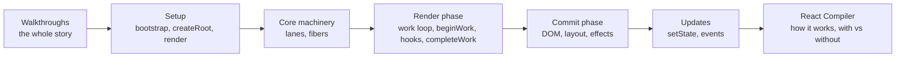

# React Internals

You have written `useState` a thousand times. This course opens the box and follows the real code paths inside React: what `createRoot` builds, how an update picks a priority, how the work loop walks the fiber tree, where your hooks are stored, and what the commit phase does to the DOM. The last parts show how the React Compiler changes your components so React can skip work it would otherwise redo.

It is written for working React developers who want a working model of the runtime instead of folklore. You do not need to have read React's source before. Every claim links to the exact lines on GitHub, and every page is pinned to **React v19.3.1**, so the line numbers stay true.

> [!tip] How to read this
> Start with the two walkthroughs: [[20 Walkthrough - First Render End to End|First Render]] and [[21 Walkthrough - setState to Pixels|setState to Pixels]]. They tell the whole story in one sitting and link into the deep dives whenever you want more detail. After that, read the parts in order, or jump to the one that answers today's question. The [[00 React Internals Index|index]] has a one-line summary of each part.

## Parts

1. [[00 React Internals Index|Index: from createRoot to pixels]]
2. [[01 Bootstrap - Packages, JSX and the Dispatcher|Bootstrap: packages, JSX and the dispatcher]]
3. [[02 createRoot - FiberRoot and HostRoot|createRoot: FiberRoot and HostRoot]]
4. [[03 root.render - Scheduling the First Update|root.render: scheduling the first update]]
5. [[04 Lanes and the Scheduler|Lanes and the Scheduler]]
6. [[05 The Fiber Data Structure|The fiber data structure]]
7. [[06 The Work Loop - Render Phase|The work loop: render phase]]
8. [[07 beginWork and Reconciliation|beginWork and reconciliation]]
9. [[08 completeWork - Building DOM Nodes|completeWork: building DOM nodes]]
10. [[09 Commit Phase - Mutation, Layout, Passive Effects|Commit phase: mutation, layout, passive effects]]
11. [[10 Hooks on Mount|Hooks on mount]]
12. [[11 Hooks on Update|Hooks on update]]
13. [[12 setState - dispatchSetState and Batching|setState: dispatchSetState and batching]]
14. [[13 The Event System|The event system]]
15. [[14 React Compiler - How It Works|React Compiler: how it works]]
16. [[15 Rendering With vs Without the Compiler|Rendering with vs without the Compiler]]
17. [[20 Walkthrough - First Render End to End|Walkthrough: first render end to end]]
18. [[21 Walkthrough - setState to Pixels|Walkthrough: setState to pixels]]

## The learning path

